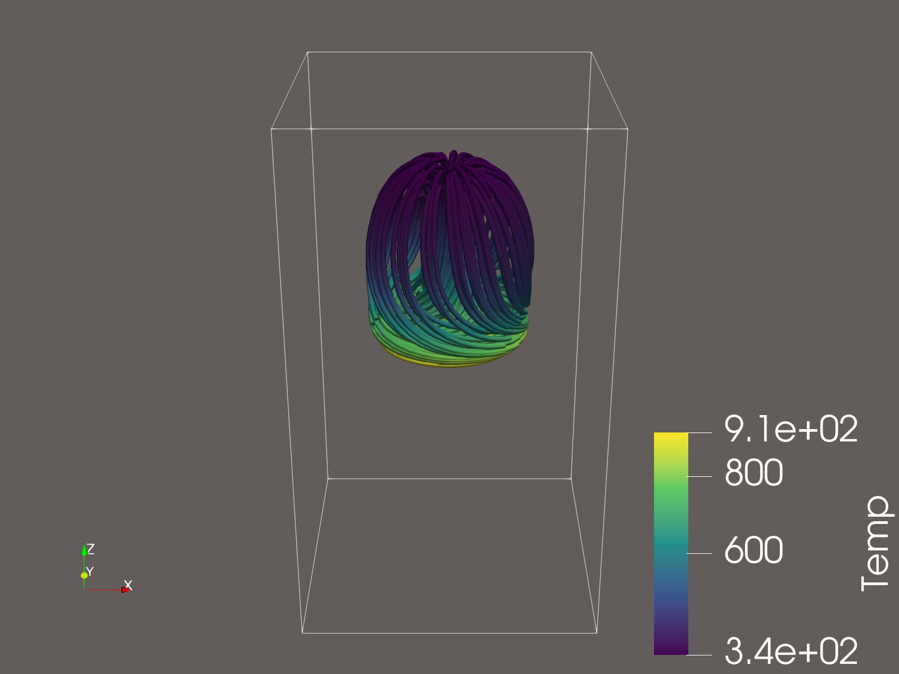

# B5: Visualization

> **Status:** draft. Verified steps and screenshots to come.

# Part 1: for learners

This module covers making figures from simulation output, molecules, density maps, and volumes on Kitsune, and reproducing them with a script. It runs as a half-day workshop, 3½ hours with a break, and the lessons behind it take 5 to 15 minutes each on their own. No visualization experience is assumed; the batch segment goes faster if you have submitted a job before.

> [!NOTE]
> **Cluster details.** <mark>Highlighted</mark> values are placeholders. Kitsune's queue names, module versions, paths, and addresses go in when the cluster is deployed.

## Why this matters

Figures are how you check a result, find a bug in a simulation, and show other people what you found. Large results are slow to copy to a laptop, and may not fit on one. OnDemand runs the visualization programs on the cluster, beside the data, and shows them in your browser. This module covers picking a picture that suits your kind of data, making it, and making it again by script.

For example: a simulation writes hundreds of gigabytes of velocity and temperature fields. Instead of downloading them, you open ParaView on the cluster and trace where the hot air goes, then leave a batch job to render every time step.

## What you'll be able to do

1. Name the kind of data in front of you, and the program on the dashboard that opens it.
2. Get a first figure out of that program and save it at a size a paper will take.
3. Apply two or three techniques from your own field to your own files.
4. Record a ParaView session as Python and rerun it as a batch job across a time series.
5. Say what a figure's color map hides, including in your own figures.

## Key ideas

A CT scan, a finite-element run, a protein, a genome track and a table of measurements all need different kinds of figure, and no one program handles them all well. The first segment practises identifying the kind of data before choosing a program. → [Glossary: mesh, grid, and image data](../reference/glossary.md#mesh-grid-and-image-data)

Inside a visualization program the picture is a chain: a reader opens the file, filters transform what it produced, and a display draws the result. Nothing edits the file on disk, so you can change an earlier step and everything after it redraws. → [Glossary: visualization pipeline](../reference/glossary.md#visualization-pipeline)

There are three common ways into 3-D data, and each one loses something. An [isosurface](../reference/glossary.md#isosurface) shows the surface at a single value, not what lies on either side of it. A [slice](../reference/glossary.md#slice) shows every value on one plane and none off it. [Volume rendering](../reference/glossary.md#volume-rendering) shows the whole field semi-transparently, but you cannot judge depth from it. Many figures combine two.

The color map changes how the data reads. A rainbow map's bright bands look like edges, so a smooth gradient looks stepped, and readers with red-green color blindness cannot put its colors in order. Maps whose lightness rises evenly, such as Viridis, make equal steps in the data look equal. → [Glossary: color map](../reference/glossary.md#color-map)

ParaView can record your clicks as Python and replay them without a window, so a figure can be rebuilt exactly. When the simulation is rerun, or a reviewer asks for a change, you run the script again in a job. → [Glossary: the ParaView family](../reference/glossary.md#the-paraview-family)

## Before you start

- An account on the cluster: <mark>Kitsune account instructions, to come</mark>.
- Pre-work, about 10 minutes: [Start an OnDemand session](../tutorials/visualization/start/ondemand-session.md). Arrive with a working session. To bring your own data to the branch labs, also do [Get your data where the app can see it](../tutorials/visualization/start/your-data.md).
- For the batch segment: module [A2](A2-slurm.md) Part 1, or having submitted one Slurm job.

## Tutorials in this module

The workshop is built from these lessons. Each one stands alone, and the order below is the one the workshop takes. Lessons marked *planned* are being written.

| # | Lesson | Minutes | What it adds |
|---|---|---|---|
| 1 | [Start an OnDemand session](../tutorials/visualization/start/ondemand-session.md) | 10 | A program running on a compute node, in your browser |
| 2 | [Get your data where the app can see it](../tutorials/visualization/start/your-data.md) | 10 | Your own files in reach of the apps. The lessons below use data that comes with their program |
| 3 | [Start ParaView on OnDemand](../tutorials/visualization/tools/paraview.md) | 10 | Open, move, color, save |
| 4 | *What kind of data do I have?* (planned) | 5 | Point or cell data; scalar or vector; and what each one lets you draw |
| 5 | *Color maps that don't lie* (planned) | 5 | One direction for temperature, two for a difference around zero |
| 6 | [Draw streamlines in ParaView](../tutorials/visualization/vectors/streamlines/paraview.md) | 10 | Where a flow goes, and what it carries |
| 7 | [See orbitals and electron density in ParaView](../tutorials/visualization/densities/orbitals-and-density/paraview.md) | 15 | Surfaces through a molecular grid |
| 8 | *Arrows on a slice* (planned) | 10 | Direction and speed on one plane |
| 9 | *Values along a line* (planned) | 5 | A profile shown as numbers and as a plot |
| 10 | *Derived fields: vorticity and Q-criterion* (planned) | 15 | Where a flow swirls, computed two ways |

Two of the lessons have versions for other programs. The comparisons, [streamlines across programs](../tutorials/visualization/vectors/streamlines/README.md) and [orbitals across programs](../tutorials/visualization/densities/orbitals-and-density/README.md), say what each one reads and draws. The [ParaView lessons page](../tutorials/visualization/maps/paraview.md) lists the rest of the ParaView set as it is written.

## Schedule

| Segment | Minutes | Demo or Do | Outcome |
|---|---|---|---|
| 1. Seeing your data | 20 | Demo + discussion | 1, 5 |
| 2. Your first program: ParaView | 25 | Do (follow along) | 2 |
| 3. Branch lab 1 | 40 | Do | 3 |
| Break | 10 | | |
| 4. Branch lab 2 | 40 | Do | 3 |
| 5. Batch production | 40 | Do | 4 |
| 6. Figure critique | 15 | Do (in pairs) | 5 |
| 7. Where next, and questions | 20 | Demo + Q&A | |

## Segments

### 1. Seeing your data (20 min)

**Explain.** Volumes, meshes, particles, molecules, genome tracks, and tables each suit different pictures, and different programs draw them best. Values stored at points or per cell, and single numbers (scalars) or directions (vectors), decide which filters apply. Choose a color map to fit the data, not for appearance: one-directional data gets a sequential map, signed data a diverging map centered on zero.

**Do.** In pairs, sort six example datasets into data type, first picture, and program, using the [lesson map](../tutorials/visualization/README.md). The six: a CT scan, a CFD run, a protein, a cryo-EM map, a sequencing run and a climate grid. About 10 minutes.

**You should see.** Each dataset matched to a branch of the lesson map. Where a pair disagrees, work out why.

### 2. Your first program: ParaView (25 min)

**Explain.** Everyone starts in ParaView, so the class shares one vocabulary: the pipeline, **Apply**, coloring by a variable, rescaling, and saving a picture.

**Do.** [Start ParaView on OnDemand](../tutorials/visualization/tools/paraview.md), with `disk_out_ref.ex2`.

**You should see.** Your own screenshot of the disk, colored by temperature with the Viridis map, saved in scratch.

### 3. Branch lab 1 (40 min)

**Explain.** Each participant works through the lessons for their own field, from the list above or the lesson map. Instructors circulate.

**Do.** The first two or three lessons for your field, for example:
- **Flow and transport:** [streamlines in ParaView](../tutorials/visualization/vectors/streamlines/paraview.md), then arrows on a slice.
- **Quantum chemistry:** [orbitals and electron density](../tutorials/visualization/densities/orbitals-and-density/README.md), in GaussView, ParaView, ChimeraX, or PyMOL, then the [electrostatic potential](../reference/glossary.md#electrostatic-potential-esp) on a density surface.
- **Structural biology:** a clear protein figure, then a mutation, both in PyMOL.
- **Imaging:** slices, then isosurfaces, of a CT scan.
- **Genomics:** reads and coverage at a gene, then finding a known variant.

**You should see.** One finished figure, and the session file or script that remakes it.

### 4. Branch lab 2 (40 min)

**Explain.** Go further in the same field, or try a lesson from another one. Pairs from different fields compare what each picture hides.

**Do.** The next lessons on your own list.

**You should see.** A second figure, and an explanation of what it shows that the first does not.

### 5. Batch production (40 min)

**Explain.** Use the window to explore. Use a script to render every time step, dataset, and revision. ParaView records your clicks as Python; `pvbatch` replays that Python with no window, so a Slurm job can run it.

**Do.** Record a trace of the [streamlines](../reference/glossary.md#streamline) figure, tidy it into a script, and run it with `pvbatch` in a batch job. Then assemble frames into a movie. The lessons *From clicks to a script*, *Batch rendering* and *Frames to a movie* are being written; the [worked example](#worked-example) below covers the core.

**You should see.** PNG files written by a job that ran while you did something else.

### 6. Figure critique (15 min)

**Explain.** Five questions for any figure:
1. Can I tell what is shown without the caption?
2. Does the color map fit the data?
3. Is there a scale or legend?
4. Would it survive grayscale printing and a colorblind reader?
5. Is anything cropped or hidden that matters?

**Do.** Swap figures with a partner and apply the five questions.

**You should see.** At least one concrete improvement for each figure.

### 7. Where next, and questions (20 min)

**Explain.**
- **Client and server ParaView:** your own computer draws the window while a server on the cluster reads the data. It takes setting up, and the client version must match the server's.
- **VisIt:** another visualization program, with readers for some simulation formats ParaView handles less well.
- **In situ tools** (ParaView Catalyst, Ascent): make pictures while a simulation runs, instead of saving all its data.
- **The plotting lessons:** 2-D plots in Python or R.

**Do.** Questions, and choosing which lessons to do next.

**You should see.** Each participant has chosen the next two or three lessons for their own data.

## Worked example

The streamlines figure as a script: [`scripts/streamlines.py`](../tutorials/visualization/scripts/streamlines.py). Each block matches a click from the lesson [Draw streamlines in ParaView](../tutorials/visualization/vectors/streamlines/paraview.md).

**Run in:** a batch job, as part of `streamlines.py` (an annotated excerpt)

```python
reader = OpenDataFile(data_file)            # File ▸ Open…
reader.UpdatePipeline()                     # Apply: actually read the file
names = list(reader.PointData.keys())       # the variables it found

velocity = pick("V", "v")                   # array names differ in case between
temperature = pick("Temp", "temp")          # ParaView versions, so look them up

view = GetActiveViewOrCreate("RenderView")  # the render view in the middle of the window
Show(reader, view).SetRepresentationType("Outline")   # Representation ▸ Outline

tracer = StreamTracer(Input=reader)         # Filters ▸ Alphabetical ▸ Stream Tracer
tracer.Vectors = ["POINTS", velocity]       # Vectors = V
tubes = Tube(Input=tracer)                  # Filters ▸ Alphabetical ▸ Tube

display = Show(tubes, view)
ColorBy(display, ("POINTS", temperature))   # the coloring drop-down ▸ Temp
display.RescaleTransferFunctionToDataRange(True, False)   # Rescale to Data Range

SaveScreenshot(out_png, view, ImageResolution=[1600, 1200])   # File ▸ Save Screenshot…
```

Three things make it solid enough for a batch job:
- It looks array names up instead of assuming them.
- It tries both spellings of the Viridis preset, since the name differs between ParaView versions.
- It renders offscreen.

To run it in a batch job, load ParaView (<mark>Kitsune ParaView module</mark>) and run `pvbatch --opengl-window-backend OSMesa streamlines.py disk_out_ref.ex2 out.png`. Older ParaView builds can fail here: their [offscreen rendering](../reference/glossary.md#offscreen-rendering) needs OSMesa support, which not every build has.

<details markdown="1">
<summary>What you should see</summary>


*Figure 1. The script's picture, drawn by `pvbatch` in a batch job.*

</details>

## Check your understanding

<details markdown="1">
<summary>A colleague has a folder of cryo-EM maps and wants figures for a paper. Which program would you suggest, and which kind of picture?</summary>

ChimeraX: it opens a map from a file or straight from a public cryo-EM archive. A common picture is an isosurface at a chosen threshold, with the fitted atomic model shown inside it.

</details>

<details markdown="1">
<summary>Why is a rainbow color map a poor choice for a temperature field?</summary>

Its bright bands (yellow, cyan) create boundaries that aren't in the data, and colorblind readers can't order its colors. A sequential map such as Viridis changes evenly in lightness, so equal steps in temperature look like equal steps in color.

</details>

<details markdown="1">
<summary>Your batch job's pvbatch script fails with an error about opening a display. What's wrong, and what are two ways around it?</summary>

Compute nodes have no screen, so draw in memory instead: load ParaView (<mark>Kitsune ParaView module</mark>), then run `pvbatch --opengl-window-backend OSMesa`. Or run the script in a terminal inside a desktop session, which has a display.

</details>

## Common pitfalls

| What you see | Why it happens | What to do |
|---|---|---|
| Your time allocation drains while you're not working | An OnDemand session was left running after the tab was closed | Delete sessions on **My Interactive Sessions** when done |
| The app can't find your data | Apps open in your home directory; the data is in scratch | Link scratch into home, as in [Get your data](../tutorials/visualization/start/your-data.md) |
| A new variable shows as one flat color | The color scale still fits the previous variable | **Rescale to Data Range** |
| A figure looks striped or banded | A rainbow color map | Switch to Viridis (one direction) or a diverging map (signed values) |
| A batch render fails with a display error, or aborts | Compute nodes have no screen, and not every ParaView build renders offscreen | Load a ParaView built with OSMesa (<mark>Kitsune ParaView module</mark>), then `pvbatch --opengl-window-backend OSMesa`; or run it in a desktop session's terminal |
| `pvbatch` stops with ``version `GOMP_5.0' not found`` | An older GCC module is loaded, and ParaView finds its OpenMP library first | `module purge`, then load ParaView again |
| Hours spent copying results to a laptop to look at them | The data is being copied to the program instead of the program being run where the data is | Visualize on the cluster; bring back only pictures and small extracts |

## Cheat sheet and next steps

- **Start any program:** OnDemand ▸ **Interactive Apps** ▸ the program; a queue for short interactive work (<mark>Kitsune queue name</mark>); delete the session when done.
- **ParaView:** **Apply** after every change; **Rescale to Data Range** after changing variables; **File ▸ Save State** keeps your whole pipeline.
- **By script:** **Tools ▸ Start Trace**, then run the result in a batch job: load ParaView (<mark>Kitsune ParaView module</mark>), then `pvbatch --opengl-window-backend OSMesa script.py`.
- **Every lesson, by what you want to see:** the [lesson map](../tutorials/visualization/README.md).
- **Next modules:** [B4](B4-hdf5.md), for storing data so it is easier to visualize later; [A2](A2-slurm.md) Part 2, for running many render jobs at once.

## Credits and licenses

Lesson data:
- ParaView example data (Kitware/Sandia, BSD-3-Clause);
- PDB (CC0) and AlphaFold DB (CC-BY 4.0);
- EMDB, ClinVar, and 1000 Genomes (freely available archives);
- formaldehyde cubes computed with PySCF (Apache-2.0).

---

# Part 2: for instructors and planners (not published)

## Metadata

| Field | Value |
|---|---|
| Expertise_Level | Beginner → Intermediate |
| Target_Group | SBU grad students & postdocs; faculty/staff researchers with simulation, imaging, structural, chemical, or genomic data; external ACCESS users |
| Learning_Resource_Type | Workshop (half day) · Self-paced lessons |
| Duration | 210 min workshop; lessons 5–15 min each |
| Prerequisites | The two *Start here* lessons; [A1](A1-cluster-basics.md) recommended; [A2](A2-slurm.md) Part 1 for the batch segment |
| Keywords | paraview, pvpython, pvbatch, chimerax, pymol, gaussview, igv, matlab, jupyter, rstudio, open ondemand, streamlines, isosurface, volume rendering, cube file, cryo-em, alphafold, batch rendering, color maps |
| License (planned) | CC-BY 4.0 |

## Scope, hardware, and placeholders

**Covers:** choosing a picture for your data; one starter lesson per SeaWulf OnDemand program; single-technique lessons in branches (densities and volumes, vector fields, molecules, genomes, time series, and batch, plots, making your own data); paths by field; batch rendering with the ParaView family.

**Leaves out, or points to:** client–server ParaView (advanced; needs matching client and server versions and a documented connection method, which RCI doesn't yet provide); VisIt (not an OnDemand app on SeaWulf); in situ visualization (Catalyst, Ascent); Bokeh/HoloViews (dropped: scope creep for a first module).

**Hardware note:** SeaWulf has no dedicated visualization nodes, so ParaView draws with the node's processors. That is fine for lesson-sized data; `pvbatch` draws offscreen with `paraview/6.0.1` (OSMesa); 5.11's offscreen mode aborts (self-test, 2026-09-21). Kitsune editions will fill `{{Kitsune: ParaView/VisIt module versions}}`, `{{Kitsune: client–server connection method (reverse tunnel / OOD desktop)}}` and `{{Kitsune: vis partition, if any}}`. Their SeaWulf values are in [program/seawulf-pilot.md](../program/seawulf-pilot.md). **Optional extension (pending hardware):** GPU-accelerated remote desktops or rendering nodes.

## Delivery options

- **Workshop (recommended):** half day, hybrid, assembled from the lessons as in the schedule. Before it:
  - ask RCI for a Slurm reservation for 20–30 simultaneous OnDemand sessions;
  - ask for a read-only shared folder with the pre-staged data (the ParaView examples, the formaldehyde cubes, the cavity-flow series);
  - have participants do the two *Start here* lessons and confirm a working session. This replaces the original pre-class client–server check, which Kitware requires for its DOE training because connection problems otherwise eat the session.
  - Staff: one helper per 8–10 participants.
- **Split format:** segments 1–4 as one 2-hour session; segment 5 as a separate 60-minute session for people who need batch production. The plotting lessons can serve a separate 45-minute session for users who don't need 3-D.
- **Self-paced:** the lessons in any order, from the [lesson map](../tutorials/visualization/README.md).
- **Guest instructors:** Kitware delivers ParaView training for DOE facilities (4-hour remote format); consider contracting a session once Kitsune's visualization setup is stable.

## Sources to adapt

| Provider | Material | Format | License | Tier | Last offered / updated | What to borrow |
|---|---|---|---|---|---|---|
| Kitware / Sandia | [ParaView tutorials](https://docs.paraview.org/en/latest/Tutorials/index.html): Self-directed Tutorial; Classroom Tutorials (incl. pvpython/pvbatch) | Docs + instructor-ready exercise sets | "© ParaView Developers". Checked 2026-09-21: the docs repository states CC BY-ND 4.0 (no derivatives); the Self-directed Tutorial page states CC BY 4.0 | `ASK` | Docs v6.1.0 (2026) | Ready-to-teach exercise sequences. Our lessons are original text that links to these |
| Kitware for NERSC/ALCF/OLCF/LANL | [ParaView scientific data analysis and visualization training](https://www.olcf.ornl.gov/calendar/paraview-scientific-data-analysis-and-visualization-training/) | Remote live, 4 h | n/a | `LINK` | Oct 2, 2025 | Required pre-class client–server setup |
| LLNL | [VisIt tutorials](https://visit-sphinx-github-user-manual.readthedocs.io/en/develop/tutorials/index.html) (incl. remote usage, scripting, movies) | Self-paced | VisIt repo BSD-3-Clause | `ADAPT` | Active 2026 | Dedicated remote-usage tutorial |
| Cornell CVW | [ParaView](https://cvw.cac.cornell.edu/ParaView); [Large Data Visualization](https://cvw.cac.cornell.edu/large-data-vis); [Bokeh](https://cvw.cac.cornell.edu/bokeh) | Self-paced | © Cornell, all rights reserved | `LINK` | Undated | Remote ParaView on cluster nodes; parallel pipeline concepts |
| ANL ATPESC | [Data Analysis & Visualization track](https://extremecomputingtraining.anl.gov/) (VisIt; Ascent in situ) | Lecture PDFs + hands-on | Not stated | `LINK` | 2025 slides; ATPESC 2026 Jul 26–Aug 7 | Advanced/in situ pointers (site blocks automated checks) |
| TACC | [TACC Analysis Portal](https://docs.tacc.utexas.edu/tutorials/TAP/); [ParaView](https://docs.tacc.utexas.edu/software/paraview/) and [VisIt](https://docs.tacc.utexas.edu/software/visit/) at TACC; [Remote Desktop Access](https://docs.tacc.utexas.edu/tutorials/remotedesktopaccess/) | User documentation (MkDocs; source in the TACC-Docs GitHub repository) | No license file | `LINK` | TAP updated Jun 16, 2025 | The style model: form fields with their Slurm equivalents, troubleshooting by symptom, labeled commands, minimal scripts first |
| UCSF RBVI | [ChimeraX user guide](https://web.archive.org/web/20261029001502/https://www.cgl.ucsf.edu/chimerax/docs/user/index.html) and tutorials | Docs + tutorials | Program free for non-commercial use; docs license not stated | `LINK` | 2026 | Command reference; the cryo-EM tutorial pair EMD-25428 / 7STH |
| PyMOL community | [PyMOL Wiki](https://pymolwiki.org/) | Wiki | Not checked | `LINK` | Active | `isosurface`, `ramp_new`, the mutagenesis wizard |
| IGV team (Broad Institute / UC San Diego) | [IGV desktop documentation](https://igv.org/doc/desktop/) | Docs | IGV software MIT; docs not stated | `LINK` | 2026 | Batch commands; genome name aliases |
| Gaussian, Inc. | [cubegen](https://gaussian.com/cubegen/), [formchk](https://gaussian.com/formchk/) | Reference | Proprietary | `LINK` | n/a | Exact cube-file syntax |
| MathWorks | [Vector-field](https://www.mathworks.com/help/matlab/visualize/vector-field-displayed-with-cone-plots.html) and volume-visualization docs | Docs | Proprietary | `LINK` | R2024a | The `wind`, `flow` and `mri` examples |

## Adaptation notes

- **Localize (done for SeaWulf):** the lessons are written for SeaWulf's OnDemand apps, with values from [program/seawulf-pilot.md](../program/seawulf-pilot.md). The original plan's key local deliverable (a tested client–server connection script) moves to the Kitsune edition, to be built with the systems team; it isn't needed for beginners.
- **Datasets (chosen):** small open datasets per lesson: the ParaView examples; formaldehyde cubes (PySCF or Gaussian); hemoglobin (PDB 4HHB, EMD-3488 / 5ME2, AlphaFold P68871, *HBB* / rs334); MATLAB's built-in data; NOAA air temperature. Add one sample from a Kitsune user domain when those users are known.
- **Permission needed:** ParaView's tutorial text is not reused (license conflict above); our lessons link to it. VisIt docs are BSD-3.
- **Verification:** run `tutorials/visualization/tests/inventory.slurm` before the first offering, and work through [PILOT-CHECKLIST.md](../tutorials/visualization/PILOT-CHECKLIST.md).

## Assessment instruments

- **Exercise check (outcomes 2–4):** one figure from a branch lesson, the session file or script that remakes it, and a frame series rendered by `pvbatch` in a batch job.
- **Exit quiz (outcomes 1, 5):** match 4 datasets to a data type and a program; choose a color map for 2 variables and justify the choice; name what a given figure hides.
- **Figure critique (outcome 5):** the five-question checklist in segment 6, applied to a partner's figure.
- **Pre/post survey:** confidence in choosing a picture, using one program, and producing figures by script (5-point scale).

## Open questions

- Will Kitsune have any nodes suitable for remote visualization desktops? (hardware decision)
- Is there a visualization group at SBU that should co-teach?
- Demand check: which fields (CFD, chemistry, structural biology, imaging, genomics) have the most prospective users? That decides which lessons get written first.
- Can RCI provide a reservation and a shared folder of pre-staged data for workshops?
- Does Gaussian on SeaWulf require membership in a license group?
- Are napari and CryoSPARC OnDemand apps learners can launch?
