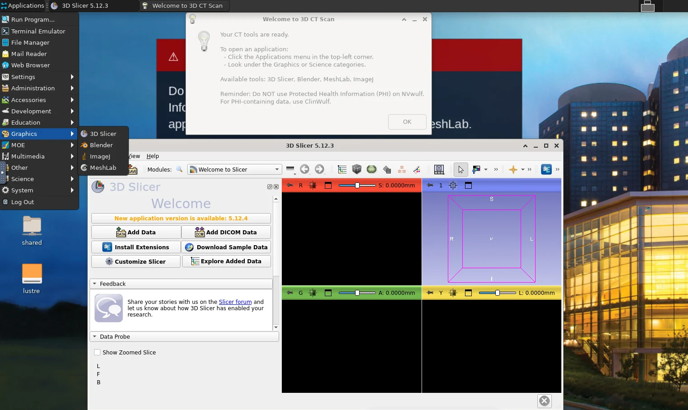

# 3D CT Scan (Open OnDemand)

This app provides a desktop with 3D Slicer, Blender, MeshLab, and ImageJ for CT visualization, segmentation, and mesh processing. GPU rendering is recommended for interactive work with three-dimensional data.

**On this page:** [Where it runs](#where) · [Start a session](#start) · [Launch settings](#settings) · [Troubleshooting](#trouble)

## Where it runs {#where}

| Cluster | Runs on |
| --- | --- |
| NVwulf | B40 nodes using `b40x4` or `b40x4-long` |

## Start a session {#start}

1. Sign in to the OnDemand portal for your cluster ([NVwulf](https://nvwulf-ood.nvwulf.stonybrook.edu/)) with your NetID and Duo.
2. Open Interactive Apps and choose 3D CT Scan.
3. Choose the launch settings below and click Launch 3D CT Scan.
4. After the session starts, Open OnDemand provides Compression and Image Quality controls for the remote desktop display. Compression controls how strongly the graphical display is compressed before being sent to the browser. Higher compression can improve responsiveness on slower network connections but may reduce visual quality. Image Quality controls the quality of the displayed image. Higher values provide a sharper display but may require more network bandwidth. For most sessions, the default settings are appropriate. Adjust them only if the desktop appears slow, blurry, or unresponsive.
5. Open the Applications menu at the top left of the desktop and look under Graphics or Science for 3D Slicer, Blender, MeshLab, and ImageJ.
6. Save your work or export the results, then click Delete on the session card when finished. Closing the browser tab does not stop the session.

Use NVwulf for data that does not contain protected health information. PHI work belongs in an approved ClinWulf environment.

*NVwulf 3D CT Scan Open OnDemand desktop environment. The session provides access to 3D Slicer, Blender, ImageJ, and MeshLab from the Applications menu for CT visualization, segmentation, and mesh processing.*

## Launch settings {#settings}

Defaults below are starting points. Ask for resources your task needs, and keep the requested hours within the selected queue limit.

| Setting | What to choose |
| --- | --- |
| Queue | `b40x4` Regular, up to 8 hours, or `b40x4-long` Long, up to 48 hours. |
| Rendering mode | Default GPU accelerated, allocating one GPU. CPU only allocates zero GPUs and uses software rendering. |
| Wall-time (hours) | Default 4 hours. Choose enough time for your work, within the selected queue limit. |
| Cores | Default 4; form range 1 to 16. Use only as many cores as the task can use, within the selected node capacity. |
| Memory (GB) | Default 64 GB. Choices: 8, 16, 32, 64, 128, 256, 360 GB. |

Email notifications are optional. Enter an email address and select Email when job starts if you want a start notification.

Choose an explicit memory size for routine work. All available can reserve node memory and increase waiting time; use it only when your task needs it.

## Troubleshooting {#trouble}

**I cannot find the tools.** Use the Applications menu. The session opens a desktop rather than automatically opening all four tools.

**Three-dimensional rendering is slow.** Start a new session with GPU accelerated rendering. CPU only uses slower software rendering.

**A large CT volume will not load.** Choose more memory for the next session, or begin with a smaller volume. Save segmentation and mesh outputs before the session ends.

**My session stays Queued.** Try a shorter request, less memory, or fewer cores or GPUs. Check the session output if the job fails instead of remaining queued.

If the problem continues, [contact HPC support](https://iacs.supportsystem.com) with the cluster, app name, job ID, and the error text.

## Related guides {#related}

- [Open OnDemand apps on NVwulf](nvwulf-ondemand-apps.md)
- [OnDemand overview](../shared/ondemand-overview.md)
- [Open OnDemand](https://rci.stonybrook.edu/hpc/ondemand)

**Applies to:** NVwulf

Ported from RCI's guide: <https://rci.stonybrook.edu/docs/ondemand-3d-ct-scan> (maintained by Research Computing and Informatics).
