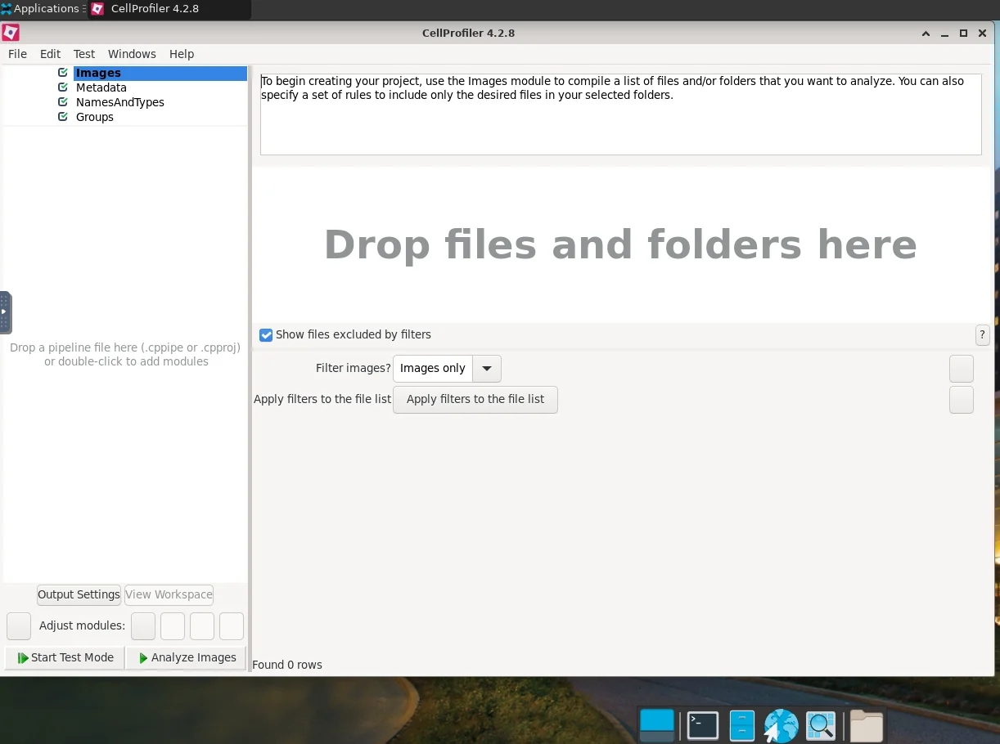

# CellProfiler (Open OnDemand)

CellProfiler uses reproducible pipelines to measure and analyze biological images. This NVwulf app opens the graphical interface for designing pipelines and running image analysis.

**On this page:** [Where it runs](#where) · [Start a session](#start) · [Launch settings](#settings) · [Troubleshooting](#trouble)

## Where it runs {#where}

| Cluster | Runs on |
| --- | --- |
| NVwulf | B40 nodes using `b40x4` or `b40x4-long` |

## Start a session {#start}

1. Sign in to the OnDemand portal for your cluster ([NVwulf](https://nvwulf-ood.nvwulf.stonybrook.edu/)) with your NetID and Duo.
2. Open Interactive Apps and choose CellProfiler.
3. Choose the launch settings below and click Launch.
4. After the session starts, Open OnDemand provides Compression and Image Quality controls for the remote desktop display. Compression controls how strongly the graphical display is compressed before being sent to the browser. Higher compression can improve responsiveness on slower network connections but may reduce visual quality. Image Quality controls the quality of the displayed image. Higher values provide a sharper display but may require more network bandwidth. For most sessions, the default settings are appropriate. Adjust them only if the desktop appears slow, blurry, or unresponsive.
5. Save your work or export the results, then click Delete on the session card when finished. Closing the browser tab does not stop the session.

*NVwulf CellProfiler graphical interface running through Open OnDemand. The interface provides a pipeline-based workflow for biological image analysis, with modules for loading images, extracting metadata, assigning names and types, grouping datasets, and adding analysis steps before running the pipeline. Users can drag image files, folders, or an existing CellProfiler pipeline into the workspace and then start testing or full image analysis.*

## Launch settings {#settings}

Defaults below are starting points. Ask for resources your task needs, and keep the requested hours within the selected queue limit.

| Setting | What to choose |
| --- | --- |
| CellProfiler Version | Version 4.2.8. |
| Queue | `b40x4` Regular, up to 8 hours, or `b40x4-long` Long, up to 48 hours. |
| Working Directory | Defaults to `/lustre/nvwulf/scratch/<netid>`. Choose the folder containing your project or data. Enter a full path. |
| Wall-time (hours) | Default 4 hours. Choose enough time for your work, within the selected queue limit. |
| Cores | Default 4; form range 1 to 16. Use only as many cores as the task can use, within the selected node capacity. |
| Memory (GB) | Default 16 GB. Choices: 4, 8, 16, 32, 64, 128, 256 GB. |
| Use GPU | Default No. Enable for a Cellpose pipeline; standard pipelines usually use CPU. |

Email notifications are optional. Enter an email address and select Email when job starts if you want a start notification.

Choose an explicit memory size for routine work. All available can reserve node memory and increase waiting time; use it only when your task needs it.

## Troubleshooting {#trouble}

**A pipeline cannot find its images.** Check the input paths, file filters, and working directory. Test the pipeline on a small set before processing all images.

**Cellpose is not using a GPU.** Select Use GPU on the launch form and enable GPU use in the Cellpose task or plugin. Standard CellProfiler pipelines do not normally need a GPU.

**A batch needs more memory or time.** Test a smaller batch, then request enough memory and wall time for the full run. Save the pipeline and partial outputs before the session ends.

**My session stays Queued.** Try a shorter request, less memory, or fewer cores or GPUs. Check the session output if the job fails instead of remaining queued.

If the problem continues, [contact HPC support](https://iacs.supportsystem.com) with the cluster, app name, job ID, and the error text.

## Related guides {#related}

- [Open OnDemand apps on NVwulf](nvwulf-ondemand-apps.md)
- [OnDemand overview](../shared/ondemand-overview.md)
- [Open OnDemand](https://rci.stonybrook.edu/hpc/ondemand)

**Applies to** NVwulf

Ported from RCI's guide: <https://rci.stonybrook.edu/docs/ondemand-cellprofiler> (maintained by Research Computing and Informatics).
{: .rci-credit }
