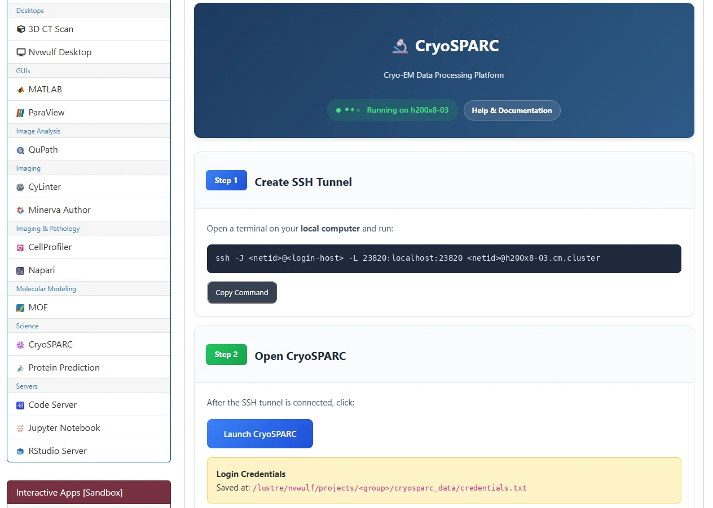
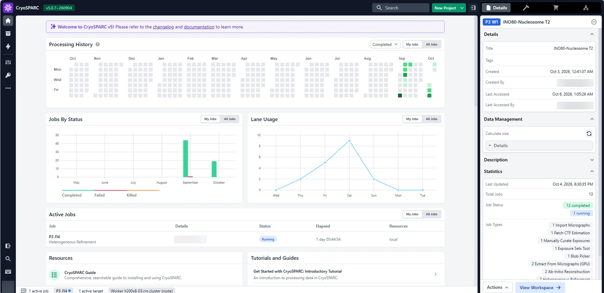

# CryoSPARC (Open OnDemand)

CryoSPARC provides a browser workspace for cryo-EM data processing. This NVwulf app starts a personal CryoSPARC instance with a database and projects that can be reused across sessions.

**On this page:** [Where it runs](#where) · [Start a session](#start) · [Launch settings](#settings) · [Troubleshooting](#trouble)

## Where it runs {#where}

| Cluster | Runs on |
| --- | --- |
| NVwulf | B40 nodes using `b40x4` or `b40x4-long` |

## Start a session {#start}

1. Sign in to the OnDemand portal for your cluster ([NVwulf](https://nvwulf-ood.nvwulf.stonybrook.edu/)) with your NetID and Duo.
2. Open Interactive Apps and choose CryoSPARC.
3. Choose the launch settings below and click Launch.
4. Wait for Running. After the Open OnDemand session starts, create an SSH tunnel from a terminal on your local computer using the exact command shown on the session page (see figure below). Keep that terminal window open for the entire CryoSPARC session, because closing it terminates the port-forwarding connection. Once the tunnel is established, click Launch CryoSPARC to open the CryoSPARC web interface in your browser. Login credentials are stored in the `credentials.txt` file shown on the session page. The Help & Documentation button provides additional connection and troubleshooting guidance.
5. Sign in with the account for your instance. Open a project and choose the worker lane associated with this session when running processing jobs.
6. Save your work or export the results, then click Delete on the session card when finished. Closing the browser tab does not stop the session.

Have your own CryoSPARC license ID ready. Choose separate writable directories for instance data and project files, and reuse them in later sessions. Start only one session for the same instance data directory at a time; save and stop local processing before deleting the session.

*Running NVwulf CryoSPARC Open OnDemand session. The session page provides the SSH port-forwarding command needed to securely connect from the user's local computer, followed by the Launch CryoSPARC button. It also shows the location of the saved CryoSPARC login credentials and provides access to Help & Documentation.*

*CryoSPARC web interface running on NVwulf through Open OnDemand. The dashboard provides access to projects, processing history, job status, active jobs, resource usage, and CryoSPARC processing workflows for cryo-EM data analysis.*

## Launch settings {#settings}

Defaults below are starting points. Ask for resources your task needs, and keep the requested hours within the selected queue limit.

| Setting | What to choose |
| --- | --- |
| Queue | `b40x4` Regular, up to 8 hours, or `b40x4-long` Long, up to 48 hours. |
| Number of hours | Default 8 hours. Choose enough time for your work, within the selected queue limit. |
| Memory (GB) | Default 128 GB. Choices: 64, 128, 256, 320, 384 GB. |
| Number of GPUs | Default 2. Choices: 1, 2, 3, 4. Choose a count your processing task can use. |
| Number of CPU cores | Default 16; form range 4 to 64. Use only as many cores as the task can use, within the selected node capacity. |
| Your CryoSPARC License ID | Required. Enter your personal CryoSPARC license ID; use the registration link at cryosparc.com/download if you need one. |
| CryoSPARC Data Directory | Default `/lustre/nvwulf/scratch/<netid>/cryosparc_data`. Stores the instance database and configuration; reuse it to reopen your instance. |
| Default Project Directory | Default `/lustre/nvwulf/scratch/<netid>/cryosparc_projects`. Choose a writable location for project files and reuse it. |
| CryoSPARC Password | Password for a new CryoSPARC account. Blank generates one; account details are saved in `credentials.txt` in the data directory. |

Email address is used for the CryoSPARC account; use the address associated with your license. Email when job starts is optional.

Choose an explicit memory size for routine work. All available can reserve node memory and increase waiting time; use it only when your task needs it.

## Troubleshooting {#trouble}

**The instance cannot start.** Check the license ID, the account email, and whether the data directory is writable. Review the session output for the first startup error.

**I cannot sign in.** For an account created by the app, check `credentials.txt` in the data directory. An existing instance normally keeps its account credentials.

**Projects are missing or processing cannot run.** Reuse the original data directory and confirm that the project paths remain available. Check the worker lane and its allocated resources before launching jobs.

**My session stays Queued.** Try a shorter request, less memory, or fewer cores or GPUs. Check the session output if the job fails instead of remaining queued.

If the problem continues, [contact HPC support](https://iacs.supportsystem.com) with the cluster, app name, job ID, and the error text.

## Related guides {#related}

- [Open OnDemand apps on NVwulf](nvwulf-ondemand-apps.md)
- [OnDemand overview](../shared/ondemand-overview.md)
- [Open OnDemand](https://rci.stonybrook.edu/hpc/ondemand)

**Applies to** NVwulf

Ported from RCI's guide: <https://rci.stonybrook.edu/docs/ondemand-cryosparc> (maintained by Research Computing and Informatics).
{: .rci-credit }
