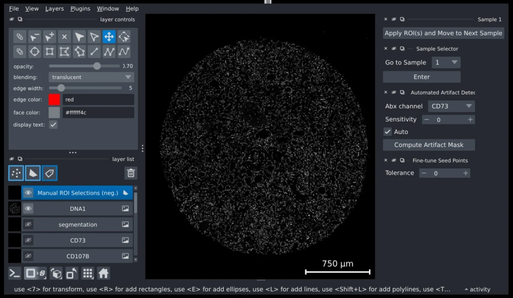

# CyLinter (Open OnDemand)

CyLinter supports quality control of multiplex tissue imaging data through interactive review. The NVwulf app runs CyLinter in a browser desktop using your configuration file and workspace.

**On this page:** [Where it runs](#where) · [Start a session](#start) · [Launch settings](#settings) · [Troubleshooting](#trouble)

## Where it runs {#where}

| Cluster | Runs on |
| --- | --- |
| NVwulf | B40 nodes using `b40x4` or `b40x4-long` |

## Start a session {#start}

1. Sign in to the OnDemand portal for your cluster ([NVwulf](https://nvwulf-ood.nvwulf.stonybrook.edu/)) with your NetID and Duo.
2. Open Interactive Apps and choose CyLinter.
3. Choose the launch settings below and click Launch.
4. Wait for Running, then click Connect to CyLinter. Follow the workflow started from your YAML configuration. Save review results in the locations specified by that configuration.
5. Save your work or export the results, then click Delete on the session card when finished. Closing the browser tab does not stop the session.

Prepare the CyLinter configuration and referenced input files before launching. Enter a complete absolute configuration path, such as `/lustre/nvwulf/scratch/<netid>/project/cylinter_config.yml`.

*NVwulf CyLinter graphical interface running through Open OnDemand. The interface provides an interactive image-review workflow for multiplex tissue imaging data, with controls for selecting channels, defining manual regions of interest, detecting artifacts, and moving through samples during quality-control analysis. The layer panel displays image and segmentation channels, while the right-side controls support sample selection and artifact-mask refinement.*

## Launch settings {#settings}

Defaults below are starting points. Ask for resources your task needs, and keep the requested hours within the selected queue limit.

| Setting | What to choose |
| --- | --- |
| Queue | `b40x4` Regular, up to 8 hours, or `b40x4-long` Long, up to 48 hours. |
| Number of hours | Default 4 hours. Choose enough time for your work, within the selected queue limit. |
| Memory (GB) | Default 64 GB. Choices: 8, 16, 32, 64, 128, 256, 480 GB. |
| Number of cores | Default 8; form range 1 to 64. Use only as many cores as the task can use, within the selected node capacity. |
| Use GPU | Default Yes. GPU is recommended for the interactive viewer. |
| Workspace directory | Defaults to `/lustre/nvwulf/scratch/<netid>`. Choose the folder containing your project or data. Enter a full path. |
| CyLinter config YAML | Required full path to a valid CyLinter YAML configuration. Check all referenced input paths before launch. |
| Desktop resolution | Desktop size as WIDTHxHEIGHT. Default 1920x1080; use a size that fits your browser window. |

Email notifications are optional. Enter an email address and select Email when job starts if you want a start notification.

Choose an explicit memory size for routine work. All available can reserve node memory and increase waiting time; use it only when your task needs it.

## Troubleshooting {#trouble}

**The desktop opens but CyLinter does not.** A valid config YAML is required before launch. Check the full configuration path and the input paths inside the file.

**The session is Running after CyLinter failed.** The desktop deliberately stays open for inspection. Read cylinter-<jobid>.log in your workspace to identify the error; Running alone does not mean the analysis succeeded.

**The viewer reports a display or Qt error.** Keep the default GPU choice and inspect the session output and VNC log. The interactive workflow needs a real desktop display.

**My session stays Queued.** Try a shorter request, less memory, or fewer cores or GPUs. Check the session output if the job fails instead of remaining queued.

If the problem continues, [contact HPC support](https://iacs.supportsystem.com) with the cluster, app name, job ID, and the error text.

## Related guides {#related}

- [Open OnDemand apps on NVwulf](nvwulf-ondemand-apps.md)
- [OnDemand overview](../shared/ondemand-overview.md)
- [Open OnDemand](https://rci.stonybrook.edu/hpc/ondemand)

**Applies to:** NVwulf

Ported from RCI's guide: <https://rci.stonybrook.edu/docs/ondemand-cylinter> (maintained by Research Computing and Informatics).
