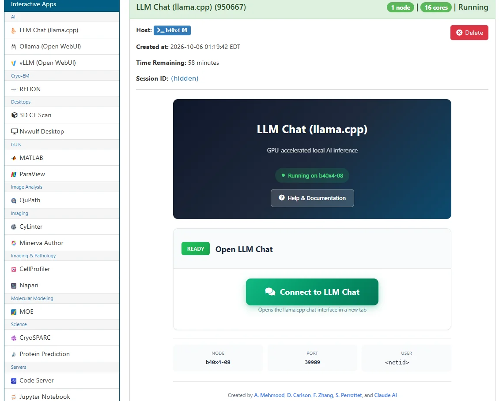
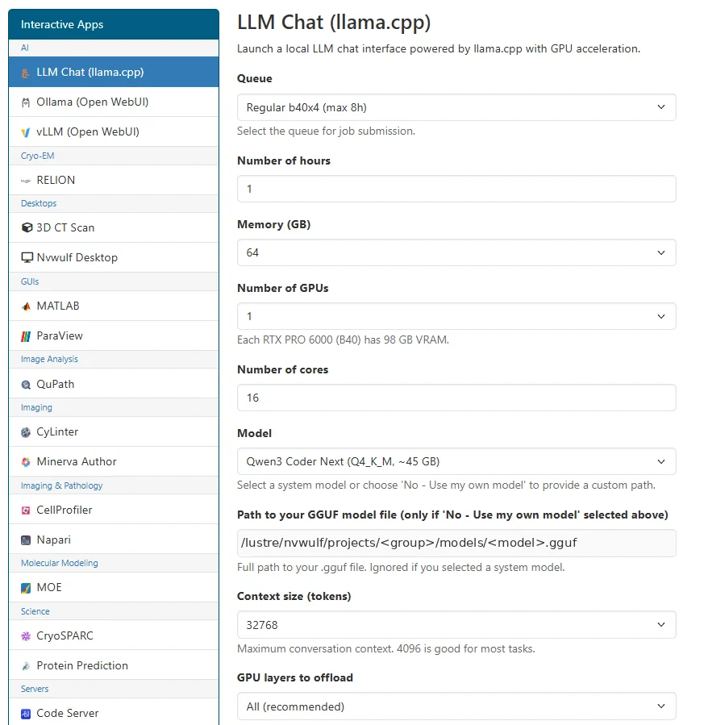

# LLM Chat with llama.cpp (Open OnDemand)

LLM Chat runs a language model on NVwulf and opens a browser chat interface. Choose a provided GGUF model or load your own model file for interactive inference.

**On this page:** [Where it runs](#where) · [Start a session](#start) · [Launch settings](#settings) · [Troubleshooting](#trouble)

## Where it runs {#where}

| Cluster | Runs on |
| --- | --- |
| NVwulf | B40 nodes using `b40x4` or `b40x4-long` |

## Start a session {#start}

1. Sign in to the OnDemand portal for your cluster ([NVwulf](https://nvwulf-ood.nvwulf.stonybrook.edu/)) with your NetID and Duo.
2. Open Interactive Apps and choose LLM Chat (llama.cpp).
3. Choose the launch settings below and click Launch.
4. The application includes several preconfigured models, but users can also run compatible GGUF models stored in their own NVwulf directories. Select No - Use my own model and provide the full path to the .gguf file. For instructions on finding and downloading compatible models from Hugging Face, including how to place them in NVwulf storage, use the built-in Help & Documentation button on the running session page (see the figure below).
5. Wait for Running, then click Connect to LLM Chat.
6. Once the model has loaded, enter a prompt in the chat interface.
7. Save your work or export the results, then click Delete on the session card when finished. Closing the browser tab does not stop the session.

*Running NVwulf LLM Chat (llama.cpp) Open OnDemand session. Once the local model server is ready, the session card displays the assigned compute node and provides the Connect to LLM Chat button for opening the browser-based chat interface. The built-in Help & Documentation button provides additional instructions for using the application.*

## Launch settings {#settings}

Defaults below are starting points. Ask for resources your task needs, and keep the requested hours within the selected queue limit.

| Setting | What to choose |
| --- | --- |
| Queue | `b40x4` Regular, up to 8 hours, or `b40x4-long` Long, up to 48 hours. |
| Number of hours | Default 2 hours. Choose enough time for your work, within the selected queue limit. |
| Memory (GB) | Default 64 GB. Choices: 32, 64, 128, 256, 480 GB. |
| Number of GPUs | Default 1. Choices: 1, 2, 3, 4. Choose a count your processing task can use. |
| Number of cores | Default 1; form range 1 to 64. Use only as many cores as the task can use, within the selected node capacity. |
| Model | Mistral 7B Instruct v0.2, Qwen3 Coder Next, or DeepSeek Coder 33B Instruct, supplied as GGUF models; or choose your own model. Default Mistral. |
| Path to your GGUF model file (only if 'No - Use my own model' selected above) | Full path to your readable .gguf file. Used only when the Model choice is your own model. |
| Context size (tokens) | Default 4096 tokens; choices 2048, 4096, 8192, 16384, or 32768. Longer context needs more memory. |
| GPU layers to offload | Default All, offloading model layers to GPU. Alternatives are None, 16, 32, or 48; reduce offload if the model does not fit. |

Email notifications are optional. Enter an email address and select Email when job starts if you want a start notification.

Choose an explicit memory size for routine work. All available can reserve node memory and increase waiting time; use it only when your task needs it.

*NVwulf LLM Chat (llama.cpp) Open OnDemand launch interface. The form allows users to select the B40 queue, wall time, memory, GPU and CPU resources, and a preconfigured GGUF model. Users may also provide the path to their own GGUF model and configure the context size and number of model layers offloaded to the GPU.*

## Troubleshooting {#trouble}

**The model cannot be found.** If you chose your own model, supply the full path to a readable .gguf file. The custom path is ignored when a system model is selected.

**The model does not fit in GPU memory.** Use a smaller model or shorter context, allocate additional GPUs where appropriate, or reduce GPU layers to offload part of the work to CPU.

**The chat interface does not open.** Check `llama-server.log` in the session output directory for model-loading or startup errors.

**My session stays Queued.** Try a shorter request, less memory, or fewer cores or GPUs. Check the session output if the job fails instead of remaining queued.

If the problem continues, [contact HPC support](https://iacs.supportsystem.com) with the cluster, app name, job ID, and the error text.

## Related guides {#related}

- [Open OnDemand apps on NVwulf](nvwulf-ondemand-apps.md)
- [OnDemand overview](../shared/ondemand-overview.md)
- [Open OnDemand](https://rci.stonybrook.edu/hpc/ondemand)

**Applies to:** NVwulf

Ported from RCI's guide: <https://rci.stonybrook.edu/docs/ondemand-llm-chat> (maintained by Research Computing and Informatics).
