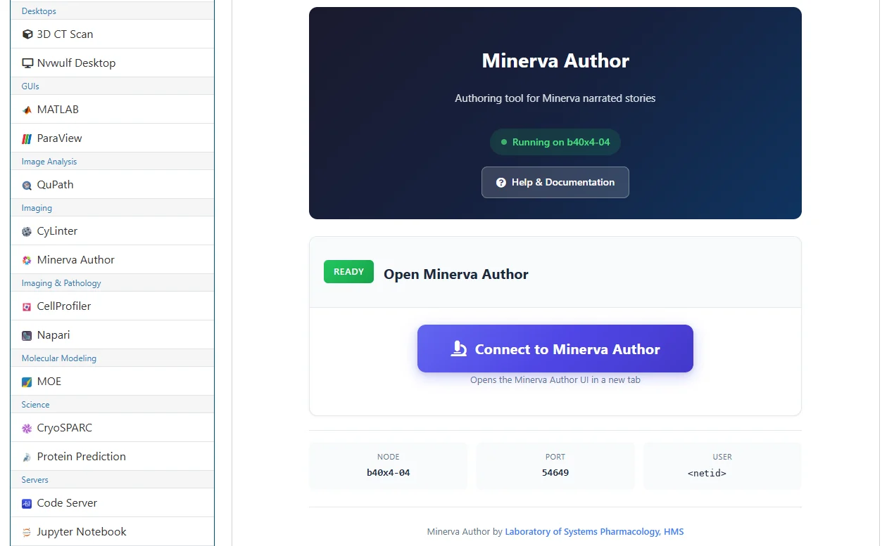
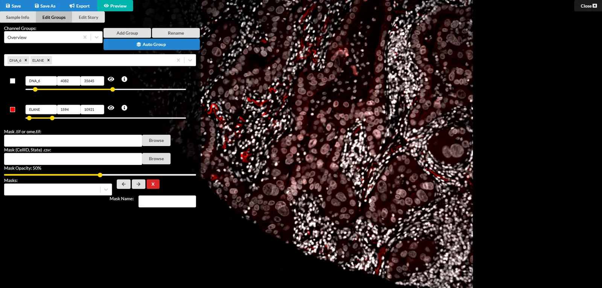

# Minerva Author (Open OnDemand)

Minerva Author creates guided, interactive stories from tissue images. Use its NVwulf browser interface to import an image, choose views and channels, and prepare a story for sharing.

**On this page:** [Where it runs](#where) · [Start a session](#start) · [Launch settings](#settings) · [Troubleshooting](#trouble)

## Where it runs {#where}

| Cluster | Runs on |
| --- | --- |
| NVwulf | B40 nodes using `b40x4` or `b40x4-long`; CPU processing, no GPU requested |

## Start a session {#start}

1. Sign in to the OnDemand portal for your cluster ([NVwulf](https://nvwulf-ood.nvwulf.stonybrook.edu/)) with your NetID and Duo.
2. Open Interactive Apps and choose Minerva Author.
3. Choose the launch settings below and click Launch.
4. Wait for Running, then click Connect to Minerva Author (see figure below). Import your image. Build the story, save or export it, and check the output path before ending the session.
5. Save your work or export the results, then click Delete on the session card when finished. Closing the browser tab does not stop the session.

*Running NVwulf Minerva Author Open OnDemand session. The session page shows the assigned compute node and provides the Connect to Minerva Author button for opening the browser-based authoring interface in a new tab. The Help & Documentation button provides additional usage and troubleshooting guidance.*

*Minerva Author web interface running on NVwulf through Open OnDemand. The interface allows users to define channel groups, adjust channel display ranges and visibility, configure masks and opacity, and interactively review multiplex tissue images while preparing a narrated Minerva story.*

## Launch settings {#settings}

Defaults below are starting points. Ask for resources your task needs, and keep the requested hours within the selected queue limit.

| Setting | What to choose |
| --- | --- |
| Queue | `b40x4` Regular, up to 8 hours, or `b40x4-long` Long, up to 48 hours. |
| Number of hours | Default 4 hours. Choose enough time for your work, within the selected queue limit. |
| Memory (GB) | Default 64 GB. Choices: 16, 32, 64, 128, 256 GB. |
| Number of cores | Default 8; form range 1 to 64. Use only as many cores as the task can use, within the selected node capacity. |
| Workspace directory | Defaults to `/lustre/nvwulf/scratch/<netid>`. Choose the folder containing your project or data. Enter a full path. |

Email notifications are optional. Enter an email address and select Email when job starts if you want a start notification.

## Troubleshooting {#trouble}

**An image cannot be imported.** Check that the file is readable and in a supported format, such as OME-TIFF or SVS. Inspect the workspace log for the actual reader error.

**Image pyramid generation is slow.** Allow time for large images and use more CPU cores or memory when needed. This app uses CPU processing and does not request a GPU.

**The interface fails or an export is missing.** Check the chosen output directory and .minerva-author-&lt;jobid>.log in the workspace. Keep exported stories and related image assets together.

**My session stays Queued.** Try a shorter request, less memory, or fewer cores. Check the session output if the job fails instead of remaining queued.

If the problem continues, [contact HPC support](https://iacs.supportsystem.com) with the cluster, app name, job ID, and the error text.

## Related guides {#related}

- [Open OnDemand apps on NVwulf](nvwulf-ondemand-apps.md)
- [OnDemand overview](../shared/ondemand-overview.md)
- [Open OnDemand](https://rci.stonybrook.edu/hpc/ondemand)

**Applies to** NVwulf

Ported from RCI's guide: <https://rci.stonybrook.edu/docs/ondemand-minerva-author> (maintained by Research Computing and Informatics).
{: .rci-credit }
