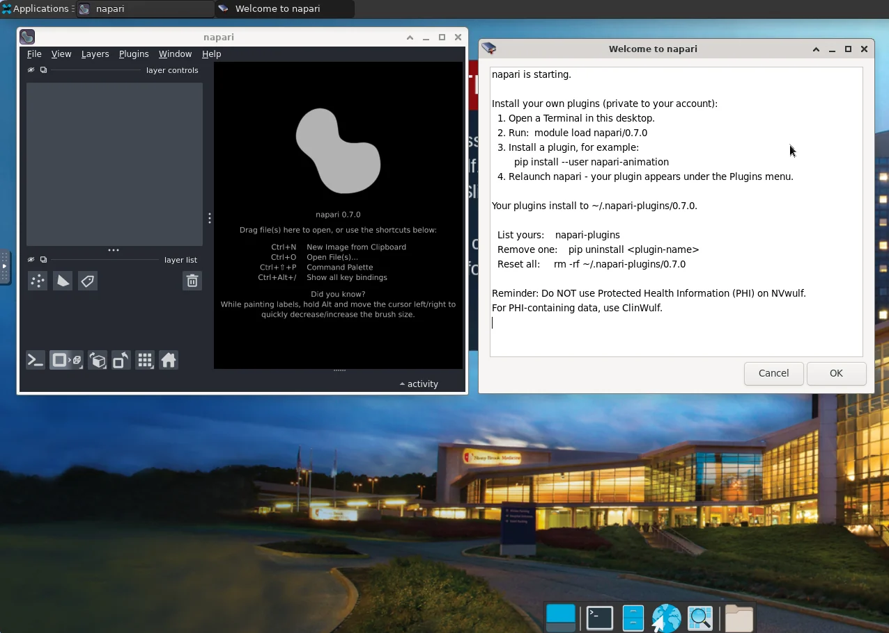

# Napari (Open OnDemand)

Napari is an interactive viewer for multi-dimensional images and analysis layers. Use the NVwulf desktop to inspect large images and work with supported analysis plugins.

**On this page:** [Where it runs](#where) · [Start a session](#start) · [Launch settings](#settings) · [Troubleshooting](#trouble)

## Where it runs {#where}

| Cluster | Runs on |
| --- | --- |
| NVwulf | B40 nodes using `b40x4` or `b40x4-long` |

## Start a session {#start}

1. Sign in to the OnDemand portal for your cluster ([NVwulf](https://nvwulf-ood.nvwulf.stonybrook.edu/)) with your NetID and Duo.
2. Open Interactive Apps and choose Napari.
3. Choose the launch settings below and click Launch.
4. After the session starts, Open OnDemand provides Compression and Image Quality controls for the remote desktop display. Compression controls how strongly the graphical display is compressed before being sent to the browser. Higher compression can improve responsiveness on slower network connections but may reduce visual quality. Image Quality controls the quality of the displayed image. Higher values provide a sharper display but may require more network bandwidth. For most sessions, the default settings are appropriate. Adjust them only if the desktop appears slow, blurry, or unresponsive.
5. Save your work or export the results, then click Delete on the session card when finished. Closing the browser tab does not stop the session.

*NVwulf Napari graphical interface running through Open OnDemand. The application provides an interactive viewer for multidimensional image data and supports additional analysis functionality through user-installed plugins. The startup window also provides instructions for installing private Napari plugins within the user's account.*

## Launch settings {#settings}

Defaults below are starting points. Ask for resources your task needs, and keep the requested hours within the selected queue limit.

| Setting | What to choose |
| --- | --- |
| Napari Version | Version 0.7.0. |
| Queue | `b40x4` Regular, up to 8 hours, or `b40x4-long` Long, up to 48 hours. |
| Working Directory | Defaults to `/lustre/nvwulf/scratch/<netid>`. Choose the folder containing your project or data. Enter a full path. |
| Wall-time (hours) | Default 4 hours. Choose enough time for your work, within the selected queue limit. |
| Cores | Default 4; form range 1 to 16. Use only as many cores as the task can use, within the selected node capacity. |
| Memory (GB) | Default 64 GB. Choices: 8, 16, 32, 64, 128, 256, 480 GB. |
| Use GPU | Default Yes. GPU is recommended for interactive image rendering. |

Email notifications are optional. Enter an email address and select Email when job starts if you want a start notification.

Choose an explicit memory size for routine work. All available can reserve node memory and increase waiting time; use it only when your task needs it.

Note. Users can install their own Napari plugins without modifying the shared installation. Open a terminal inside the desktop, load the Napari module, and install the required plugin with pip install --user &lt;plugin-name>. User-installed plugins are stored under `~/.napari-plugins/0.7.0` and become available from the Plugins menu after Napari is restarted. To list installed plugins, run napari-plugins. To remove a plugin, use pip uninstall &lt;plugin-name>. The entire private plugin environment can be reset by removing `~/.napari-plugins/0.7.0`.

## Troubleshooting {#trouble}

**The viewer is slow or shows graphics errors.** Use GPU on the launch form is recommended for large image rendering. Reconnect once and report persistent OpenGL errors with the session output.

**A large image will not load.** Increase system memory or start with a smaller dataset. GPU memory and system memory are different allocations.

**A file format or plugin is unavailable.** Check the session output for the reader or plugin error. Contact support with the format and plugin name rather than changing the shared installation.

**My session stays Queued.** Try a shorter request, less memory, or fewer cores or GPUs. Check the session output if the job fails instead of remaining queued.

If the problem continues, [contact HPC support](https://iacs.supportsystem.com) with the cluster, app name, job ID, and the error text.

## Related guides {#related}

- [Open OnDemand apps on NVwulf](nvwulf-ondemand-apps.md)
- [OnDemand overview](../shared/ondemand-overview.md)
- [Open OnDemand](https://rci.stonybrook.edu/hpc/ondemand)

**Applies to** NVwulf

Ported from RCI's guide: <https://rci.stonybrook.edu/docs/ondemand-napari> (maintained by Research Computing and Informatics).
{: .rci-credit }
