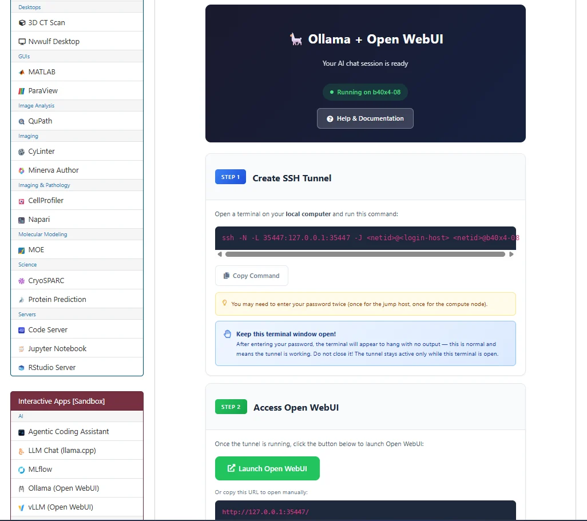
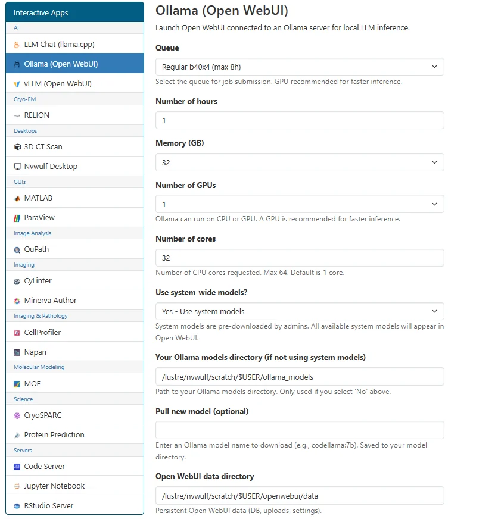

# Ollama with Open WebUI (Open OnDemand)

This app combines Ollama model serving with an Open WebUI chat interface on NVwulf. Use preloaded system models or keep your own models and chat data in directories you can reuse.

**On this page:** [Where it runs](#where) · [Start a session](#start) · [Launch settings](#settings) · [Troubleshooting](#trouble)

## Where it runs {#where}

| Cluster | Runs on |
| --- | --- |
| NVwulf | B40 nodes using `b40x4` or `b40x4-long` |

## Start a session {#start}

1. Sign in to the OnDemand portal for your cluster ([NVwulf](https://nvwulf-ood.nvwulf.stonybrook.edu/)) with your NetID and Duo.
2. Open Interactive Apps and choose Ollama (Open WebUI).
3. Choose the launch settings below and click Launch.
4. Wait for Running. After the session starts, create an SSH tunnel from a terminal on your local computer using the exact command shown on the session page (figure below). Keep that terminal window open while using Open WebUI, because closing it terminates the port-forwarding connection. Once the tunnel is established, click Launch Open WebUI to open the interface in your browser. You may be prompted for your password more than once because the connection passes through the NVwulf login host to the assigned compute node. Use the built-in Help & Documentation button for detailed connection instructions, model management guidance, and troubleshooting.
5. Save your work or export the results, then click Delete on the session card when finished. Closing the browser tab does not stop the session.

Keep important chat exports and downloaded models in persistent project storage. Avoid running two sessions against the same WebUI data directory at once.

*Running NVwulf Ollama + Open WebUI session. The session page provides the SSH port-forwarding command required to connect securely from the user's local computer, followed by the Launch Open WebUI button used to open the browser interface once the tunnel is active. The Help & Documentation button provides additional usage and troubleshooting instructions.*

## Launch settings {#settings}

Defaults below are starting points. Ask for resources your task needs, and keep the requested hours within the selected queue limit.

| Setting | What to choose |
| --- | --- |
| Queue | `b40x4` Regular, up to 8 hours, or `b40x4-long` Long, up to 48 hours. |
| Number of hours | Default 2 hours. Choose enough time for your work, within the selected queue limit. |
| Memory (GB) | Default 64 GB. Choices: 32, 64, 128, 256, 480 GB. |
| Number of GPUs | Default 1. Choices: 1, 2, 3, 4. Choose a count your processing task can use. |
| Number of cores | Default 1; form range 1 to 64. Use only as many cores as the task can use, within the selected node capacity. |
| Use system-wide models? | Default Yes uses preloaded models. Choose No to use your own models directory. |
| Your Ollama models directory (if not using system models) | Your writable model storage directory. Default `/lustre/nvwulf/scratch/<netid>/ollama_models`. Reuse it to avoid repeated downloads. |
| Pull new model (optional) | Optional Ollama model name, for example codellama:7b. Select personal models first so the download goes to your writable model directory. |
| Open WebUI data directory | Stores WebUI accounts, chats, uploads, and settings. Default `/lustre/nvwulf/scratch/<netid>/openwebui/data`. Reuse it across sessions. |

Email notifications are optional. Enter an email address and select Email when job starts if you want a start notification.

Choose an explicit memory size for routine work. All available can reserve node memory and increase waiting time; use it only when your task needs it.

*NVwulf Ollama (Open WebUI) Open OnDemand launch interface. The form allows users to select the B40 queue, wall time, memory, GPU and CPU resources, choose between system-wide and personal Ollama models, optionally pull a new model, and specify persistent directories for models and Open WebUI data.*

## Troubleshooting {#trouble}

**No models appear.** Check Use system-wide models. For personal models, confirm the models directory is correct and that the requested download completed.

**A model download fails.** Choose personal models before using Pull new model, and check that your directory is writable and has enough free space. Inspect `ollama.log` for the error.

**My chats are missing in a new session.** Reuse the same Open WebUI data directory and account. Model storage and WebUI chat storage are separate directories.

**My session stays Queued.** Try a shorter request, less memory, or fewer cores or GPUs. Check the session output if the job fails instead of remaining queued.

If the problem continues, [contact HPC support](https://iacs.supportsystem.com) with the cluster, app name, job ID, and the error text.

## Related guides {#related}

- [Open OnDemand apps on NVwulf](nvwulf-ondemand-apps.md)
- [OnDemand overview](../shared/ondemand-overview.md)
- [Open OnDemand](https://rci.stonybrook.edu/hpc/ondemand)

**Applies to:** NVwulf

Ported from RCI's guide: <https://rci.stonybrook.edu/docs/ondemand-ollama> (maintained by Research Computing and Informatics).
