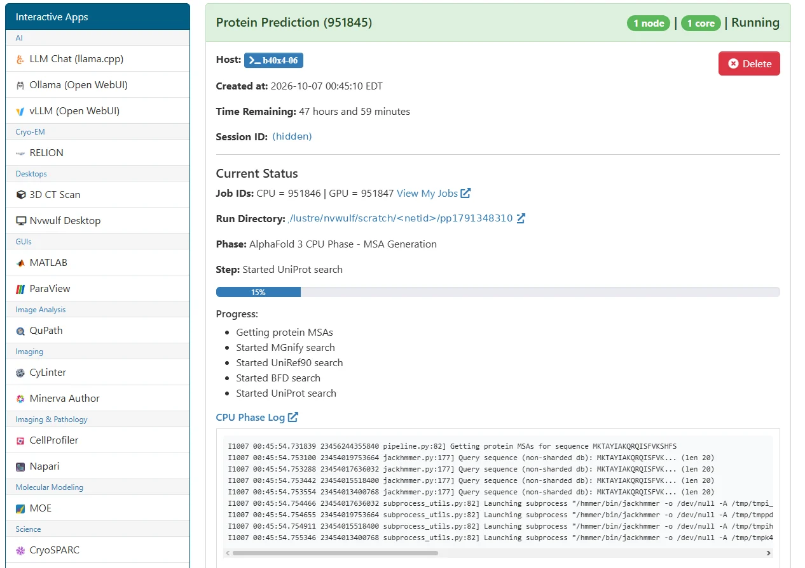
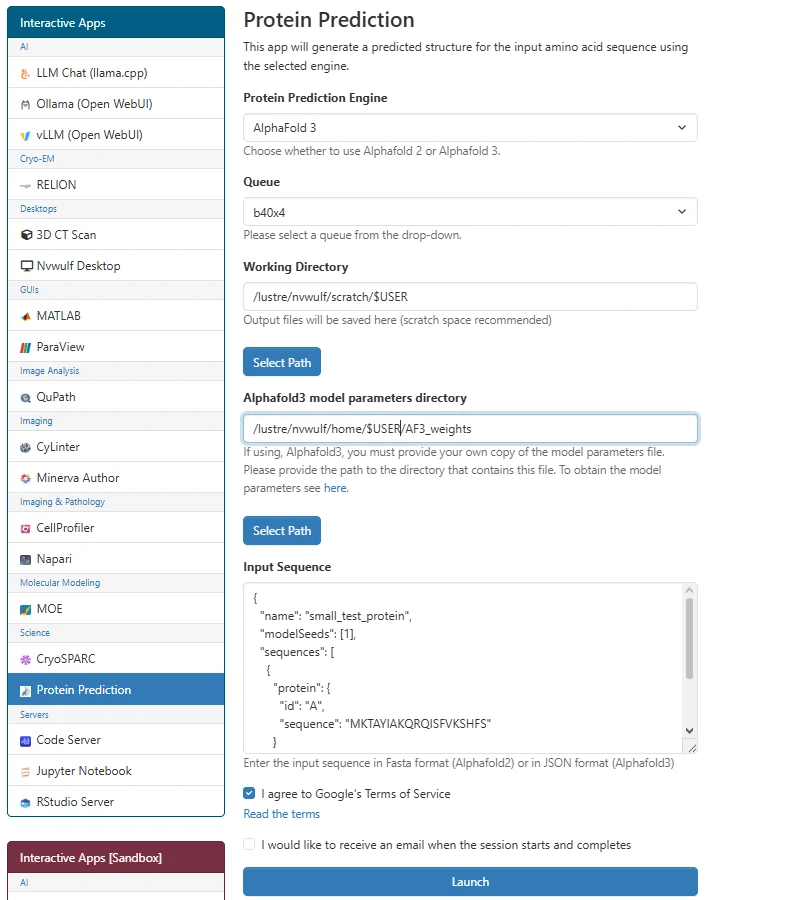

# Protein Prediction (Open OnDemand)

Protein Prediction submits an AlphaFold 2 or AlphaFold 3 workflow on NVwulf and displays its progress. It prepares inputs, runs sequence searches, and submits a dependent GPU job for structure prediction.

**On this page:** [Where it runs](#where) · [Start a session](#start) · [Launch settings](#settings) · [Troubleshooting](#trouble)

## Where it runs {#where}

| Cluster | Runs on |
| --- | --- |
| NVwulf | Submitted CPU and GPU phases on `b40x4`, `h200x4`, or `h200x8` |

## Start a session {#start}

1. Sign in to the OnDemand portal for your cluster ([NVwulf](https://nvwulf-ood.nvwulf.stonybrook.edu/)) with your NetID and Duo.
2. Open Interactive Apps and choose Protein Prediction.
3. Choose the launch settings below and click Launch.
4. Wait for the session card to show the workflow status, then follow the submitted CPU and GPU phases.
5. Protein Prediction runs as a multi-stage workflow. The initial CPU phase performs sequence and database searches required for MSA generation, followed by a dependent GPU phase for structure prediction. After launch, the Open OnDemand session page shows the CPU and GPU Slurm job IDs, current phase, progress, and relevant log output. Use View My Jobs or the displayed job IDs to check the corresponding Slurm jobs if a phase remains queued or stops unexpectedly.
6. AlphaFold 3 requires a valid local copy of the model parameters. Enter the directory containing those files in Alphafold3 model parameters directory before launching. The input must be supplied in AlphaFold 3 JSON format, and the Google Terms of Service agreement must be selected. For AlphaFold 2, provide the sequence in FASTA format.
7. Results are written under a pp<session timestamp> folder in your selected working directory, with input, structure, and logs subfolders.

For AlphaFold 3, obtain the model parameters before launching and review the terms linked on the form. If you stop a run, check the separately submitted CPU and GPU jobs in Active Jobs and cancel any jobs you no longer need.

*Running NVwulf Protein Prediction session showing AlphaFold workflow progress. The session page reports the CPU and GPU job IDs, run directory, current processing phase and step, overall progress, and live phase log, allowing users to follow the CPU-based sequence-search stage before the dependent GPU structure-prediction stage begins.*

## Launch settings {#settings}

Defaults below are starting points. Ask for resources your task needs, and keep the requested hours within the selected queue limit.

| Setting | What to choose |
| --- | --- |
| Protein Prediction Engine | Choose AlphaFold 2 or AlphaFold 3. The engine determines the input format and whether personal model parameters are required. |
| Queue | `b40x4`, `h200x4`, or `h200x8`. This chooses the partition for the submitted processing jobs. |
| Working Directory | Defaults to `/lustre/nvwulf/scratch/<netid>`. Choose the folder containing your project or data. Enter a full path. |
| Alphafold3 model parameters directory | For AlphaFold 3 only: directory containing your own model parameters. Default `/lustre/nvwulf/home/<netid>/AF3_weights`; replace it if yours are elsewhere. |
| Input Sequence | Paste FASTA for AlphaFold 2 or valid AlphaFold 3 JSON for AlphaFold 3. |
| I agree to Google's Terms of Service | For AlphaFold 3, read the linked terms and select the agreement checkbox before submission. |

The email checkbox requests notifications when the session starts and completes.

*NVwulf Protein Prediction Open OnDemand launch interface. The form allows users to choose AlphaFold 2 or AlphaFold 3, select the processing queue and working directory, provide the AlphaFold 3 model-parameter directory when required, and enter the protein sequence in the appropriate input format before launching the workflow.*

## Troubleshooting {#trouble}

**The input is rejected.** Use FASTA for AlphaFold 2 and valid AlphaFold 3 JSON for AlphaFold 3. Check the relevant phase log for the specific input error.

**AlphaFold 3 cannot load parameters.** Provide the directory containing your own authorized AlphaFold 3 model parameters. Check that the directory and parameter file are readable.

**The GPU phase is waiting or progress has stopped.** The GPU job depends on successful completion of the CPU job. Check both job IDs in Active Jobs and inspect `logs/cpu_job.log` and `logs/gpu_job.log` under the run folder.

If the problem continues, [contact HPC support](https://iacs.supportsystem.com) with the cluster, app name, job ID, and the error text.

## Related guides {#related}

- [Open OnDemand apps on NVwulf](nvwulf-ondemand-apps.md)
- [OnDemand overview](../shared/ondemand-overview.md)
- [Open OnDemand](https://rci.stonybrook.edu/hpc/ondemand)

**Applies to:** NVwulf

Ported from RCI's guide: <https://rci.stonybrook.edu/docs/ondemand-protein-prediction> (maintained by Research Computing and Informatics).
