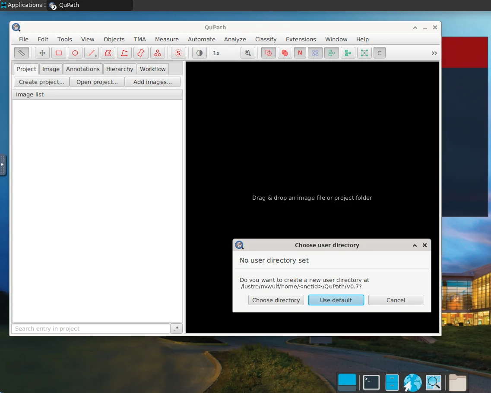

# QuPath (Open OnDemand)

QuPath provides tools for whole-slide image viewing, annotation, and quantitative analysis. Open the NVwulf desktop to work with large pathology images stored on the cluster.

**On this page:** [Where it runs](#where) · [Start a session](#start) · [Launch settings](#settings) · [Troubleshooting](#trouble)

## Where it runs {#where}

| Cluster | Runs on |
| --- | --- |
| NVwulf | B40 nodes using `b40x4` or `b40x4-long` |

## Start a session {#start}

1. Sign in to the OnDemand portal for your cluster ([NVwulf](https://nvwulf-ood.nvwulf.stonybrook.edu/)) with your NetID and Duo.
2. Open Interactive Apps and choose QuPath.
3. Choose the launch settings below and click Launch.
4. After the session starts, Open OnDemand provides Compression and Image Quality controls for the remote desktop display. Compression controls how strongly the graphical display is compressed before being sent to the browser. Higher compression can improve responsiveness on slower network connections but may reduce visual quality. Image Quality controls the quality of the displayed image. Higher values provide a sharper display but may require more network bandwidth. For most sessions, the default settings are appropriate. Adjust them only if the desktop appears slow, blurry, or unresponsive.
5. Save your work or export the results, then click Delete on the session card when finished. Closing the browser tab does not stop the session.

*NVwulf QuPath graphical interface running through Open OnDemand. The interface provides tools for creating or opening projects, loading whole-slide images, managing annotations, and performing image analysis. On first launch, QuPath prompts the user to create or select a personal user directory for settings and extensions.*

## Launch settings {#settings}

Defaults below are starting points. Ask for resources your task needs, and keep the requested hours within the selected queue limit.

| Setting | What to choose |
| --- | --- |
| QuPath Version | Version 0.7.0. |
| Queue | `b40x4` Regular, up to 8 hours, or `b40x4-long` Long, up to 48 hours. |
| Working Directory | Defaults to `/lustre/nvwulf/scratch/<netid>`. Choose the folder containing your project or data. Enter a full path. |
| Wall-time (hours) | Default 4 hours. Choose enough time for your work, within the selected queue limit. |
| Cores | Default 4; form range 1 to 16. Use only as many cores as the task can use, within the selected node capacity. |
| Memory (GB) | Default 128 GB. Choices: 4, 8, 16, 32, 64, 128, 256, 480 GB. |
| Use GPU | Default No. Enable only when your analysis or extension uses a GPU. |

Email notifications are optional. Enter an email address and select Email when job starts if you want a start notification.

Choose an explicit memory size for routine work. All available can reserve node memory and increase waiting time; use it only when your task needs it.

## Troubleshooting {#trouble}

**My project cannot find its images.** Check that the original slide files are still available at the paths used by the project. Moving the project alone does not move its images.

**An analysis runs out of memory.** Choose more memory for a new session or reduce the number of images processed together.

**Enabling GPU does not speed up analysis.** GPU use depends on the selected extension or task. Routine annotation and many analyses work on CPU; allocating a GPU does not enable every plugin automatically.

**My session stays Queued.** Try a shorter request, less memory, or fewer cores or GPUs. Check the session output if the job fails instead of remaining queued.

If the problem continues, [contact HPC support](https://iacs.supportsystem.com) with the cluster, app name, job ID, and the error text.

## Related guides {#related}

- [Open OnDemand apps on NVwulf](nvwulf-ondemand-apps.md)
- [OnDemand overview](../shared/ondemand-overview.md)
- [Open OnDemand](https://rci.stonybrook.edu/hpc/ondemand)

**Applies to:** NVwulf

Ported from RCI's guide: <https://rci.stonybrook.edu/docs/ondemand-qupath> (maintained by Research Computing and Informatics).
