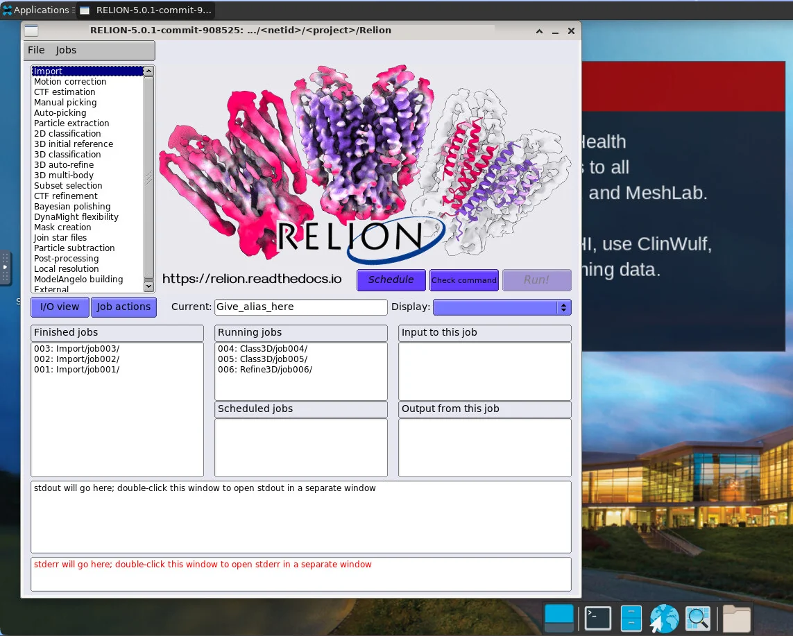

# RELION (Open OnDemand)

RELION provides tools for cryo-EM image processing and structure determination. This NVwulf app opens the RELION graphical interface in your project directory, with resources for jobs run within the session.

**On this page:** [Where it runs](#where) · [Start a session](#start) · [Launch settings](#settings) · [Troubleshooting](#trouble)

## Where it runs {#where}

| Cluster | Runs on |
| --- | --- |
| NVwulf | B40 nodes using `b40x4` or `b40x4-long` |

## Start a session {#start}

1. Sign in to the OnDemand portal for your cluster ([NVwulf](https://nvwulf-ood.nvwulf.stonybrook.edu/)) with your NetID and Duo.
2. Open Interactive Apps and choose RELION.
3. Choose the launch settings below and click Launch.
4. After the session starts, Open OnDemand provides Compression and Image Quality controls for the remote desktop display. Compression controls how strongly the graphical display is compressed before being sent to the browser. Higher compression can improve responsiveness on slower network connections but may reduce visual quality. Image Quality controls the quality of the displayed image. Higher values provide a sharper display but may require more network bandwidth. For most sessions, the default settings are appropriate. Adjust them only if the desktop appears slow, blurry, or unresponsive.
5. Save your work or export the results, then click Delete on the session card when finished. Closing the browser tab does not stop the session.

Jobs run locally use the OnDemand session allocation and end with the session. Jobs submitted separately to Slurm need their own submission settings and allocation. Check which mode you selected before starting a long run.

*NVwulf RELION graphical interface running through Open OnDemand. The interface provides access to the complete RELION cryo-EM processing workflow, including particle import, motion correction, CTF estimation, particle picking and extraction, 2D and 3D classification, refinement, masking, particle subtraction, and post-processing. The lower panels display finished, running, and scheduled jobs together with their associated input, output, standard output, and error information.*

## Launch settings {#settings}

Defaults below are starting points. Ask for resources your task needs, and keep the requested hours within the selected queue limit.

| Setting | What to choose |
| --- | --- |
| Queue | `b40x4` Regular, up to 8 hours, or `b40x4-long` Long, up to 48 hours. |
| RELION Project Directory | Your RELION project folder. Default `/lustre/nvwulf/scratch/<netid>/relion_projects`; select the folder containing your existing pipeline to resume it. |
| Number of hours | Default 8 hours. Choose enough time for your work, within the selected queue limit. |
| Number of GPUs | Default 1. Choices: 1, 2, 3, 4. Choose a count your processing task can use. |
| Number of CPU cores | Default 16; form range 4 to 64. Use only as many cores as the task can use, within the selected node capacity. |
| Memory (GB) | Default 64 GB. Choices: 32, 64, 128, 256, 480 GB. |

Email notifications are optional. Enter an email address and select Email when job starts if you want a start notification.

Choose an explicit memory size for routine work. All available can reserve node memory and increase waiting time; use it only when your task needs it.

## Troubleshooting {#trouble}

**The project looks empty.** Check RELION Project Directory. Opening a different folder opens a different project; it does not automatically locate your earlier pipeline.

**A local processing job uses too many resources.** Keep MPI processes multiplied by threads per process within the session CPU allocation, and use only the GPUs assigned to the session.

**GPU utilization is low.** Check that the selected RELION job supports GPU execution and has GPU use enabled. Import, disk access, and CPU-only steps can leave allocated GPUs idle.

**My session stays Queued.** Try a shorter request, less memory, or fewer cores or GPUs. Check the session output if the job fails instead of remaining queued.

If the problem continues, [contact HPC support](https://iacs.supportsystem.com) with the cluster, app name, job ID, and the error text.

## Related guides {#related}

- [Open OnDemand apps on NVwulf](nvwulf-ondemand-apps.md)
- [OnDemand overview](../shared/ondemand-overview.md)
- [Open OnDemand](https://rci.stonybrook.edu/hpc/ondemand)

**Applies to:** NVwulf

Ported from RCI's guide: <https://rci.stonybrook.edu/docs/ondemand-relion> (maintained by Research Computing and Informatics).
