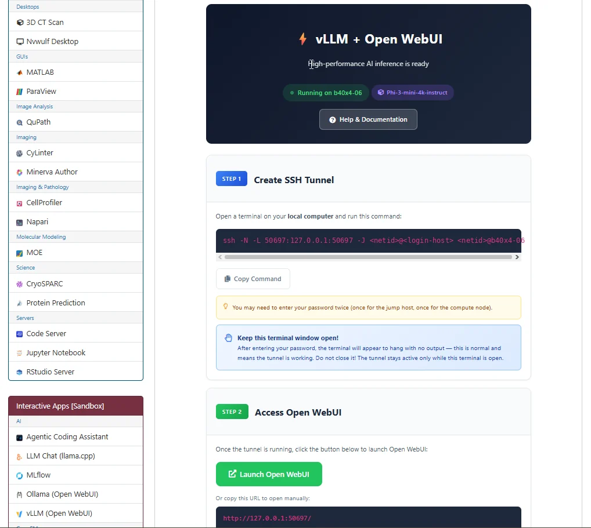

# vLLM with Open WebUI (Open OnDemand)

This app serves a language model with vLLM on NVwulf and provides an Open WebUI chat interface. Use a provided model or a Hugging Face model stored in your own directory.

**On this page:** [Where it runs](#where) · [Start a session](#start) · [Launch settings](#settings) · [Troubleshooting](#trouble)

## Where it runs {#where}

| Cluster | Runs on |
| --- | --- |
| NVwulf | B40 nodes using `b40x4` or `b40x4-long` |

## Start a session {#start}

1. Sign in to the OnDemand portal for your cluster ([NVwulf](https://nvwulf-ood.nvwulf.stonybrook.edu/)) with your NetID and Duo.
2. Open Interactive Apps and choose vLLM (Open WebUI).
3. Choose the launch settings below and click Launch.
4. Wait for Running. After the vLLM session starts, create an SSH tunnel from a terminal on your local computer using the exact command shown on the Open OnDemand session page (see the figure below). You may be prompted for your password more than once because the connection passes through the NVwulf login host to the assigned compute node. Keep the terminal window open while using Open WebUI. Once the tunnel is active, click Launch Open WebUI to open the browser interface. The session page also shows the model currently being served and provides a Help & Documentation button for additional connection, model-selection, and troubleshooting guidance.
5. vLLM loads the selected model when the session starts. Larger models or longer context lengths may require more GPU memory and can take additional time to become ready. Wait until the session indicates that the inference service is running before opening Open WebUI.
6. Save your work or export the results, then click Delete on the session card when finished. Closing the browser tab does not stop the session.

Reuse the Open WebUI data directory to retain your account and chats. Keep important exports and model files in persistent storage.

*Running NVwulf vLLM + Open WebUI session. The session page shows the assigned compute node and active model, provides the SSH port-forwarding command required to connect securely from the user's local computer, and includes the Launch Open WebUI button for opening the browser-based chat interface. The Help & Documentation button provides additional usage and troubleshooting information.*

## Launch settings {#settings}

Defaults below are starting points. Ask for resources your task needs, and keep the requested hours within the selected queue limit.

| Setting | What to choose |
| --- | --- |
| Queue | `b40x4` Regular, up to 8 hours, or `b40x4-long` Long, up to 48 hours. |
| Number of hours | Default 2 hours. Choose enough time for your work, within the selected queue limit. |
| Memory (GB) | Default 64 GB. Choices: 32, 64, 128, 256, 480 GB. |
| Number of GPUs | Default 1. Choices: 1, 2, 3, 4. Choose a count your processing task can use. |
| Number of cores | Default 1; form range 1 to 64. Use only as many cores as the task can use, within the selected node capacity. |
| Use system-wide model? | Choose Phi-3 Mini 4K Instruct or Qwen2.5 0.5B Instruct, or use personal models. Default personal models requires a name or download below. |
| Your model directory | Your writable model storage directory. Default `/lustre/nvwulf/scratch/<netid>/hf`. Reuse it to avoid repeated downloads. |
| Model from your directory (if not using system model) | Model in your personal directory, using a Hugging Face ID or cache name, for example microsoft/Phi-3-mini-4k-instruct. |
| Download new model (optional) | Optional Hugging Face model ID to download to your model directory. Ensure any required model access is already available. |
| Max context length | Default 4096; choices 2048, 4096, 8192, 16384, or 32768. Reduce this when GPU cache memory is insufficient. |
| GPU memory utilization | Default 0.9. Choices 0.7, 0.8, 0.9, or 0.95 set the fraction of GPU memory available to vLLM, including model and cache. |
| Open WebUI data directory | Stores WebUI accounts, chats, uploads, and settings. Default `/lustre/nvwulf/scratch/<netid>/openwebui/data`. Reuse it across sessions. |
| Extra vLLM arguments (optional) | Optional extra arguments passed to vllm serve. Leave blank for a standard session. |

Email notifications are optional. Enter an email address and select Email when job starts if you want a start notification. Choose an explicit memory size for routine work. All available can reserve node memory and increase waiting time; use it only when your task needs it.

## Troubleshooting {#trouble}

**No model was selected.** Choose a system model, enter a model already in your directory, or fill in Download new model. The personal-model default needs a model name or download request.

**vLLM reports GPU memory or cache errors.** Try a shorter Max context length or a smaller model. More allocated GPUs enable tensor parallelism for compatible models. Inspect `vllm.log` before changing several settings.

**A model cannot be downloaded.** Check the model ID, access requirements, and available disk space. Gated models require the appropriate Hugging Face access.

**My session stays Queued.** Try a shorter request, less memory, or fewer cores or GPUs. Check the session output if the job fails instead of remaining queued.

If the problem continues, [contact HPC support](https://iacs.supportsystem.com) with the cluster, app name, job ID, and the error text.

## Related guides {#related}

- [Open OnDemand apps on NVwulf](nvwulf-ondemand-apps.md)
- [OnDemand overview](../shared/ondemand-overview.md)
- [Open OnDemand](https://rci.stonybrook.edu/hpc/ondemand)

**Applies to** NVwulf

Ported from RCI's guide: <https://rci.stonybrook.edu/docs/ondemand-vllm> (maintained by Research Computing and Informatics).
{: .rci-credit }
