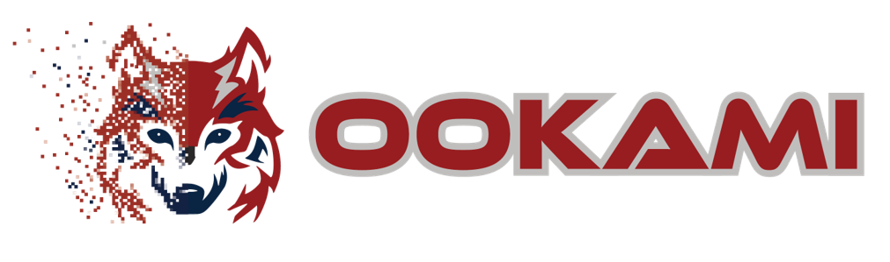
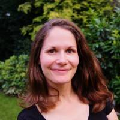

# A NEW PATH TO EXASCALE COMPUTING

!!! note archive "Archived page"
    Ookami reached end of life at the end of 2025. This is a copy of its website, kept for reference; some original material is not included.

## Stony Brook's testbed for future supercomputing technologies

Ookami is a computer technology testbed supported by the National Science Foundation under grant OAC 1927880. It provides researchers with access to the [A64FX](https://www.arm.com/blogs/blueprint/fujitsu-a64fx-arm) processor developed by Riken and Fujitsu for the Japanese path to exascale computing and is currently deployed in the until June 2022 fastest computer in the world, [Fugaku](https://www.fujitsu.com/global/about/innovation/fugaku/). It is the first such computer outside of Japan. By focusing on crucial architectural details, the ARM-based, multi-core, 512-bit SIMD-vector processor with ultrahigh-bandwidth memory promises to retain familiar and successful programming models while achieving very high performance for a wide range of applications. It supports a wide range of data types and enables both HPC and big data applications.

The Ookami HPE (formerly Cray) Apollo 80 system has 176 A64FX (48 cores per node) compute nodes, which includes 2 dedicated debug nodes, each with 32GB of high-bandwidth memory and a 512 Gbyte SSD. This amounts to about 1.5M node hours per year. A high-performance Lustre filesystem provides about 800 TB storage.

To facilitate users exploring current computer technologies and contrasting performance and programmability with the A64FX, Ookami also includes:

- 1 node with dual socket AMD Milan (64 cores) with 512 Gbyte memory
- 2 nodes with dual socket Thunder X2 (64 cores) each with 256 Gbyte memory
- 1 node with dual socket Intel Skylake (36 cores) with 192 Gbyte memory
- 2 nodes with dual socket NVIDIA Grace superchips (144 cores)

## Allocations

Since October 2022 Ookami is an **[ACCESS](https://access-ci.org/)** service provider. We strongly encourage researchers interested in Ookami to submit an ACCESS allocation request. [ACCESS allocation](https://allocations.access-ci.org/)

## End of service

The Ookami cluster will reach its end of life end of 2025. We thank our user community for making it a vital platform for research and innovation. Users are advised to complete all computing tasks by the end of the year. A data migration-only period will follow in January–February 2026.

For assistance or questions, please contact the support team.

[Frequently Asked Questions](support/faq/README.md) [Submit A Ticket](https://iacs.supportsystem.com/)

Contact: [ookami_computer@stonybrook.edu](mailto:ookami_computer@stonybrook.edu?subject=)

## Announcements

### Ongoing Events:

**Ookami office hours**
Starting immediately, our weekly scheduled Office Hours are replaced with On-Demand Office Hours — a flexible, personalized way to get expert support when you need it most.
Here’s how it works:
You can now book a one-on-one session with our experts at a time that suits your schedule. Whether you need help troubleshooting, optimizing workflows, or planning your next big project, we’re here to assist!

Click [**here**](https://docs.google.com/forms/d/e/1FAIpQLSfD4ypKIOw1XkvLHGWNaPK2kDXxTvxGGpLo2TXz1PiuJzQjBQ/viewform?usp=dialog) to book your On-Demand Office Hours session

### May 4–8, 2025:

The Institute for Advanced Computational Science (IACS) at Stony Brook University (SBU) and the HPE Cray User Group (CUG) Board are thrilled to extend a warm invitation to all members of CUG to the 2025 **[CUG Conference](https://cug.org/cug-2025/)**, from May 4 – May 8, 2025, within minutes of New York City, the big apple – a city that is always open for adventure.

Meet the Ookami project team at the following sessions:

- Sun, May 4th, 1-5pm: Programming Environments, Applications, and Documentation (PEAD)
- Thu, May 8th, 4 - 4:30pm: Supernovae in HPC: Benchmarking FLASH Across Advanced Computing Clusters

### aPRIL 23, 2025:

Join in the Ookami [ByteBoost](byteboost.md) webinar and learn more about the system, as well other testbeds like ACES and Neocortex and the ByteBoost program

### March 12, 2025:

We are thrilled to announce the second year of the [ByteBoost Cybertraining Program](byteboost.md). This groundbreaking program is driven by the imperative to enhance researchers' proficiency and productivity when navigating cutting-edge, specialized computing technologies. By offering experiential learning opportunities on modern computing technologies, ByteBoost will empower researchers to make the best computing choices in the ever-changing landscape of computational technology. This initiative will focus on supporting researchers to use the technologies of three NSF supported computing testbeds - Ookami, Neocortex, and ACES, and is supported by NSF award OAC-2320990.

Join the introductory webinar

### February 19-21, 2025:

HPC Asia - International Workshop on Arm-based HPC: Practice and Experience ([IWAHPCE-2025](https://arm-hpc-user-group.github.io/iwahpce-2025/index.html)):

- 11:30 - 12pm: The AmpereOne A192-32X in Perspective: Benchmarking a New Standard

### November 17-22,2024:

[Supercomputing](https://sc24.supercomputing.org/) conference:

- LLVM-HPC2024: The Tenth Workshop on the LLVM Compiler Infrastructure in HPC

### June 21-25, 2024:

Join us at the [PEARC](https://pearc.acm.org/pearc24/) conference in Providence, Rhode Island.
Sessions from the Ookami team and our project partners:

Monday, July 22nd:

- [Providing cutting-edge computing testbeds to the science and engineering community](https://web.cvent.com/event/f318e73c-2230-432a-a044-b75625020543/websitePage:afd80266-008e-414b-9f94-2fd9b4dd1924?session=61dbb5cf-0d62-416c-883a-176d675c7c6c&shareLink=true); 1:30 PM-5:00 PM

Tuesday, July 23rd:

- [Overview of ACCESS allocated cyberinfrastructure usage](https://web.cvent.com/event/f318e73c-2230-432a-a044-b75625020543/websitePage:afd80266-008e-414b-9f94-2fd9b4dd1924?session=247ef6ed-24a8-4501-85b9-c0f60e050d46&shareLink=true); 11:00 AM-11:25 AM
- [Benchmarking with Supernovae: A Performance Study of the FLASH Code](https://web.cvent.com/event/f318e73c-2230-432a-a044-b75625020543/websitePage:afd80266-008e-414b-9f94-2fd9b4dd1924?session=c0639588-0001-4a1a-8b2a-c35859999424&shareLink=true); 3:00 PM-3:25 PM
- [Open OnDemand: Connecting Computing Power With Powerful Minds](https://web.cvent.com/event/f318e73c-2230-432a-a044-b75625020543/websitePage:afd80266-008e-414b-9f94-2fd9b4dd1924?session=beb6fdd9-c569-4c54-9280-f538d35a1b4a&shareLink=true); 3:50 PM-4:15 PM
- [XDMoD Users group meeting](https://web.cvent.com/event/f318e73c-2230-432a-a044-b75625020543/websitePage:afd80266-008e-414b-9f94-2fd9b4dd1924?session=a2c6c5a3-9c48-45dd-bdeb-603170c883e9&shareLink=true); 4:45 PM-5:45 PM

Wednesday, July 24th:

- [Modeling Users on High-Performance Computing Resource](https://web.cvent.com/event/f318e73c-2230-432a-a044-b75625020543/websitePage:afd80266-008e-414b-9f94-2fd9b4dd1924?session=737ae0cf-fb87-4468-bc59-b98885a5831c&shareLink=true); 11:50 AM-12:00 PM
- [A64FX Enables Engine Decarbonization Using Deep Learning](https://web.cvent.com/event/f318e73c-2230-432a-a044-b75625020543/websitePage:afd80266-008e-414b-9f94-2fd9b4dd1924?session=4bf15264-58da-48c8-bc9c-02afdd7e6a9b&shareLink=true); 3:30 PM-3:45 PM
- [Fantastic ACCESS Cyberinfrastructure Resources and Where to Find Them](https://web.cvent.com/event/f318e73c-2230-432a-a044-b75625020543/websitePage:afd80266-008e-414b-9f94-2fd9b4dd1924?session=1cf0d372-2632-445a-9ae9-ed7af75fd614&shareLink=true); 4:45 PM-5:45 PM

### May 23, 2024:

**NVIDIA Grace Webinar**

Learn more about the [NVIDIA Grace Superchips](support/faq/nvidia-grace-cpus.md) on Ookami
If you have any questions please share them already now, so they can be addressed during the webinar ([ookami_computer@stonybrook.edu](mailto:ookami_computer@stonybrook.edu))
This webinar will be taught by Dr. John Linford from NVIDIA. Dr. John Linford is a principal technical manager at NVIDIA focused on developing the CPU software ecosystem. John previously worked as the Arm director of HPC engineering. John has almost two decades of front-line HPC applications, systems, and optimization experience and particularly enjoys working with emerging technologies and extreme-scale systems.

The webinar will take place at 2pm EDT and an invite will be sent out to the Ookami mailinglist. If you are not on the mailinglist but would like to attend the webinar, please contact us under [ookami_computer@stonybrook.edu](mailto:ookami_computer@stonybrook.edu?subject=NVIDIA%20Grace%20Webinar)

**[Slides](files/_pdf/20240523_Developing_GH_SW_Public.pdf)**

[**Recording**](https://youtu.be/VRX7-LEbemI)

### APRIL 15, 2024:

We are pleased to announce the addition of two **[NVIDIA Grace superchips](https://www.nvidia.com/en-us/data-center/grace-cpu-superchip/)** to Ookami. These new nodes with 144 cores each are now available for your testing and experimental projects.
[Learn more](support/faq/nvidia-grace-cpus.md)

### March 7, 2024:

**Ookami Open OnDemand Webinar**

Ookami is now available via [Open OnDemand](support/faq/open_ondemand.md), an intuitive, innovative, and interactive interface to remote computing resources. Open OnDemand helps computational researchers and students efficiently utilize remote computing resources by making them easy to access from any device. In this webinar we will show you how to use Open OnDemand on Ookami.

[Slides](files/_pdf/OOD-Slides.pdf)

### February 29, 2024:

**Ookami Webinar**

Whether you are interested in Ookami and consider getting an account, a new user, or a longtime user, who wants to optimize their usage, this webinar is for you!
It will cover the basics of the system, a lot of tips and tricks on how to use it efficiently, and how to get an account.
[Slides](files/_pdf/Ookami%20Webinar%202_29_2024.pdf)

### January 25-27, 2024: HPC Asia

Join the International Workshop on Arm-based HPC: Practice & Experience:

- 11:40-12:05 Nikolay A. Simakov, Matthew D. Jones, Thomas R. Furlani, Eva Siegmann and Robert J. Harrison, “First Impressions of the NVIDIA Grace CPU Superchip and NVIDIA Grace Hopper Superchip for Scientific Workloads”

### November 12-17, 2023: Supercomputing 2023

- [BoF: Arm in HPC: Experiences and Lessons Learned in Operating Arm-Based HPC Systems](https://sc23.supercomputing.org/proceedings/bof/bof_pages/bof120.html)
- [BoF: ACCESS Resource Provider Forum](https://sc23.conference-program.com/presentation/?id=bof181&sess=sess367)

### July 18th & August 8th, 2023:

**Webinar about Linaro Forge**

In this presentation we will provide an overview of Linaro Forge, a cross platform, integrated environment for debugging and optimizing parallel codes at any scale. We will provide hands-on demonstrations of how Linaro Forge reduces development time, simplifies debugging, and eases application performance enhancement.

**Ensuring Program Correctness with Linaro DDT**
Using sample codes, we will walk through the major capabilities of the debugger to illustrate how DDT can debug applications ranging from a single thread to large scale

- Using Forge as a remote client
- Using semantic analysis tools to catch bugs before you even run the code
- How to use sparklines to visualize variable values across processes and threads
- Illustrate memory debugging to trap array out of bounds errors and memory leaks
- Using the array viewer to visualize multi-dimensional variables
- Using watchpoints to halt execution dependent upon expression values
- Offline debugging for large scale debugging, catching non-deterministic errors and continuous integration
- Trace points, a flexible and deterministic printf alternative
- Modifying the definition of your program without re-building using the Evaluate Window
- Debugging on a GPU (optional)
- Debugging Python (optional)

**Performance Engineering with Linaro Performance Reports and Linaro MAP**
We will illustrate how in a matter of minutes you can understand the nature of your application’s performance. We will introduce best practices to attain and maintain optimal performance.

- Understanding the performance road map
- Characterize file IO behavior
- Isolate workload imbalance issues in codes at any scale
- See how the amount of time spent in memory operations varies over time and processes
- Determine how well your application is vectorized
- Profiling Python applications (optional)

Speakers: Beau Paisley and Rudy Shand, Linaro

[Recordings here](support/index_links_and_docs.md)

### July 23-27th, 2023:

We will attend the [PEARC'23](https://pearc.acm.org/pearc23/) conference in Portland Oregon. Meet us at:

- Workshop: The Taming of the Wolf - or how to use the Ookami Cray Apollo 80 system and its Fujitsu A64FX processors; Mo July 24th, 8.30 am - 4.30 pm PDT ([slides](files/_pdf/PEARC_23_Ookami_Workshop.pdf))
- Presentation: From Molecular Dynamics to Oceanography - Ookami Graduate Students Porting and Tuning Science Codes for A64FX
- Presentation: A Further Study of Linux Kernel Hugepages on A64FX with FLASH, an Astrophysical Simulation Code

### May 7th -11th, 2023:

The Cray User Group meeting ([CUG](https://cug.org/cug-2023/)). Will take place in Helsinki, Finnland. Ookami is an Cray Apollo 80 system and we are looking forward to share our experiences in the following talks:

- Su, May 7th: **Programming Environments, Applications, and Documentation** session
- Tue, May 9th, 2 - 2.30 pm EEST: Nikolay Simakov, **Benchmarking High-End ARM Systems with Scientific Applications. Performance and Energy Efficiency**
- Th, May 11th, 11.30 -2 pm EEST: Eva Siegmann, **The Ookami Apollo80 system: Progress, Challenges and Next Steps**
- Th, May 11th, 2.45 - 3.15 pm EEST: Smeet Chheda, **Performance Study on CPU-based Machine Learning with PyTorch**

### April 26th, 2023:

NSF technical talk: [**Ookami - Experiences during the First Three Years of a Computing Technology Testbed**](https://beta.nsf.gov/events/ookami-experiences-during-first-three-years/2023-04-26) by Eva Siegmann

### MARCH 23rd, 2023:

The [**2nd** **Ookami user group meeting**](user_meeting/ugm2023.md) took place on Thursday **March 23rd, 2pm EST.**
The purpose of this meeting is to share experiences, learn from each other, get feedback and have a fruitful discussion about A64FX and Ookami.

### December 8th, 2022:

We are holding a webinar about using the Julia programming languange on A64FX. Mose Giordano and Valentin Churavy, both Julia core developers, will hold this webinar, consisting of an introduction to the programming language, hands-on examples on Ookami, and lots of opportunities to ask your questions. The webinar is virtual and will take place from **2-4pm EST**.

[Recording](https://www.youtube.com/watch?v=kZNYFWGnixA)
[Examples](https://github.com/giordano/julia-on-ookami/)

### October 26th, 2022:

We are holding a webinar targeting researchers interested in using Ookami. We will cover Ookami in general, A64FX, as well as how to get an ACCESS allocation. The webinar is virtual and will take palce at **2pm EST.**

### October 1st, 2022:

From today on Ookami is officially an [**ACCESS**](https://access-ci.org/) resource provider with 90% of its resource available via ACCESS.

### JUly 12th, 2022:

Join us for the BoF session **NSF innovative computing technology testbed community exchange** at the PEARC 2022 conference. 1:30pm - 2:20PM EST at studio 2.

[Read the report](files/_pdf/PEARC2022_BoF_testbeds___report.pdf)

Also visit our project partners from the University at Buffalo and hear about XDMoD and ACCESS (where Ookami will be a resource provider):

- 2022-07-11: 0830-1700: Arlington: "Open OnDemand, Open XDMoD, and ColdFront - an HPC center management toolset"
- 2022-07-12: 1030-1100: Arlington: "Performance Optimization of the Open XDMoD Datawarehouse - best Full paper"
- 2022-07-12: 1130-1145: Studio 2: "Developing Accurate Slurm Simulator"
- 2022-07-12: 1200-1330 :The Square: "Meeting ACCESS: an opportunity to discuss the new NSF Cyberinfrastructure with the ACCESS PIs"
- 2022-07-12: 1330-1430: Studio 1: "Open OnDemand User Group Meeting" (BoF)
- 2022-07-13: 1330-1430: Studio 1: "XDMoD" (BoF)
- 2022-07-14: 0900-1000: Arlington: "ColdFront HPC Resource Allocation Management System User Group Meeting" (BoF)
- 2022-07-14: 1000-1230: Ballroom A: "ACCESSing the Future of Research Computing: A Panel Discussion with Principals of the National Sciene"

### JUNE 15th, 2022:

At 2pm EST we will host a **general webinar about the Ookami cluster.** This will provide an overview of the system, its characteristics and features, as well as insights on what applications benefit from the A64FX architecture. The webinar is targeted especially for **XSEDE users**, who are considering submitting an allocation proposal in the upcoming submission period (June 15th - July 15th) and allocations starting in October.

### May 19th, 2022:

James Custer from HPE will hold a webinar about the **Cray Performance Tools** and how to use them on Ookami. The webinar will take place from 2pm - 4pm EST with enough time for questions.
The Cray Performance Measurement and Analysis Tools (or CrayPat) are a suite of optional utilities that enable the user to capture and analyze performance data generated during the execution of a program on a Cray system. The information collected and analysis produced by use of these tools can help the user to find answers to two fundamental programming questions: How fast is my program running? and How can I make it run faster?

[Recording](https://www.youtube.com/watch?v=GqJv2TNoQKE)

### May 17th, 2022:

On Tuesday May 17th, starting at 9:00 AM EDT, we will be performing the second and final phase of security and reliability updates. That maintenance is expected to be completed by the end of business the same day. During that outage, the Ookami login nodes and queues will not be available, and jobs will need to be restarted after the maintenance window.

**[UPDATE]** Ookami is back online and accessible.

### May 3rd, 2022:

We will be performing security and reliability updates on Ookami starting 9:00 AM EDT on Tuesday May 3rd. The maintenance is expected to be completed by the end of business the same day. During the outage, the Ookami login nodes and queues will not be available, and jobs will need to be restarted after the maintenance window.

We apologize for the inconvenience and thank you for your patience while we perform these necessary updates.

**[UPDATE**] Ookami is back online and accessible.

### March 24th, 2022:

A general Ookami webinar for everybody interested in this resource took place. It covered the most important topics from technical details about A64FX to the allocation process and the XSEDE integration.

### February 10th, 2022:

From 2pm - 5pm EST the **Ookami user group meeting** took place. [Read more](user_meeting/README.md)

### January 13th, 2022:

From **2pm - 4pm EST** a webinar about [**Chapel**](https://chapel-lang.org/)took place. The recording and slides can be found [here](support/index_links_and_docs.md).

Tired of mixing multiple programming notations and models to make use of HPC systems? Come hear about Chapel, a productive, unified language for scalable parallel programming that is being used for scalable applications as diverse as Computational Fluid Dynamics and interactive Data Science.

### November 15th-19th, 2021:

The SC conference took place.
There were three talks about the work done on Ookami:

- Su November 14, 9.28-944am CST, HPCSysPros Workshop: Lightning Talk: Ookami – The First Year of a Computing Technology Testbed
- Su November 14, 11- 11.15am CST, EduHPC Workshop: Educating HPC Users in the use of advanced computing technology
- We November 17, 5.50 - 5.58pm CST, Arm HPC user group BoF session: One year of operations - experiences on the Ookami A64FX testbed

### November 11th-12th, 2021:

SC 2021 - ARM HPC user group [hackathon](https://arm-hpc-user-group.github.io/SC21-Hackathon/). Ookami provides guest accounts for participants.

### October 27th, 2021

The [thirteenth annual concurrent collections workshop](https://cnc-workshop.github.io/cnc2021/) will take place.There will be a talk about Ookami

We, 27 October 2.45 - 3.15pm "Introduction to Ookami supercomputer"

### **October 7th, 2021**

We will be performing security and reliability updates on Ookami starting 9:00 AM EST on Thursday October 7th. The maintenance is expected to be completed by the end of business the same day. During the outage, the Ookami login nodes and queues will not be available, and running jobs will need to be restarted after the maintenance window.

We apologize for the inconvenience and thank you for your patience while we perform these necessary updates.

**[UPDATE**] Ookami is back online and accessible.

### **July 27TH, 2021**

We had a webinar from **[HPC@FAU](https://hpc.fau.de/).** It will cover their tools likwid, OSACA, and the roofline-model for SpMV.

### **July 22TH, 2021**

Join panelist and IACS Director Robert Harrison on July 22 at 9:00 PDT / 12:00 EDT / 17:00 BST, for **The Next Platform: The Future of Supercomputing is Happening Now,** taking place on The Next Platform’s homepage.

### **July 13TH, 2021**

We will had a webinar about the **Parallelware Analyzer** by Appentra. Watch the recording here.

### **June 4TH, 2021**

Ookami is currently not accessible. We are investigating the issue and will keep you posted.

**[UPDATE**] Ookami is back online and accessible.

### **May 25TH, 2021**

**Login1 will be rebooted** at 1pm. Please log off by 12:45pm.

**[UPDATE**] Login1 is running and Ookami is accessible again.

### **APRIL 28TH, 2021**

At **1:30pm EST** we had an **introduction to Ookami**. This webinar is mainly for people interested in the system and thinking about getting accounts on Ookami.
Find the slides and recordings in our [documentation section](support/index_links_and_docs.md).

### **APRIL 20TH, 2021**

We had a workshop on **[TAU](https://www.cs.uoregon.edu/research/tau/home.php)** from **10am - noon** taking place within the weekly hakathon.
TAU Performance System® is a portable profiling and tracing toolkit for performance analysis of parallel programs written in Fortran, C, C++, UPC, Java, Python.
Find the recordings in our [documentation section](support/index_links_and_docs.md)

### **MARCH 23rd, 2021**

We had an **introduction to XDMoD**from 10 - 10.30 am. It will take place within the weekly hakathon.
Recordings are available [here](support/index_links_and_docs.md).

### **March 3rd, 2021**

The **Ookami webinar** will give an introduction to the system and demonstrate its usage. Everybody interested in Ookami can join via zoom.
**03/03/2021: 2 pm - 3 pm EST**
Find the slides [here](files/support/_docs/Ookami_Webinar_04282021.pdf)

### **FEBRUARY 24TH - 26TH, 2021**

We are delighted to announce, that there will be a **hands-on training session with arm**. The topics will cover the toolchains from arm, Fujitsu, Cray and open source, tuning for A64FX, and many more. This will enable you to get the most out of your computations.
The sessions will be on
**02/24/2021: 1 pm – 3 pm EST**
**02/25/2021: 1 pm – 3 pm EST**
**02/26/2021: 1 pm – 3 pm EST**
You can find the material of the hackathon [here](support/index_links_and_docs.md).

### JanUARY 26Th, 2021:

We are happy to announce, that the Ookami had a successful review of the 1st project year. The system is accepted and all vendors are paid. Join us in exploring the system's capabilities and get an account.

### January 25TH, 2021:

We will be performing security and reliability updates on Ookami starting at **9:00 AM EST on Thursday January 28th**. The maintenance is expected to be completed by noon the same day. During the outage, the Ookami login nodes and queues will not be available, and running jobs will need to be restarted after the maintenance window.

We apologize for the inconvenience and thank you for your patience while we perform these necessary updates.

### January 4th, 2021:

The Ookami lead research scientist Dr. Eva Siegmann joined our team. Eva holds a Ph.D. in applied mathematics. She is a specialist in scientific computing with a strong background in particle simulations. Since 2012 Eva is working in academia and on industrial projects with leading companies and research groups. Before coming to SBU she was located in Austria.
Eva is looking forward to support the Ookami users and have fun with the system.

### DECEMBER 28th, 2020:

The Ookami cluster is currently inaccessible. We are working on a resolution and will provide another update once the issue is resolved.

**[UPDATE**] The issue has been resolved and Ookami is now once again accessible.

In addition, we were just informed of scheduled electrical maintenance at the CEWIT Data Center on the circuits powering the Ookami cluster. In anticipation of this necessary maintenance, the Ookami cluster will be going down on Tuesday 12/29/2020 at the end of business and coming back online by noon on Wednesday 12/30/2020. We thank you for your patience while these important updates are completed

### December 21st, 2020:

Due to network issues, the Ookami cluster is currently inaccessible. We are working with the networking teams on a resolution and will provide another update once the issue is resolved.

**[UPDATE**] Network issues now resolved.

### November 19th, 2020**:**

In order to upgrade our storage system, we will have scheduled maintenance on the Ookami cluster starting at 10 AM on Monday November 23rd. The maintenance is expected to be completed by the start of business on Tuesday November 24th.

During this outage, all Ookami Login nodes and queues will be unavailable. We apologize for the inconvenience and thank you for your patience while we work through these necessary upgrades.

## Partners

## [Stony Brook University IACS](https://iacs.stonybrook.edu/)

## [Stony Brook University DoIT](https://it.stonybrook.edu/)

## [University at Buffalo, CCR](http://www.buffalo.edu/ccr.html)

## [NSF](https://www.nsf.gov/)

Archived from `https://www.stonybrook.edu/commcms/ookami/`, retrieved November 5, 2026.
{: .archive-credit }
