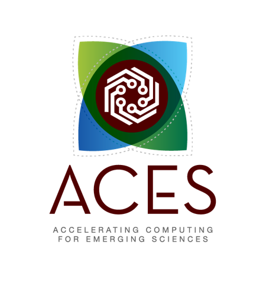
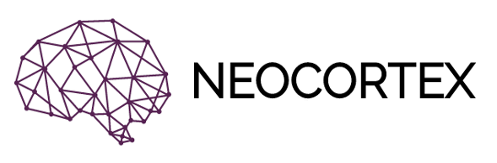
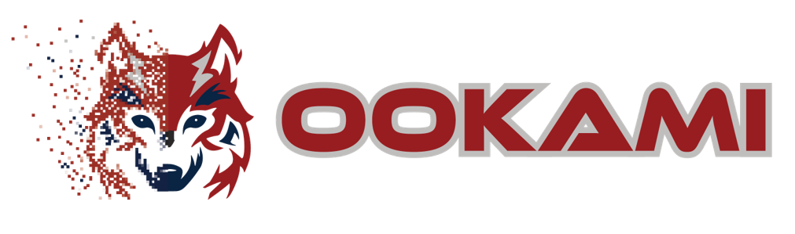
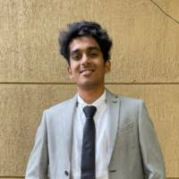

# Cybertraining:

!!! note archive "Archived page"
    Ookami reached end of life at the end of 2025. This is a copy of its website, kept for reference; some original material is not included.

**ByteBoost 2.0**

### PI Team

Dave Carlson (Stony Brook University)

Paola Buitrago (Pittsburgh Supercomputing Center/Carnegie Mellon University)

Dhruva Chakravorty (Texas A&M University)

### **Overview**

We are thrilled to announce the second iteration of the **ByteBoost** Cybertraining Program, **ByteBoost 2.0**. This groundbreaking program is driven by the imperative to enhance researchers' proficiency and productivity when navigating cutting-edge, specialized computing technologies. By offering experiential learning opportunities on modern computing technologies, **ByteBoost 2.0** will empower researchers to make the best computing choices in the ever-changing landscape of computational technology. This initiative will focus on supporting researchers to use the technologies multiple computing testbed platforms. **ByteBoost 2.0** is supported by NSF awards OAC-2519578, OAC-2519579, and OAC-2519580.

Learn more about [ByteBoost 1.0](https://figshare.com/articles/poster/ByteBoost_Cybertraining_-_A_groundbreaking_cybertraining_program_designed_to_enhance_research_utilizing_cutting-edge_specialized_computing_technologies/26662021/1?file=48495727)

### Program Objectives:

- **Facilitate Seamless Research:** Elevate the ease and productivity of researchers working with cutting-edge computing technologies

- **Community Growth:** Foster a community of computational researchers who are adept at working with the newest technologies and porting applications.
- **Optimal Testbed Usage:** Ensure the proper and efficient utilization of testbeds, a critical component in the recent surge of data-enabled science and engineering.

### Target Audience:

- Early career researchers (graduate students, postdoctoral associates, and Assistant Professors) from all fields of computationally inclined research.
- Requirements: Familiarity with linux and the command line

### Program Highlights:

- **Multiple Webinars:** Engage with leaders and experts in the field through a series of hour-long webinars that delve into the intricacies of cutting-edge computing technologies. During the webinars, experts will provide an overview of the computing technologies and software applications available on these three testbeds.
- **'Bring your own science (BYOS)' Workshop:** Immerse yourself in an intensive week-long workshop designed to provide hands-on experience with the featured testbed architectures. Participants will gain valuable insights into the complexities and nuances of these technologies. They will work in teams to address capstone challenges (capstone projects). As an outcome, participants will decide on which of the testbed platforms they will implement their capstone projects.
- In Fall 2026, participants will have the opportunity to present their work to a broad audience.

### **Training Platforms used for ByteBoost 1.0:**

|  |  |
| --- | --- |
| [**ACES**](https://hprc.tamu.edu/aces/) is an innovative composable hardware platform that helps accelerate transformative changes in multiple scientific research areas. ACES offers a rich accelerator testbed consisting of five different cutting edge accelerators including NVIDIA and Intel Ponte Vecchio GPUs (Graphics Processing Units) and Graphcore IPUs (Intelligence Processing Units). These accelerators enable researchers to scale up a variety of simulation and machine learning tasks, while the proximity of multiple accelerator types encourages performance benchmarking for informative comparisons. |  |
| **[Neocortex](https://www.cmu.edu/psc/aibd/neocortex/)** is an innovative resource that targets the acceleration of AI-powered scientific discovery by reducing the time for deep learning training and integrating machine learning into analytic and simulation workflows. Neocortex features two Cerebras CS-2 systems which offer cluster-scale performance on a single chip. These accelerators are optimized to accommodate the tensor computations that are at the heart of contemporary machine learning algorithms. |  |
| **[Ookami](README.md)** is an innovative resource that accelerates discovery in high performance and big data research areas. Ookami provides researchers with access to the A64FX processor developed by Riken and Fujitsu. By focusing on crucial architectural details, the ARM-based, multi-core, 512-bit SIMD-vector processor with ultrahigh-bandwidth memory promises to retain familiar and successful programming models while achieving very high performance for a wide range of applications. |  |

### **Key Dates & Participation 2026:**

**Campus Champions call:** Tues 1/20/2026, 3 PM ET

**Webinar schedule**

Wed 2/11/2026, 2 - 3pm ET, **Overview of the Byteboost program**
Wed 2/25/2026, 2 - 3pm ET, **ACES**
Wed 3/11/2026, 2 - 3pm ET, **Neocortex**
Wed 3/25/2026, 2 - 3pm ET, **Voyager & Cosmos**
Wed 4/8/2026, 2 - 3pm ET, **Argonne National Lab**
Wed 4/22/2026, 2 - 3pm ET, **Stony Brook - AMA27**

[Register here](https://cmu.zoom.us/meeting/register/5WBoM8vvSsWRsMN89xoAiA)

**Application window for the 2026 workshop**

- Application window for the 2026 workshop is open from Wed, Feb 18th - Friday, April 24th

[View the CFP](https://easychair.org/cfp/ByteBoost26)

**In-person workshop**

- 8/3 - 8/7/2026 at the Pittsburgh Supercomputing Center in Pittsburgh, Pennsylvania

### What do prior ByteBoost participants say about the program?

|  |  |
| --- | --- |
| **Atharva Joshi, University of Southern California**  Attending the ByteBoost HPC workshop was a transformative experience for me. Before this workshop, my knowledge of Machine Learning was largely theoretical, and my focus was building consumer-facing ML applications. However, this workshop opened the door to a new and exciting domain of ML Systems.  Through hands-on access to cutting-edge hardware accelerators such as Cerebras (that are not easily accessible to students), I had the opportunity to benchmark Flash Attention on Nvidia GPUs and compare its performance against Cerebras CS2 for BERT LLM pre-training. This project deepened my understanding of how ML algorithms scale, leveraging parallel processing.  The insights I gained from this experience led me to explore ML systems more deeply. I now have a much stronger appreciation for the role of hardware in optimizing ML performance and how system-level innovations drive real-world AI applications. I’m grateful to ByteBoost for providing this invaluable learning opportunity and helping shape my technical journey. |  |
| **Omid Asudeh, University of Utah**  My experience with ByteBoost was incredibly valuable. I explored sparse matrix operations in AI learning, focusing on optimizing computations for large-scale models. The program provided me with the resources and mentorship to deploy my codes on Ookami, allowing me to test its performance on sparse matrix data. This experience deepened my understanding of high-performance computing and its applications in AI. ByteBoost not only enhanced my technical skills but also connected me with a network of researchers and professionals who share a passion for advancing AI efficiency. I highly recommend it to anyone looking to push the boundaries of computing and machine learning. |  |

**Contact**:david.carlson@stonybrook.edu

ByteBoost 2.0 is funded by the following National Science Foundation Cybertraining awards: [2519578](https://www.nsf.gov/awardsearch/show-award?AWD_ID=2519578), [2519579](https://www.nsf.gov/awardsearch/show-award?AWD_ID=2519579), and [2519580](https://www.nsf.gov/awardsearch/show-award?AWD_ID=2519580).

Archived from `https://www.stonybrook.edu/commcms/ookami/ByteBoost.php`, retrieved November 5, 2026.
{: .archive-credit }
