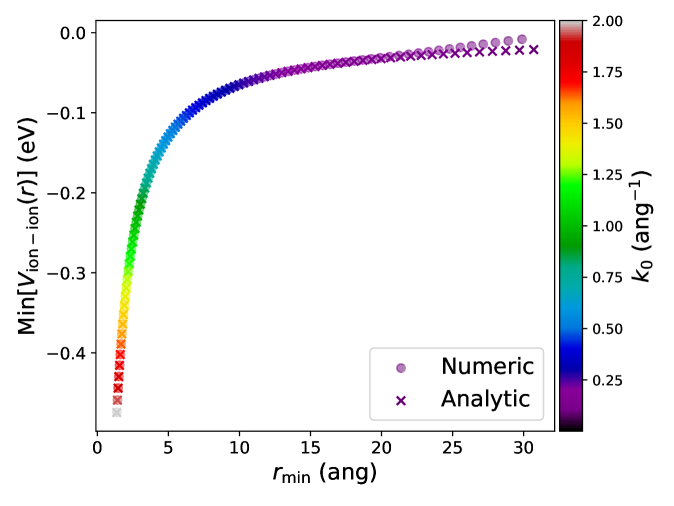

# The Dielectric Dance Party: When Charges Break the Rules

!!! note archive "Archived page"
    Ookami reached end of life at the end of 2025. This is a copy of its website, kept for reference; some original material is not included.

Picture a dance floor where the usual rules of attraction and repulsion go haywire. In a solvent (like water) like-charged ions (normally wallflowers) decide to dance together, while oppositely charged ions (the usual dance partners) awkwardly avoid each other. This surprising behavior is due to the solvent's quirky non-local dielectric response function. While this had previously only been linked to a well known phenomenon called “overscreening”, researchers from Stony Brook University and the Universidad Autónoma de Madrid have shown that this behavior is always expected whenever a solvent has a sufficiently strong dielectric response.

By mixing simulations and theoretical models, the authors of the work have uncovered this bizarre electrostatic party, shedding light on solvation processes and other electrostatic phenomena in electrolyte solutions. This phenomenon even parallels electron-electron interactions in metals, proving just how universal these strange interactions can be.

Figure: The bound-state depth for dressed-dressed interactions in the TF approximation as a function of its location, colored by the screening parameter . The bound state depth gets weaker with increasing screening length, and the position of the minimum shifts to farther separations. The numerical results agree well with the analytical expressions. [1]

Read the [full paper](https://journals.aps.org/prresearch/abstract/10.1103/PhysRevResearch.6.033095)

[1] Anti-Coulomb ion-ion interactions: a theoretical and computational study; Wills, Mannino, Losada, Mayo, Soler, Marivi Fernández-Serra; Physical Review Research; Vol. 6, Iss. 3 — July - September 2024

Archived from `https://www.stonybrook.edu/commcms/ookami/science_stories/Fernandez-Serra`, retrieved November 5, 2026.
{: .archive-credit }
