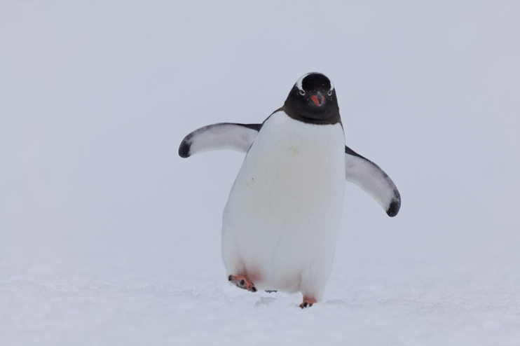
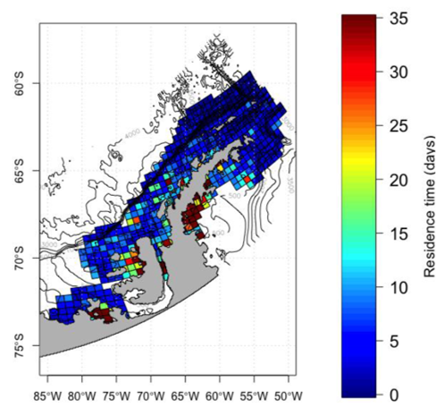

# Penguins and their diets

!!! note archive "Archived page"
    Ookami reached end of life at the end of 2025. This is a copy of its website, kept for reference; some original material is not included.

lynchlab.com

Penguins … cute, clumsy, but also affected by krill fishery and climate warming.

A team at Stony Brook University studies the connectivity of antarctic krill *(Euphausia superba*) and its impact on *Pygoscelis Penguin*. Antarctic krill is the main diet of these penguins and its presence or absence plays a crucial role for the penguins. The krill populations are highly dynamic on both spatial and temporal scales, with cycles of abundance peaking approximately every 4–6 years. It’s impacted by many factors, such as the extent of sea ice, the availability of phytoplankton, and krill fishery.

Figure: Mean residence times (days) over the simulated period (November 2008 - February 2009) along the West Antarctic Peninsula.

The researchers use computational models to simulate the movement of krill around the Western Antarctic Peninsula. Four whole astral summers were considered in the model.

The study revealed that krill populations are isolated from each other but connectivity metrics did not correlate with penguin colony sizes. This is mainly due to the geographic features of the investigated islands. Rare exceptions to these patterns were observed across all four seasons simulated.

The simulations explain why certain penguin colonies are bigger than others. Regions with bigger krill populations also attract more penguins due to the easier availability of food.

Their study was published in a paper titled **[Quantifying Antarctic krill connectivity across the West Antarctic Peninsula and its role in large-scale Pygoscelis penguin population dynamics](https://digitalcommons.odu.edu/ccpo_pubs/383/)**
Several other papers are currently in preparation.

Katherine Gallagher, a biological oceanographer, NSF Office of Polar Programs Postdoctoral Research Fellow and the PI of this NSF funded project, and her team utilized Ookami for their studies. Their code, Regional Ocean Modeling System (ROMS), was successfully ported and tuned to run efficentlt on the Ookami system.

This research was featured in an [**ACCESS science story**](https://access-ci.org/the-best-dressed-dinner-guest/).

Archived from `https://www.stonybrook.edu/commcms/ookami/science_stories/Gallagher`, retrieved November 5, 2026.
{: .archive-credit }
