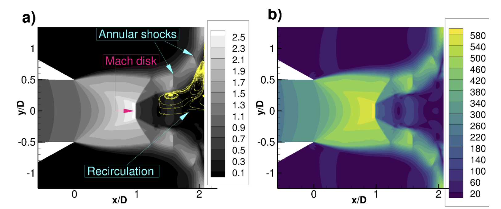

# Cracking the Code of Supersonic Jets: The Science Behind Jet Expansion and Turbulence
                        in Extreme Conditions

!!! note archive "Archived page"
    Ookami reached end of life at the end of 2025. This is a copy of its website, kept for reference; some original material is not included.

In the world of aerospace research, a team of engineers embarked on a mission to understand the complex behavior of supersonic jets, particularly how they expand and interact under different nozzle pressure ratios (NPRs) and nozzle temperature ratios (NTRs). Using high-powered simulations, they explored the intricate dance of shockwaves and expansion fans that occur when jets blast out into open air or collide with surfaces.

Figure: Flow field structure of the impinging jet with a NPR of 4.03 and a NTR of 1.00 and h/D=2.08 where h
the normal distance from the nozzle lip to the wall and D is the nozzle diameter: a) Mach number, b) velocity
magnitude (m/s). [1]

As the jets expanded into low ambient pressures, the usual rules of fluid dynamics started to falter. The jet flow became rarefied, causing air molecules to behave unpredictably. This led to the appearance of wobbly Mach disks and intensified turbulence closer to the nozzle as temperatures rose. The team discovered that traditional fluid dynamics models couldn’t fully capture these phenomena, especially at very low pressures. This realization drove them to develop a hybrid approach, blending conventional fluid models with kinetic theory to get a more accurate picture.

By the end of their study, the team had created a framework that not only shed light on these strange jet behaviors but also provided essential insights for designing spacecraft and other high-tech aerospace applications. Their work ensures that even in extreme conditions, supersonic jets will perform reliably. So, the next time you see a jet scream across the sky, know that behind that roar lies a deep well of science, keeping everything in check.

Read the full [publication](https://arc.aiaa.org/doi/abs/10.2514/6.2024-4086)

[1] Dynamics of Jet Expansion and Impingement Across a Spectrum of Nozzle Pressure Ratios; Ozgur Tumuklu; AIAA 2024-4086; <https://arc.aiaa.org/doi/abs/10.2514/6.2024-4086>

Archived from `https://www.stonybrook.edu/commcms/ookami/science_stories/%20Tumuklu`, retrieved November 5, 2026.
{: .archive-credit }
