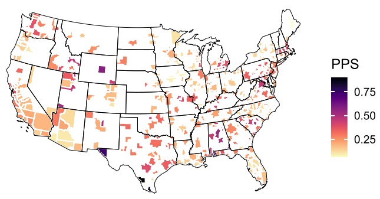

# The correlation between where we spend our time and political segregation

!!! note archive "Archived page"
    Ookami reached end of life at the end of 2025. This is a copy of its website, kept for reference; some original material is not included.

A collaborativ team of researchers at Stony Brook University and New York University investigates how human mobility patterns are associated with experienced partisan segregation in US metropolitan areas.

Figure: The geographic variation of place level partisan segregation (PPS). [1]

Using Ookami, the team analyzed anonymous GPS movement data for over 5 million points of interest. The measurement of partisan segregation is done in two ways: (i) place-level partisan segregation, which is based on the partisan composition of daily visitors, and (ii) community-level experienced partisan segregation, which is based on the segregation level of places visited by its residents.
The analysis showed partisan segregation in places varies across different geographic areas, locations types, and time periods. Moreover, partisan segregation is distinct from experienced segregation by race and income. The researchers found out that partisan segregation individuals experience is relatively lower when they visit places beyond their residential areas, but partisan segregation in residential space and activity space is strongly correlated.

You can read more about this research in the publication [**Human mobility patterns are associated with experienced partisan segregation in US metropolitan areas**](https://www.nature.com/articles/s41598-023-36946-z).

[1] Zhang, Y., Cheng, S., Li, Z. *,* Jiang W.*;* Human mobility patterns are associated with experienced partisan segregation in US metropolitan areas. *Sci Rep* 13, 9768 (2023).

Archived from `https://www.stonybrook.edu/commcms/ookami/science_stories/Zhang`, retrieved November 5, 2026.
{: .archive-credit }
