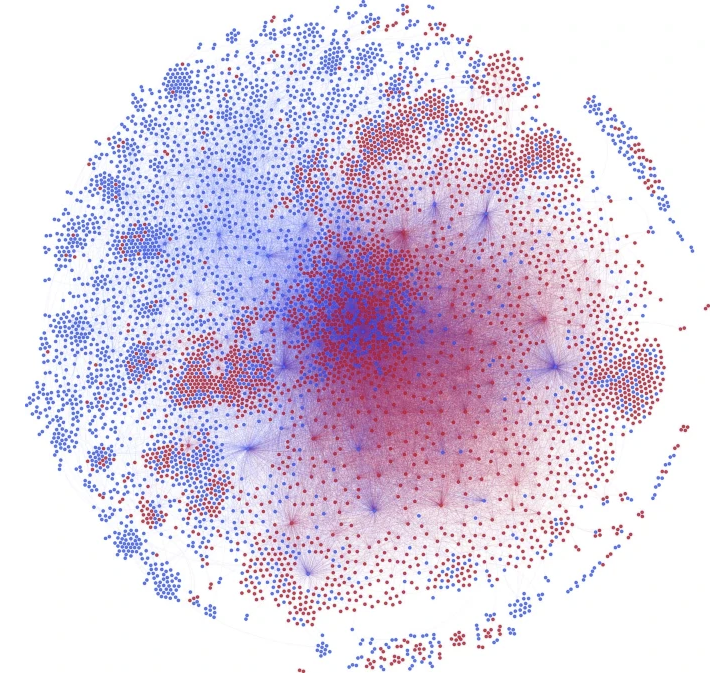

# Using social media to analyze Sinophobia during the pandemic

!!! note archive "Archived page"
    Ookami reached end of life at the end of 2025. This is a copy of its website, kept for reference; some original material is not included.

The outbreak of the COVID-19 pandemic led to a global surge in anti-Chinese sentiment. To further examine this, researchers analyzed over 25 million of Chinese tweets (December 2019 to April 2021).

Figure: Nodes are pro- (Red) and anti- (Blue) China Twitter users and edges indicate at least 10 conversations between two nodes.

©[Zhang, Lin, Wang, Fan](https://www.nature.com/articles/s41599-023-01959-6)

The authors analyzed tweets and discussions to understand how these communities responded to and expressed their views about the pandemic, particularly in relation to China and its people. The paper shed light on the emergence of negative sentiment and discriminatory attitudes within these communities during the early stages of the pandemic. The analysis provides insights into the impact of social media on the propagation of such sentiments and contribute to the broader understanding of the social dynamics surrounding the pandemic.

The researchers used multi-modal supervised and unsupervised machine learning tools. This work was the first to systematically examine the dynamics of sentiments in Chinese language communities on a major Western social media platform

The full paper 'Sinophobia was popular in Chinese language communities on Twitter during the early COVID-19 pandemic' by Zhang, Lin, Wang & Fan is published in Humanities and Social Science Communications 10, 488 (2023). [https://doi.org/10.1057/s41599-023-01959-6](https://www.nature.com/articles/s41599-023-01959-6)

Ookami was used for this research.

Archived from `https://www.stonybrook.edu/commcms/ookami/science_stories/Zhang2`, retrieved November 5, 2026.
{: .archive-credit }
