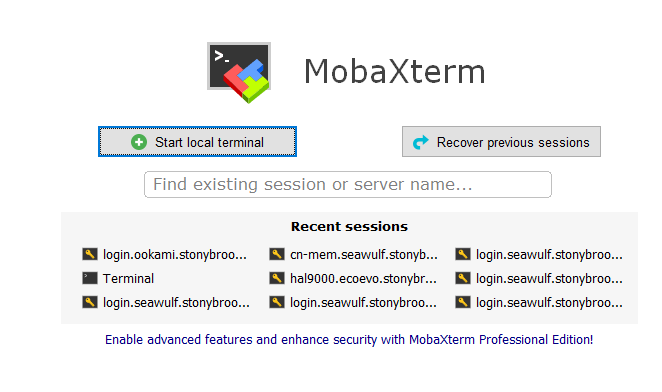
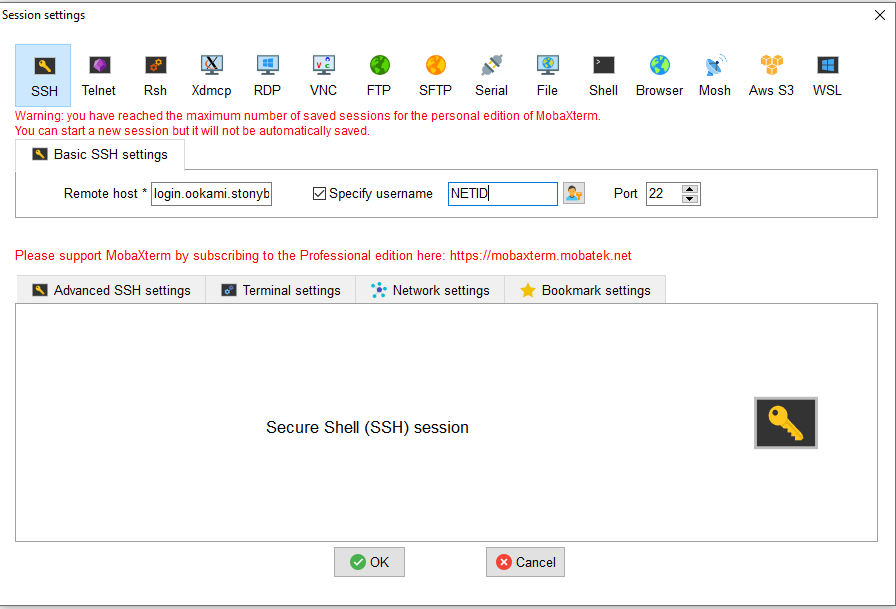
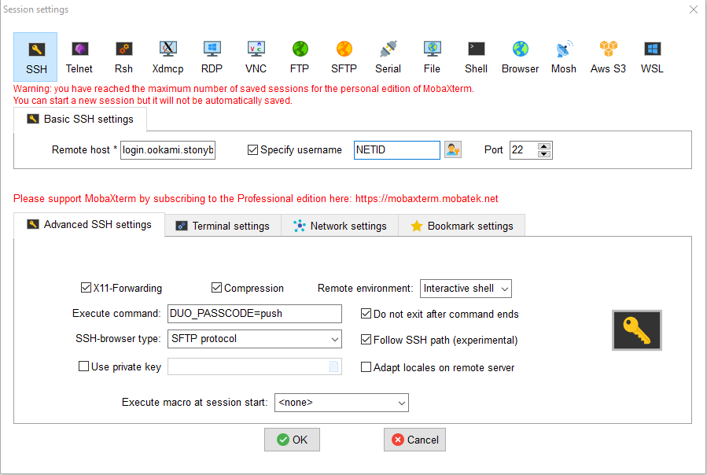

# How do I log into Ookami?

!!! note archive "Archived page"
    Ookami reached end of life at the end of 2025. This is a copy of its website, kept for reference; some original material is not included.

Please read about the [login node](understanding_login_nodes.md) before using the system.

You will also need to set up DUO Authentication before using the system if you have not done so already.

## Logging In

You may access the Ookami login nodes using the command line from any modern workstation via secure shell (SSH).

### Linux and MacOS

In Linux of MacOSX, simply open your favorite terminal program and SSH to the Ookami login node with X11 enabled by issuing the command:

```
ssh -X NetID@login.ookami.stonybrook.edu
```

### Windows

[MobaXterm Home Edition](https://mobaxterm.mobatek.net/download.html) may be freely downloaded and installed by Ookami users, as long as multiple individuals are not using the same installation. MobaXterm comes with its own X server, so no additional utilities are required to enable X11 tunneling. Login with Ookami by clicking the "New Session" button and provide the hostname (**login.ookami.stonybrook.edu**) and your username.





## DUO Authentication

When you attempt to access the login node by following the above methods, you will receive a notification on your DUO-enrolled device. To finish logging in, please view the DUO notification and approve the log in attempt by selecting the green check mark.

If you have not already setup DUO, please refer to our FAQ page on enrolling in DUO first.

### DUO_PASSCODE

You can make the DUO authentication process a tiny bit quicker if you use the DUO_PASSCODE environment variable. This will allow you to pre-select the type of DUO authentication you want to use instead of manually selecting it every time. So if you always want a DUO push to your phone, you can set DUO_PASSCODE to push, and you won't have to type '1' every time you log in. Also, this variable can sometimes fix issues with SCP/SFTP and other software used for file transfers.

Here are the possible values for the DUO_PASSCODE variable:

|  |  |
| --- | --- |
| `push` | Push a login request to your device. |
| `phone` | Authenticate via phone callback. |
| `sms` | Get a new batch of SMS passcodes. Your login attempt fails — log in again with one of your new passcodes. |
| A numeric passcode | Log in using a passcode, either generated with Duo Mobile, sent via SMS, generated by your hardware token, or provided by an administrator. |

You can also add a number to the end of these factor names if you have more than one device registered. For example, push2 will send a login request to your second phone, phone3 will call your third phone, etc.

You can set the DUO_PASSCODE variable by appending a line to your Ookami ~/.bashrc like so:

```
echo 'export DUO_PASSCODE=push' >> ~/.bashrc
```

If this does not work, please check the caveat on our [DUO and LD_LIBRARY_PATH](https://it.stonybrook.edu/help/kb/duo-and-ldlibrarypath) page. You may need to change the order of commands in your .bashrc file.

Additionally, please do not set DUO_PASSCODE to sms in your .bashrc or you will be unable to log in to Ookami unless you connect through the VPN (see "VPN Access" below). The sms method of authentication will send you sms codes, but you must then set the value of DUO_PASSCODE to equal one of your one time use codes which you can't do if it's set in your .bashrc on Ookami. You can set it on the client side by modifying your MobaXTerm session configuration like so:



On Mac and Linux, you can modify your ~/.ssh/config file to include this setting:

```
Host *.ookami.stonybrook.edu
SendEnv DUO_PASSCODE
```

And then set DUO_PASSCODE from your terminal before you log in:

```
export DUO_PASSCODE=123456
```

## VPN Access

Depending on your workflow and the software you use, you may find yourself frequently needing to authenticate with DUO. If this gets to be bothersome, consider connecting to Ookami through Stony Brook's VPN. Information about requesting access and connecting to Stony Brook's VPN can be found [here](https://it.stonybrook.edu/services/vpn). You will need to authenticate once with DUO in order to get connected to the VPN, and then all connections made to Ookami through the VPN will not require DUO.

You may notice that the GlobalProtect VPN software refuses to close when you're done using it. GlobalProtect is designed as an enterprise-level application, primarily for use by large corporations or research institutions. Keeping the application running at all times is one of the ways that GlobalProtect ensures that all information across the network is kept secure. However, this can feel invasive when constantly running on your personal computer, so here's how to quit the program:

### MacOS

Open Terminal and run this command to quit GlobalProtect:

```
launchctl unload /Library/LaunchAgents/com.paloaltonetworks.gp.pangp*
```

Then this one to reopen it:

```
launchctl load /Library/LaunchAgents/com.paloaltonetworks.gp.pangp*
```

You can add some aliases to your ~/.bashrc to make this even easier

```
echo "alias loadgp='launchctl load /Library/LaunchAgents/com.paloaltonetworks.gp.pang*'" >> ~/.bashrc
echo "alias unloadgp='launchctl unload /Library/LaunchAgents/com.paloaltonetworks.gp.pang*'" >> ~/.bashrc
```

Now whenever you open a new terminal session, you can just type loadgp or unloadgp to open and close GlobalProtect.

### Windows

GlobalProtect client will restart if you attempt to kill it via Task Manager. Instead, click on Windows and type Services. Open the Services desktop app, look for PanGPS, and stop the service. Start up the service again when you want to reconnect to the VPN.

## Setting Up Passwordless Access

Additionally, passwordless access is easily enabled. See [How do I set up passwordless SSH?](https://it.stonybrook.edu/help/kb/passwordless-ssh) for a short tutorial.

## Learning About the Login Nodes

Whenever you log into Ookami, you will be interacting with the Login Node. To understand what this is, see [What is a login node?](understanding_login_nodes.md)

[SUBMIT A TICKET](https://iacs.supportsystem.com)

Archived from `https://www.stonybrook.edu/commcms/ookami/support/faq/logging-into-ookami.php`, retrieved November 5, 2026.
{: .archive-credit }
