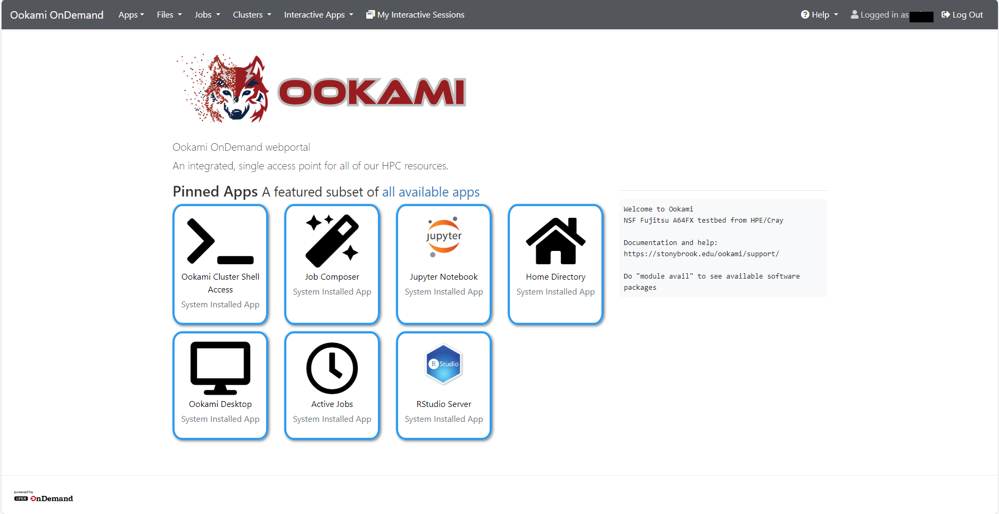
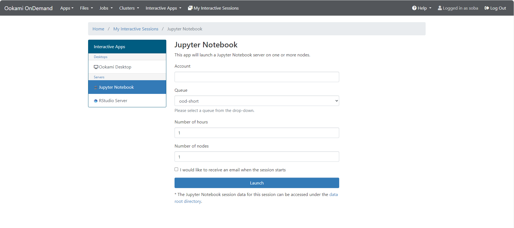
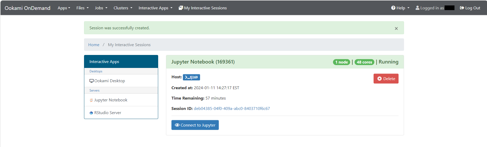
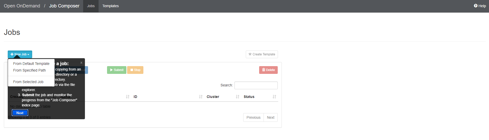
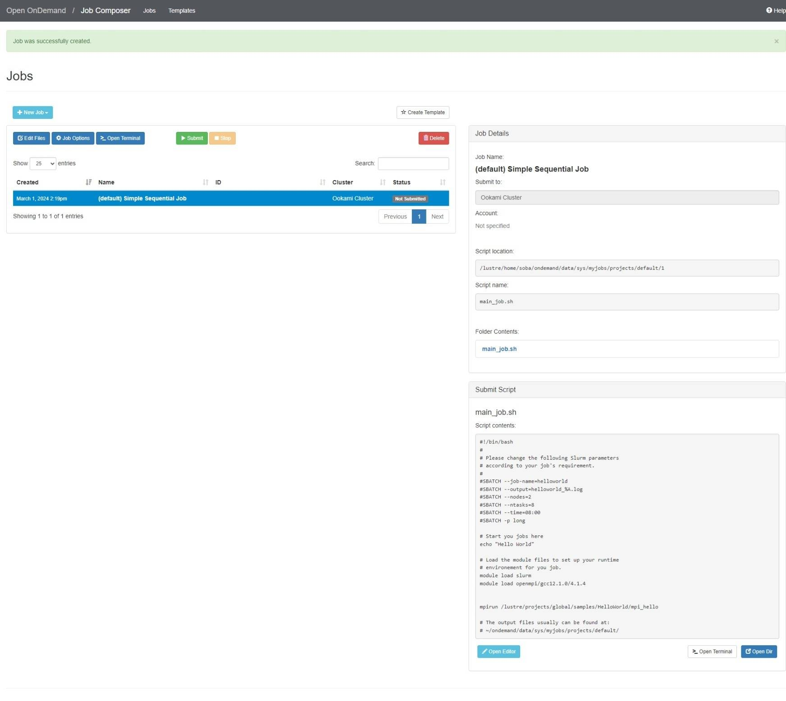
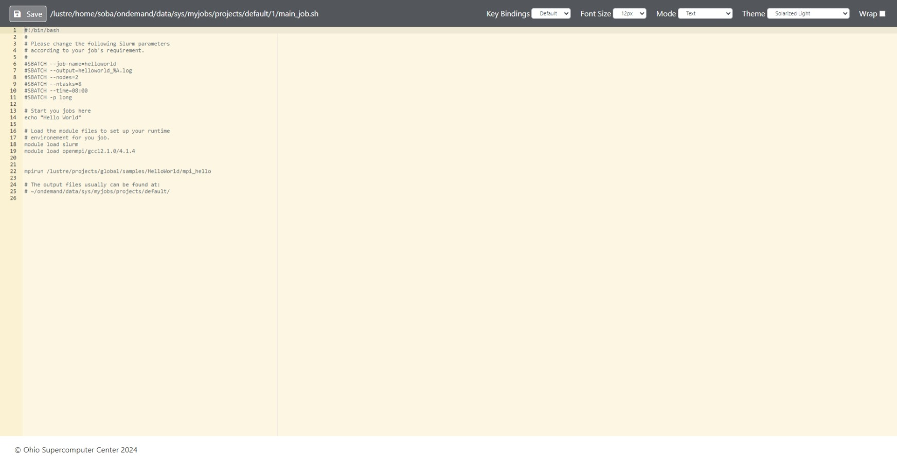
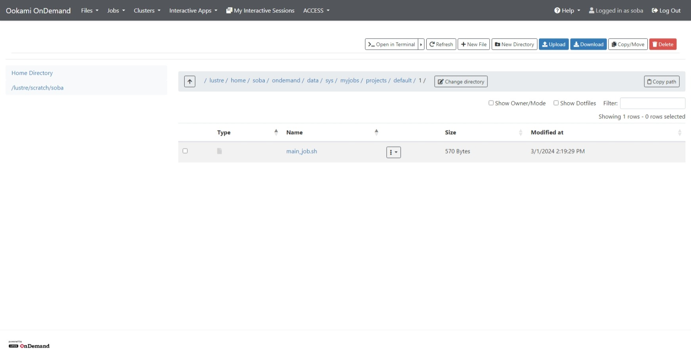

# How Do I Access Ookami with Open OnDemand?

!!! note archive "Archived page"
    Ookami reached end of life at the end of 2025. This is a copy of its website, kept for reference; some original material is not included.

## Introduction

This guide assumes that you already have access to Ookami and that you are able to log in. It serves to get you acquainted with the Open OnDemand platform you will be interacting with once you log in.
The Ookami OnDemand can be accessed from here

## Open OnDemand

Via Open OnDemand, Ookami is now available from your browser allowing you to access Ookami even from your phone or tablet. There are no needs for SSH set up or SSH tunneling for Jupyter notebooks and RStudio Servers. Open OnDemand also allows users to access desktops on Ookami nodes in interactive sessions, instead of navigating through the text-only platforms.

## Logging In

Use your NetID as your username and log in with your NetID Password. Once you enter your credentials, you may be directed to DUO authentication.
The Division of Information Technology offers the [DUO service page](https://it.stonybrook.edu/services/duo-security-two-step-login), which can be referred to for additional information regarding this service.

## Ookami OnDemand

Once logged in, your screen will show the dashboard:



To use any apps pinned on the portal, simply click on the icons and follow the instructions shown on the directed pages.
Below are walk-through of how to utilize some of the apps on Ookami OnDemand.

### Jupyter Notebook

To use Jupyter Notebook, simply click on the icon on the main page or click on **Interactive Apps** on the top navigation bar and select **Jupyter Notebook** under **Servers**. You will be directed to the setting page for Jupyter Notebook.


To set up the notebook, choose an appropriate queue and adjust the number of requested hours for the session. Account field can be left blank unless there is a different SLURM account you wish to submit the job under. Number of nodes should be kept to 1, unless using parallelization requiring more. If the waiting time is long, you can enable email notification. An email will be sent to your Stony Brook account or the email associated with your NetID once the session is ready.
Please keep in mind that the more resources you request, the longer you might have to wait in queue before having resources allocated to you.

Jupyter notebook will only have access to your home directory. If you are interested in accessing files outside of the home directory, please create a symlink from that directory to home directory. For example, to create a symlink to your scratch directory, please run the following, replacing NetID with your NetID:

```
ln -s /lustre/scratch/NetID /lustre/home/NetID
```

A symlink with your NetID as the name will be created in your home directory. More information on **ln** command can be found by running the following on your command line: -ln --help

Once you hit **Launch** at the bottom of the page, you will be redirected to a status page of your allocation. It will generally be **Queued**, **Starting**, or **Running**.

Once your job allocated a node, the status on screen will update to **Starting**. Once it is ready for use, it will update to **Running** and a button, **Connect to Jupyter**, will appear as shown below. Click on it to access Jupyter Notebook. From here, using Jupyter Notebook is the same as on any other platform.


Once you are done with the session, close the tab with Jupyter and click on **Delete** on the status page to kill the job. Then, confirm.

The same steps can be applied to RStudio Server.

### JOB COMPOSER

To run and submit an automated or non-interactive job, Job Composer can be used.
To access Job Composer, click on the icon on Dashboard or select **Job Composer** under **Jobs** on the top navigation bar. You will be directed to a Jobs setting page:



If this is your first time accessing this page, instructions to assist you will appear, as shown above. Click on **New Job** at the top left corner and select one of the options. If you already have a job script and a directory where all the necessary files are stored, select **From Specified Path**. Provide the source path and hit **Save**. The optional information can be edited by clicking on **Job Options** once you return to the **Job Composer** main page. By selecting **From Default Template**, a new job utilizing MPI will be created on the list, and a setting column will shown as below:


To change the content of the script file, click on the file name of the script under **Folder Contents** or the **Open Editor** at the bottom of the page. A text editor will open in a new tab as shown below. Make changes to the file as you would format any job script. Settings such as text size, theme, and mode can be changed on the navigation bar on the top right. Once you are done editing, click on the **Save** button at the top left to save. The changes will be saved and reflected on the applicable files stored on Ookami.


There are two ways to edit the directory and its contents from the **Job Composer**. You can click on the white **Open Terminal** button at the bottom right of the page to edit the directory from a terminal. A new tab with a terminal with the initial directory as the specified directory for your job will open. Please note that you may need to authorize a DUO notification before accessing.
If you prefer a graphic interface, click on the blue **Edit Files** button at the top left of the page or the blue **Open Dir** button also at the bottom right of the page. A new tab will open as below:


From here, you can manipulate the contents of the directory by creating new files and directories, uploading and downloading files to and from the machine you are connecting to OnDemand with, and selecting a file to copy or move from the directory. To access this page, you can also click on the **Home Directory** icon on the Dashboard or click on **Home Directory** under **Files** on the top navigation bar. This page can be opened for any directory in your Ookami account by changing the source path at the clicking on the **Change Directory** button in the middle of the page.

Once the directory and the script is ready to go, go back to the **Job Composer** main page and click **Submit** at the middle of the page. To pause a job, click on **Stop**. To delete a job from the job list, click on **Delete.**

### Running an Interactive Job

To run an interactive job aside from Jupyter Notebook and RStudio Server, Ookami Desktop or Ookami Cluster Shell Access can be used.

##### Ookami Desktop

To access the Desktop version of Ookami nodes, click on the icon on Dashboard or select **Ookami Desktop** under **Interactive Apps** on the top navigation bar. You will be directed to a Ookami Desktop setting page:


To set up your job, choose an appropriate queue and Desktop Environment for the job and adjust the number of hours you would like the session to last for. Account field can be left blank, unless there is a different SLURM account you wish to submit the job under. Number of nodes should be kept to 1, unless utilizing parallelization requiring more. If the waiting time is long, you can enable email notification. An email will be sent to your Stony Brook account or the email associated with your NetID once the session is ready.

Please keep in mind that the more resources you request, the longer you might have to wait in queue before having resources allocated to you.

Once you click on **Launch**, the page will refresh to show three general status: **Queued**, **Starting**, and **Running**.

Once the job is running, a page like below will show. From here, you can launch the Ookami Desktop, adjust compression and image quality, and retrieve view only share-able link.


With the share-able link, anyone with an Ookami account can view your Ookami desktop from their browser and copy contents shown.

Once you **Launch Ookami Desktop**, you may be prompted to enter your password under your name. Simply type in your NetID password to unlock. Then, a new tab showing a Linux Desktop where you can interact with will open.

To access the command line, double click on the black icon at the bottom of the page or select **Terminal Emulator** under **Applications** on the top navigation bar.

When you are done, close the tab, click on **delete** on the status page, and confirm on the pop-up window.

##### Ookami Cluster Shell Access

To access the terminal or shell, use the **Ookami Cluster Shell Access** by clicking on the icon on the main page or clicking on **Clusters** on the top navigation bar and selecting **Ookami Cluster Shell Access**.

You will be directed to a shell, where you will be prompted for your DUO authentication. After approving the prompt, you will be able to use the terminal as if you are accessing Ookami from your terminal via SSH. You will be able to request interactive job sessions as you would do outside of Open OnDemand.

Once you are done, simply close the tab.

More details and official documentation on Open OnDemand can be found [here](https://openondemand.org/).

[SUBMIT A TICKET](https://iacs.supportsystem.com/)

Archived from `https://www.stonybrook.edu/commcms/ookami/support/faq/open_ondemand.php`, retrieved November 5, 2026.
{: .archive-credit }
