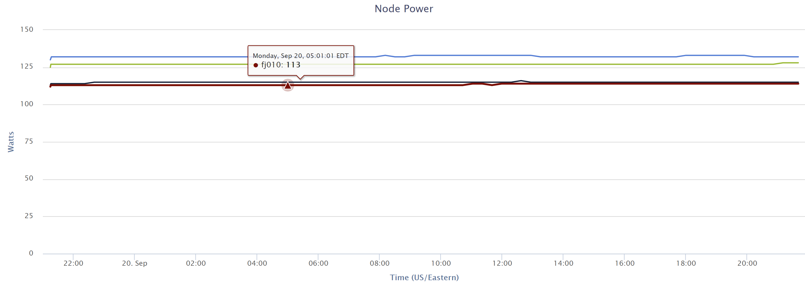

# Monitoring Power Usage

!!! note archive "Archived page"
    Ookami reached end of life at the end of 2025. This is a copy of its website, kept for reference; some original material is not included.

The easiest way to monitor the power usage of your job is using XDMoD.
[Here](xdmod.md) you can find more general information on XDMoD.

Seeing the power consumption of a specific job:

- Log into XDMoD
- Navigate to "Job Viewer"
- Select your job based on the job number
- Open the "Timeseries" folder
- Select "Node Power"

This will plot the power consumption for each node the job was running on.

Note that there is a time delay of a few hours between jobs finishing and showing up in XDMoD .



Alternatively, one can measure the power usage using the EA power counters.
[Here](https://gitlab.com/arm-hpc/training/arm-sve-tools/-/tree/master/06_A64FX/03_energy) you can find an example for that provided by Arm. Note that for this the system-wide collection has to be disabled by running the /var/lib/pcp/pmdas/perfevent/perfalloc [command](https://man7.org/linux/man-pages/man1/perfalloc.1.html). Hence, you can use it like this:

```
 [esiegmann@fj005 03_energy]$ /var/lib/pcp/pmdas/perfevent/perfalloc &
[1] 2289550

[esiegmann@fj005 03_energy]$ make run-perf
# r11:   CPU_CYCLES: This event counts every cycle
# r1e0:  EA_CORE: This event counts energy consumption per cycle of core.
# r3e0:  EA_L2: This event counts energy consumption per cycle of L2 cache.
#        It counts all events caused in measured CMG regardless of measured PE.
# r3e8:  EA_MEMORY: This event counts energy consumption per cycle of CMG local memory.
#        It counts all events caused in measured CMG regardless of measured PE.
perf stat -x\; -o neon.perf -e duration_time,r11,r1e0,r3e0,r3e8 ./hacc_arm_neon.exe 1000
Maximum OpenMP Threads: 48
Iterations: 1000
Gravity Short-Range-Force Kernel (5th Order): 12823.6 -444.108 -645.349: 1.54061 s
perf stat -x\; -o sve.perf -e duration_time,r11,r1e0,r3e0,r3e8 ./hacc_arm_sve.exe 1000
Maximum OpenMP Threads: 48
Iterations: 1000
Gravity Short-Range-Force Kernel (5th Order): 12823.6 -444.108 -645.349: 1.83943 s
./postproc_perf_energy.py neon.perf -c 8.04 -l 32.8 -m 271
Elapsed Time: 1.28975e+08 ns
Core freq: 1.79841 GHz
Per-core power: 1.82047 Watt
Per-CMG L2 power: 1.73771 Watt
Per-CMG HBM power: 1.85489 Watt
./postproc_perf_energy.py sve.perf -c 8.04 -l 32.8 -m 271
Elapsed Time: 1.1831e+08 ns
Core freq: 1.7988 GHz
Per-core power: 1.8502 Watt
Per-CMG L2 power: 1.74527 Watt
Per-CMG HBM power: 1.8578 Watt
```

Archived from `https://www.stonybrook.edu/commcms/ookami/support/faq/power_usage.php`, retrieved November 5, 2026.
{: .archive-credit }
