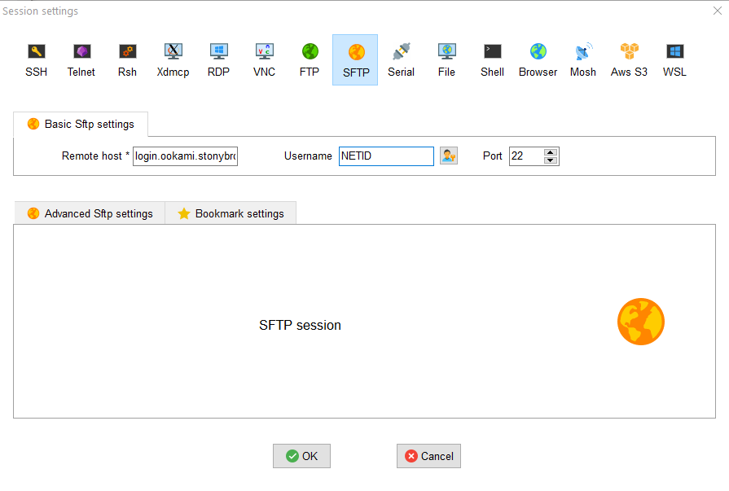
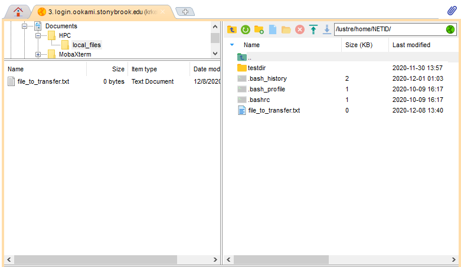
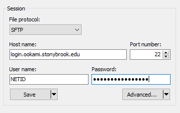

# Transferring Files to and from Ookami

!!! note archive "Archived page"
    Ookami reached end of life at the end of 2025. This is a copy of its website, kept for reference; some original material is not included.

## DUO Authentication

Just like when you log in to Ookami, transferring files requires Two-Factor Authentication via DUO. However, some file transferring software will initiate many separate connections to Ookami, which can generate lots of DUO pushes and lock your DUO account. If this happens, you'll receive an email saying that your account is locked, and you must reply to confirm that it should be unlocked. To avoid this, connect to Stony Brook's VPN before making any connections to Ookami. Please see [DoIT's VPN Homepage](https://it.stonybrook.edu/services/vpn) for more information on requesting a VPN account and setting up a connection. You'll need to authenticate once with DUO to connect to the VPN, but after this, all connections you make to Ookami through the VPN will bypass DUO.

**Note:** If you're on campus and connected to WolfieNet-Secure, you won't be able to connect to Stony Brook's VPN. One solution is to use WolfieNet-Guest to connect to the VPN. But if you want the added security and speed of WolfieNet-Secure, you'll have to use a method of transferring files that won't cause DUO to spam you with authentication requests. See our recommendations below.

If you experience any problems that involve endless hanging, lost connections, and/or lack of DUO pushes while attempting to transfer files, try setting the DUO_PASSCODE variable in your ~/.bashrc on Ookami. Our [Logging In FAQ page](https://it.stonybrook.edu/help/kb/logging-into-seawulf) has more information about this variable and how to set it. You can also set a default DUO device and action when logging in non-interactively (i.e. using sftp, scp, or similar software) by visiting Stony Brook's DUO self service portal.

## Windows

### MobaXTerm

We recommend that you use MobaXTerm for transferring files to and from a Windows machine. After starting MobaXterm, select "New Session", and choose "SFTP":



After providing your login information, you will see your local file system on the left, while your home directory on the cluster is shown on the right:



To transfer files back and forth, simply navigate to the appropriate local and remote directories on each side of the screen, and then drag and drop.

You may notice that when using MobaXTerm for an SSH session to Ookami, a small sidebar will appear on the left side of your screen with an SFTP browser. We recommend that you do not use this browser unless you are using a VPN. Without a VPN, it will send you DUO pushes every time you upload or download a file, but creating a full SFTP session as described above will not.

### WinSCP

Another program that will allow you to transfer files to and from Ookami using a Graphical User Interface is WinSCP. WinSCP can be downloaded [here](https://winscp.net/eng/download.php). Use the following settings to start an SFTP session using WinSCP:



You must use DUO to authenticate, unless you are connected to Stony Brook's VPN. Once connected, ensure you keep the Transfer Settings set to default to avoid having to authenticate with DUO again. You may then transfer files by clicking and dragging from your local machine's directory to a directory on Ookami.

## MacOS/Linux

MacOS/Linux users who access Ookami via a terminal program can transfer files back and forth using either sftp or scp command line functions. Example syntax for scp can be found here, while sftp examples can be found [here](https://www.rosehosting.com/blog/7-useful-sftp-command-line-examples/). Please note that without Stony Brook's VPN, every individual scp command you run will require DUO authentication. For this reason, we recommend using scp for one time transfers of large files or directories.

One way to minimize the number of DUO authentications needed is to copy multiple files with one scp command:

```
scp file1 file2 file3  NETID@login.ookami.stonybrook.edu:subdirectory
```

or using wildcards to transfer all files of a particular type (in this case, .txt files):

```
scp *.txt NETID@login.ookami.stonybrook.edu:subdirectory
```

If you need to frequently make different small transfers back and forth as you work, we recommend you keep an sftp session open rather than several scp commands.

[SUBMIT A TICKET](https://iacs.supportsystem.com)

Archived from `https://www.stonybrook.edu/commcms/ookami/support/faq/transferring_data_to_ookami.php`, retrieved November 5, 2026.
{: .archive-credit }
