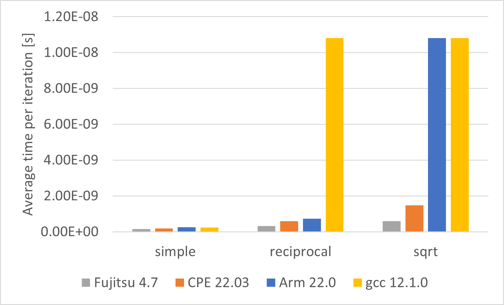
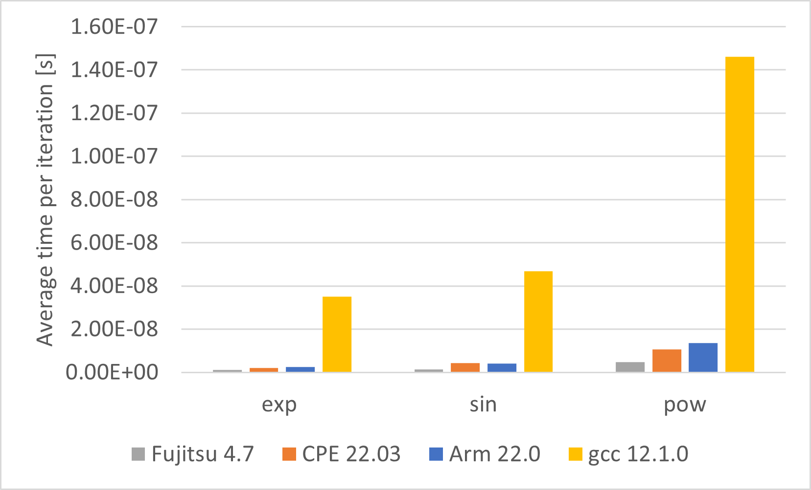

# Note that this article contains results of the Fujitsu compiler, which is not available
                        anymore on Ookami

!!! note archive "Archived page"
    Ookami reached end of life at the end of 2025. This is a copy of its website, kept for reference; some original material is not included.

## Vectorization for different compilers

Compilers can do vectorization when setting the right flags. Here we are showing two examples of code compiled with the Cray, Arm and gnu compiler.

## Simple math functions

The investigated functions are: Simple (Y = 2 X + 3 X2), Reciprocal, Square root, Exponential, Sin, Power function. Those are compiled using three different compilers, Cray, Arm and GNU (source code [here](https://github.com/esiegmann/Ookami/tree/main/ExampleCodes/doesitvectorize)). The compiler specific vectorization flags are turned on.

```
void Xsimple(size_t n, const double* __restrict__ x, double* __restrict__ y) {
  for (size_t i=0; i<n; i++) y[i] = 2.0*x[i] + 3.0*x[i]*x[i];
}

void Xrecip(size_t n, const double* __restrict__ x, double* __restrict__ y) {
  for (size_t i=0; i<n; i++) y[i] = 1.0/x[i];
}

void Xsqrt(size_t n, const double* __restrict__ x, double* __restrict__ y) {
  for (size_t i=0; i<n; i++) y[i] = std::sqrt(x[i]);
}

void Xexp(size_t n, const double* __restrict__ x, double* __restrict__ y) {
  for (size_t i=0; i<n; i++) y[i] = std::exp(x[i]);
}

void Xsin(size_t n, const double* __restrict__ x, double* __restrict__ y) {
  for (size_t i=0; i<n; i++) y[i] = std::sin(x[i]);
}

void Xpow(size_t n, const double* __restrict__ x, double* __restrict__ y) {
  for (size_t i=0; i<n; i++) y[i] = std::pow(x[i],0.55);
}
```

Below you can find the compiler versions and flags (for vectorization and vectorization reports) used for this example

#### Cray

```
module load CPE/22.03
Cray C++ : Version 10.0.3
```

with the compiler flags

```
-O3 -h aggress,flex_mp=tolerant,msgs,negmsgs,vector3,omp
```

Flag description:

O3
Optimization level 3

aggress
Provides greater opportunity to optimize loops that would otherwise by inhibited from optimization due to an internal compiler size limitation.

flex_mp=tolerant
Controls the aggressiveness of optimizations which may affect floating point and complex repeatability when application requirements require identical results whenvarying the number of ranks or threads. Tolerant uses most aggressive optimization and yields highest performance, but results may not be sufficiently repeatable for some applications

msgs
Causes the compiler to write optimization messages to stderr.

negmsgs
Causes the compiler to generate messages to stderr that indicate why optimizations such as vectorization or inlining did not occur in a given instance.

vector3
Specifies the level of automatic vectorizing to be performed. Vectorization results in dramatic performance improvements with a small increase in object code size. Vectorization directives are unaffected by this option. 3 specifies aggressive vectorization.

omp
OMP supportArm

```
module load arm-modules/22.0
Arm C/C++/Fortran Compiler version 22.0.1
```

with the compiler flags

```
-Ofast -ffp-contract=fast -Wall -Rpass=loop-vectorize -march=armv8.2-a+sve -mcpu=a64fx -armpl -fopenmp
```

Flag description:

Ofast
 Enables all the optimizations from level 3 including those performed with the -ffp-mode=fast armclang option. This level also performs other aggressive optimizations that might violate strict compliance with language standards. -Ofast implies -ffast-math.

ffp-contract=fast
If you set -ffp-contract=fast fused floating-point contractions are always used and the compiler ignores the 'STDC FP_CONTRACT' pragma setting.

Wall
Enable all warnings.

Rpass=loop-vectorize
Enable vectorization report

march=armv8.2-a+sve
Specifies architecture and extensions.

mcpu=a64fx
Select CPU architecture.

armpl
Use the 'Generic' SVE library from Arm Performance Libraries.

fopenmp
Enable OpenMPGNU

```
module load gcc/12.1.0
gcc (GCC) 12.1.0
```

with the compiler flags

```
-Ofast -Wall -mtune=a64fx -mcpu=a64fx -march=armv8.2-a+sve -fopt-info-vec -fopenmp
```

Flag description:

Ofast, Wall, mcpu=a64fx, march=armv8.2-a+sve
see descriptions above

mtune=a64fx
Tune to cpu-type

fopt-info-vec
Output vectorization report.

Fujitsu

```
module load fujitsu/compiler/4.7
FCC (FCC) 4.7.0 20211110
```

with the compiler flags

```
 -Kfast -KSVE -Koptmsg=2
```

Flag description:

Kfast
Optimization

KSVE
Vectorization

Koptmsg=2
Output vectorization report.

When compiling the compiler output suggests that Fujitsu, Cray and Arm vectorize all functions, whereas GNU can't vectorize exp, sin and pow.

|  |  |  |  |  |
| --- | --- | --- | --- | --- |
|  | Fujitsu | Cray | Arm | GNU |
| Simple (Y = 2 X + 3 X2) |  |  |  |  |
| Reciprocal |  |  |  |  |
| Square root |  |  |  |  |
| Exponential |  |  |  |  |
| Sin |  |  |  |  |
| Power |  |  |  |  |

However, looking at the runtimes of the functions gives a more complex picture (see Figure 1 & 2). The Fujitsu and cray compilers vectorizes everything as claimed. The arm compiler claims to vectorize all functions. It is doing this but some functions are not vectorized in the most efficient way. The code assembly shows that it uses the DIV and SQRT functions rather than the more efficient Netwon algorithm. And the gnu compiler just vectorizes the simple function. The recip and sqrt are not vectorized as expected from the compiler output.



Figure 1 & 2: Runtimes of the simple math functions for different compilers.

The Fujitsu compiler gives the best results.

Archived from `https://www.stonybrook.edu/commcms/ookami/support/faq/Vectorization_Example.php`, retrieved November 5, 2026.
{: .archive-credit }
