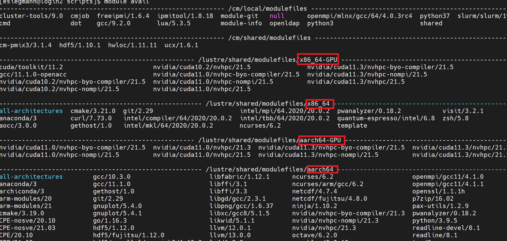

# Understanding Modules

!!! note archive "Archived page"
    Ookami reached end of life at the end of 2025. This is a copy of its website, kept for reference; some original material is not included.

To manage the complexity of the software environment, Ookami uses environment modules. Each module encapsulates particular software packages that are made available to users. This allows for separate toolchains and compiler environments to be installed on the cluster at the same time without causing errors. Each module file contains the information needed to configure the shell for an application, including all of the dependencies.

The main command to interact with modules is the **module** command. To get an overview, execute the command:

```
module --help
```

The commands used most often are:

```
module list (returns a list of all the currently loaded modules)

module avail (returns a list of the available modules)

module [load | add] (adds module to the current environment)

module [unload | rm] (removes a module from the current environment)

module initadd (adds modulefile(s) so they start up automatically when logging in)
```

IMPORTANT: Some of the modules are listed as local while the others are listed as shared. Local modules are local to the login node. Shared modules are used throughout the entire cluster.

Because Ookami contains nodes with different types of CPU architectures, some modules will be available on certain nodes and unavailable on the others. For example, the Intel compiler module (intel/compiler/64/2020/20.0.2) can only be used on nodes with x86_64 architecture.

On the login nodes the **module avail** command will show all modules for the different architectures in Ookami. Note that not all of these run on the login nodes which are ThunderX2 (aarch64).  The path indicates the architecture on which the modules can be used (see figure)



On all other nodes **module avail** will just show the modules for the architecture of the current node.

After logging on to Ookami, users setup their environment by loading modules as needed into the current shell. While it is possible to code this information directly into a .bashrc or .bash_profile, we tend to discourage users from doing this in order to fully utilize a modular environment.

Archived from `https://www.stonybrook.edu/commcms/ookami/support/faq/what_are_modules.php`, retrieved November 5, 2026.
{: .archive-credit }
