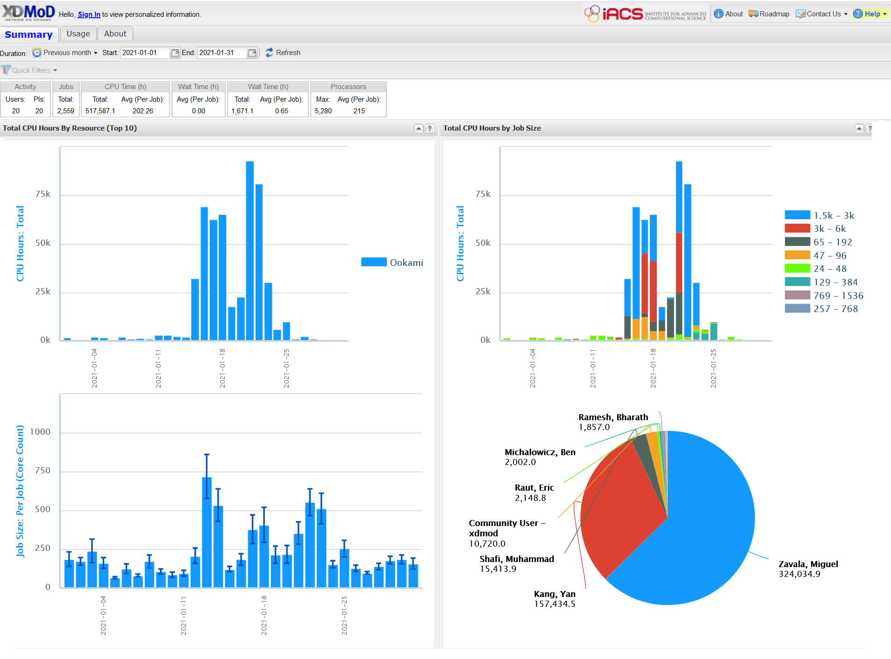

# How can I monitor Ookami's usage?

!!! note archive "Archived page"
    Ookami reached end of life at the end of 2025. This is a copy of its website, kept for reference; some original material is not included.

    Past recordings, webinars, and seminar videos are not uploaded here; their titles appear below without links.

This is can be done using XDMoD. XDMoD provides information like CPU hours, job size and many more.

XDMoD workshop recording

## Creating an XDMoD account

Go to the XDMoD website.

- Click 'Sign In' on the top right
- Select the ‘Globus’ button to sign in via Globus Auth
- On the globus auth page sign in with your Stony Brook credentials
- Give Globus permission to send identity information to XDMoD (this only needs to be done once and is needed so that XDMoD shows information about your jobs)
- XDMoD permissions only allow you to view your own jobs. Use the contact us button on the top right of the portal to request elevated permissions

Archived from `https://www.stonybrook.edu/commcms/ookami/support/faq/XDMoD.php`, retrieved November 5, 2026.
{: .archive-credit }
