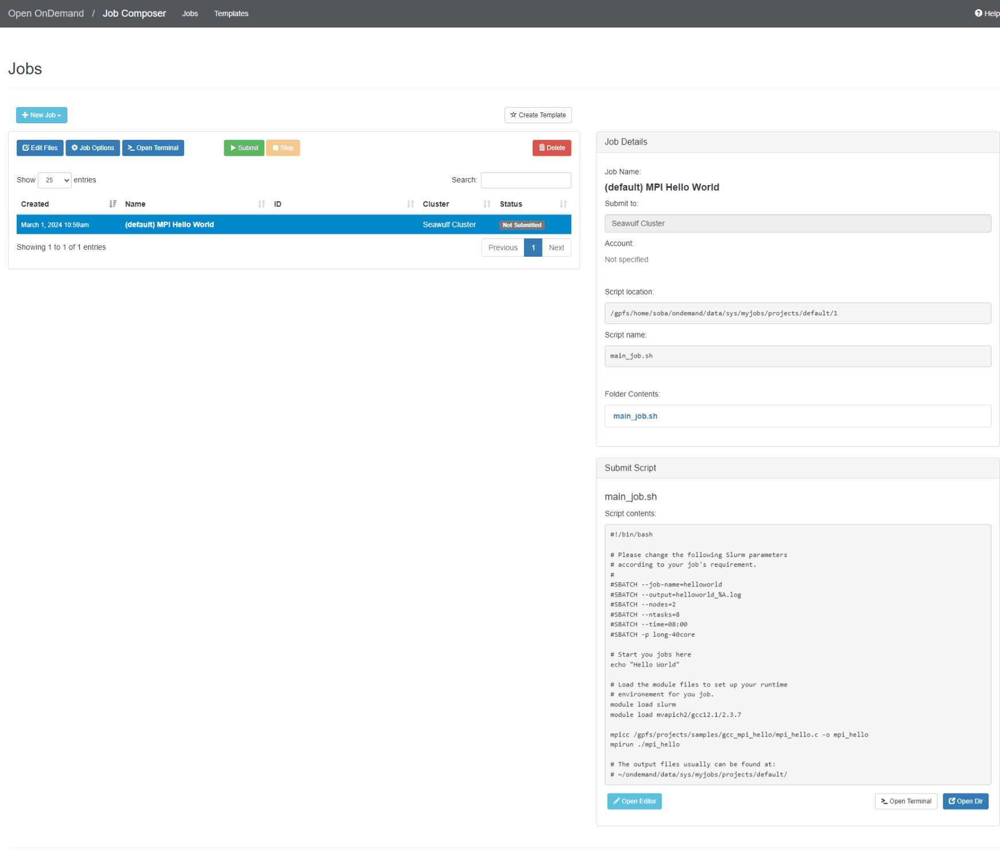
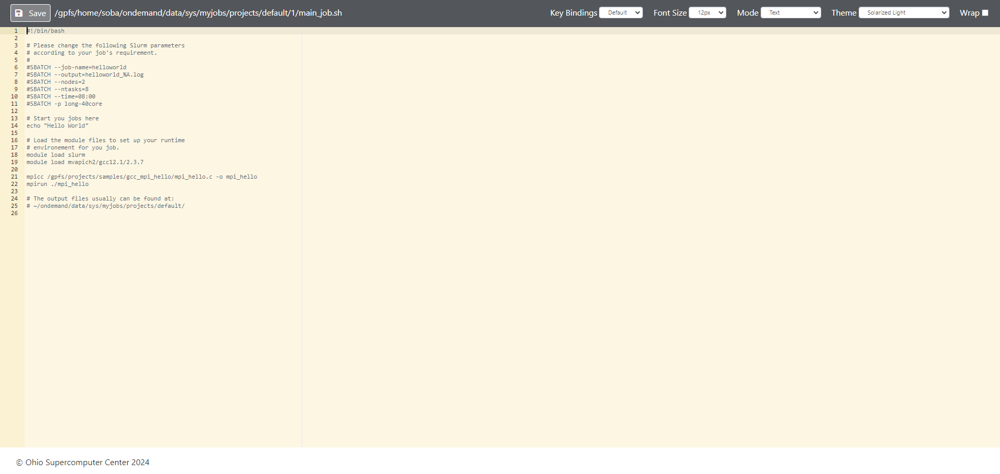
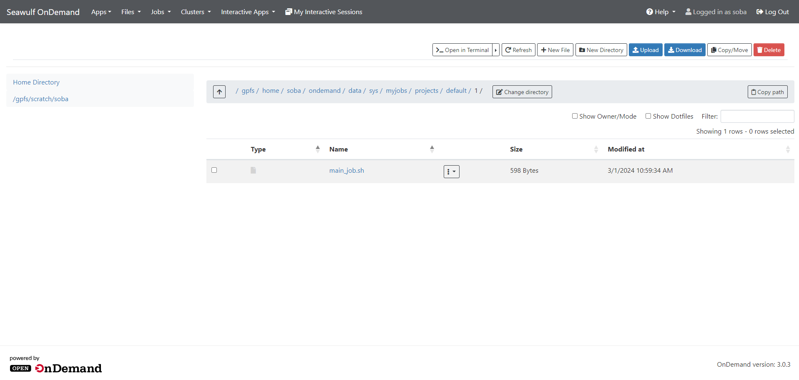

# Job Composer

Job Composer lets you create, edit, and submit batch jobs from your browser. Start from a template or an existing script, adjust it in the built-in editor, and submit it to the queue without typing `sbatch`.

**On this page:** [When to use it](#when) · [Open Job Composer](#open) · [Create a job](#create) · [Edit the script and files](#edit) · [Submit and manage](#submit) · [Troubleshooting](#trouble)

## When to use it {#when}

Batch jobs are the right choice for real work: long or large runs that don't need you watching. Job Composer is a friendly way to manage them if you'd rather not use the command line. If you're comfortable in a terminal, [writing job scripts](../shared/writing-job-scripts.md) and submitting with `sbatch` does the same thing.

Job Composer is in the **Jobs** menu of the SeaWulf, NVwulf, and ClinWulf portals. Each job gets its own folder, so its script, inputs, and output files stay together.

## Open Job Composer {#open}

1. Sign in to your cluster's [OnDemand portal](../shared/ondemand-overview.md#portals) with your NetID and Duo.
2. Choose **Jobs**, then **Job Composer**. It opens in a new tab with a list of your jobs.

## Create a job {#create}

Click **New Job** and pick where to start:

| Option | Use it when |
| --- | --- |
| From Default Template | You want a simple starting script to fill in. |
| From Template | You or your group saved a template for a job you run often. |
| From Specified Path | You already have a folder with a job script and inputs on the cluster. Job Composer copies it into a new job. |
| From Selected Job | You want to rerun an earlier job with small changes. Select it in the list first. |

*The Job Composer job list and the New Job menu.*

## Edit the script and files {#edit}

- **Open Editor** (or click the script's name under *Folder contents*) opens the job script in a text editor in a new tab. Save with the button at the top left.
- **Job Options** sets the job's name, cluster, and which file is the script.
- **Open Dir** opens the job folder in the Files app, to upload input files or download results.
- **Open Terminal** gives you a shell in the job folder (it may ask for Duo again).

Check the `#SBATCH` lines before you submit: the queue, time, cores, and memory must suit your cluster. The [job script builder](https://rci.stonybrook.edu/hpc/script-builder) and [Writing job scripts](../shared/writing-job-scripts.md) help you pick them. On SeaWulf, the script needs `module load slurm` only if it runs Slurm commands itself.

*Editing a job script in the browser.*

*A job's folder in the Files app.*

## Submit and manage {#submit}

1. Select the job in the list and click **Submit**. Its status changes to *Queued*, then *Running*, then *Completed*.
2. Click **Stop** to cancel a job that's queued or running.
3. When it finishes, open the job folder to read the output file (for example `slurm-12345.out`).
4. Click **Delete** to remove a job and its folder when you no longer need it. Copy results you want to keep first.

**Active Jobs** in the Jobs menu shows everything you have queued or running, including jobs submitted from a terminal. See also [Managing jobs](../shared/managing-jobs.md).

## Troubleshooting {#trouble}

My job failed right away

Open the job folder and read the output and error files. Common causes are a queue name that doesn't exist on that cluster, asking for more time than the queue allows, or a missing module.

My job stays Queued

The queue is busy or the request is large. See why with `squeue -u $USER` in a terminal, and see the [queue selection guide](queue-selection-guide.md).

Job Composer shows an error page instead of my jobs

Try **Restart Web Server** in the Help menu, then reopen Job Composer. If the error stays, [open a ticket](https://iacs.supportsystem.com/) with the cluster name. In the meantime you can submit the same script from a terminal with `sbatch`.

Related: [OnDemand overview](../shared/ondemand-overview.md) · [Writing job scripts](../shared/writing-job-scripts.md) · [Managing jobs](../shared/managing-jobs.md)

**Applies to:** SeaWulf

Ported from RCI's guide: <https://rci.stonybrook.edu/docs/job-composer> (maintained by Research Computing and Informatics).
