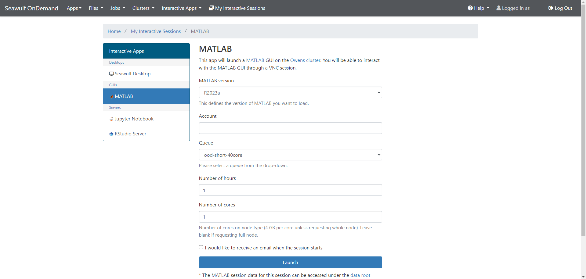
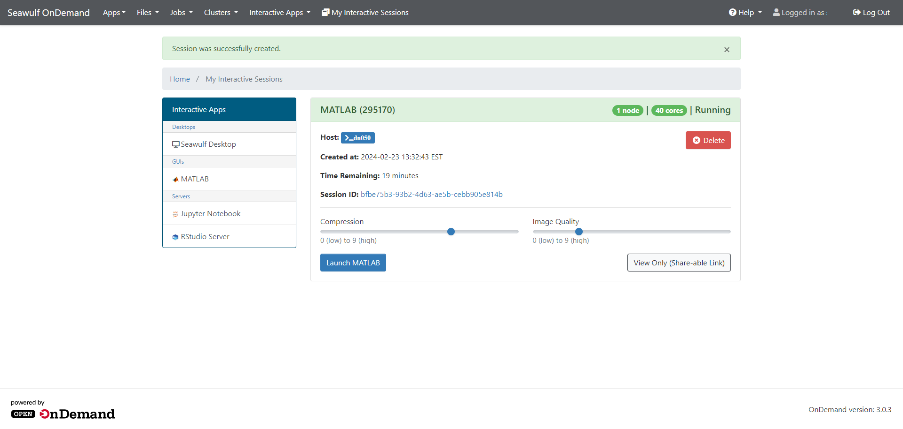
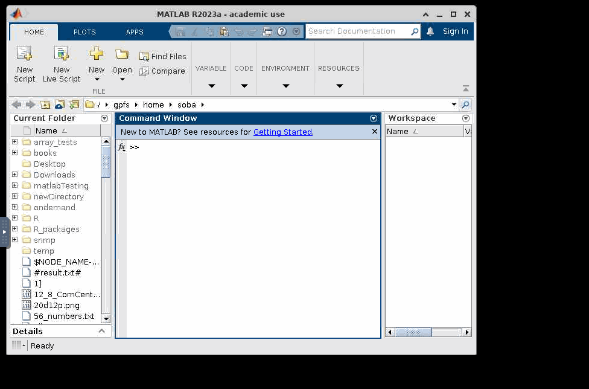

# MATLAB (Open OnDemand)

Run MATLAB's full desktop in your browser on a cluster compute node, with many more cores and much more memory than a laptop, and GPUs on NVwulf. You can also share a view-only link so a colleague can watch your session.

**On this page:** [Where it runs](#where) · [Start a session](#start) · [Launch settings](#settings) · [During your session](#session) · [Using more cores and GPUs](#parallel) · [Troubleshooting](#trouble)

## Where it runs {#where}

| Cluster | MATLAB versions | Runs on |
| --- | --- | --- |
| SeaWulf | R2025a, R2024a, R2023a, R2022a, R2021a and R2021b, and older releases back to R2016 | Shared CPU queues (40-core or 96-core nodes) |
| NVwulf | R2025a | B40 GPU nodes |

ClinWulf's portal doesn't have a MATLAB app. For free, MATLAB-compatible computing on SeaWulf, there's also **GNU Octave** (see [SeaWulf apps](seawulf-ondemand-apps.md)).

## Start a session {#start}

1. Sign in to your cluster's [OnDemand portal](../shared/ondemand-overview.md#portals) with your NetID and Duo.
2. Open **Interactive Apps** and choose **MATLAB** (under GUIs).
3. Fill in the form (see [below](#settings)) and click **Launch**.
4. When the card shows *Running*, click the launch button on the card. MATLAB opens in a new browser tab.
5. When you're done, save your work, exit MATLAB, and click **Delete** on the session card.

## Launch settings {#settings}

| Setting | What to choose |
| --- | --- |
| MATLAB version | The newest is a good default. Pick an older one only to match existing code. |
| Queue | SeaWulf: `short-40core-shared` (up to 4 hours) for most work; long and extended shared queues for more. NVwulf: `b40x4` (up to 8 hours) or `b40x4-long` (up to 48 hours). |
| Cores | 1 to 4 for interactive work. Ask for more if you'll run a parallel pool (see [below](#parallel)). |
| Memory | SeaWulf 2 to 164 GB, NVwulf 8 to 480 GB. 8 GB is a comfortable start. |
| GPUs | NVwulf only. 1 is enough unless your code uses several. |
| Modules | Optional extra modules to load first, for example a compiler for MEX files (`gcc/13.2.0` on SeaWulf). |



*The MATLAB launch form (SeaWulf). The current form asks for memory instead of nodes.*

## During your session {#session}

The running session card has a few useful controls before you connect:

- **Compression** and **Image quality** sliders. On a slow connection, raise compression and lower quality to make MATLAB more responsive.
- **View Only (Share-able Link)**. Send this link to another cluster user so they can watch your MATLAB session, for example while you get help. They can see but not type or click.



*A running session, with display settings and the view-only link.*

MATLAB starts in your home folder. Browse to scratch or project space from MATLAB's Current Folder bar, or add shortcuts in your home folder (see [Working with files](../shared/ondemand-overview.md#files)).



*MATLAB's desktop in the browser.*

## Using more cores and GPUs {#parallel}

With the Parallel Computing Toolbox, start a pool with no more workers than the cores you asked for:

```
p = parpool(4);       % 4 workers for a 4-core session
parfor i = 1:100
    results(i) = myFunction(i);
end
delete(p)
```

On NVwulf, check the GPU with `gpuDevice` and move data to it with `gpuArray`. For long or large parallel runs, submit a [batch job](../shared/writing-job-scripts.md) instead of keeping a session open.

## Troubleshooting {#trouble}

<details markdown="1">
<summary>MATLAB is slow to respond in the browser</summary>

Raise **Compression** and lower **Image quality** on the session card, then reconnect. A wired connection or the campus network also helps.

</details>

<details markdown="1">
<summary>"Out of memory" errors</summary>

Save your work, delete the session, and relaunch with more memory.

</details>

<details markdown="1">
<summary>parpool fails or starts fewer workers</summary>

Ask for no more workers than the cores on the form. To use more, relaunch with more cores.

</details>

<details markdown="1">
<summary>My session stays Queued</summary>

Try a shorter queue, fewer cores, or less memory.

</details>

Related: [OnDemand overview](../shared/ondemand-overview.md) · [SeaWulf apps](seawulf-ondemand-apps.md) · [NVwulf apps](../nvwulf/nvwulf-ondemand-apps.md)

**Applies to:** SeaWulf

Ported from RCI's guide: <https://rci.stonybrook.edu/docs/matlab-open-ondemand> (maintained by Research Computing and Informatics).
