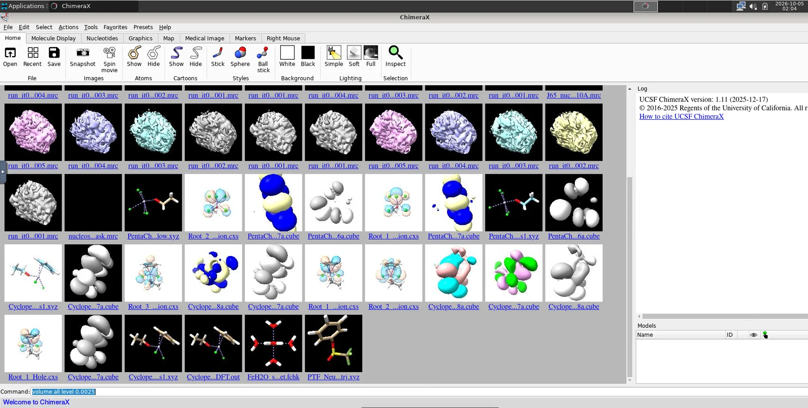

# UCSF ChimeraX (Open OnDemand)

UCSF ChimeraX lets you inspect molecular structures, sequences, and three-dimensional density maps. Use the SeaWulf browser desktop to explore large datasets and prepare molecular graphics.

**On this page:** [Where it runs](#where) · [Start a session](#start) · [Launch settings](#settings) · [Troubleshooting](#trouble)

## Where it runs {#where}

| Cluster | Runs on |
| --- | --- |
| SeaWulf | Shared CPU queues on 40-core or 96-core nodes |

## Start a session {#start}

1. Sign in to the OnDemand portal for your cluster ([SeaWulf](https://sn-ood.seawulf.stonybrook.edu/)) with your NetID and Duo.
2. Open Interactive Apps and choose UCSF ChimeraX.
3. Choose the launch settings below and click Launch.
4. After the session starts, Open OnDemand provides Compression and Image Quality controls for the remote desktop display. Compression controls how strongly the graphical display is compressed before being sent to the browser. Higher compression can improve responsiveness on slower network connections but may reduce visual quality. Image Quality controls the quality of the displayed image. Higher values provide a sharper display but may require more network bandwidth. For most sessions, the default settings are appropriate. Adjust them only if the desktop appears slow, blurry, or unresponsive.
5. Open your structure or map from the working directory. Save a ChimeraX session when you want to preserve the current view and analysis.
6. Save your work or export the results, then click Delete on the session card when finished. Closing the browser tab does not stop the session.

*SeaWulf UCSF ChimeraX graphical interface running through Open OnDemand. The interface provides tools for opening and visualizing molecular structures and volumetric density data, with recently accessed models displayed as thumbnails for quick selection and analysis.*

## Launch settings {#settings}

Defaults below are starting points. Ask for resources your task needs, and keep the requested hours within the selected queue limit.

| Setting | What to choose |
| --- | --- |
| UCSF ChimeraX version | Version 1.11. |
| Queue | Shared CPU queues on 40-core or 96-core nodes. Short up to 4 hours; long up to 24; extended up to 84. Start with `short-40core-shared` or `short-96core-shared`. |
| Working directory | Defaults to your home folder. Choose the folder containing your project or data. Enter a full path. |
| Hours | Default 1 hour. Choose enough time for your work, within the selected queue limit. |
| Cores | Default 1; form range 1 to 96. Use only as many cores as the task can use, within the selected node capacity. |
| Memory (GB) | Default 4 GB. Choices: 2, 4, 8, 16, 32, 64, 128, 164 GB. |

Email notifications are optional. Enter an email address and select Email when job starts if you want a start notification.

Choose an explicit memory size for routine work. All available can reserve node memory and increase waiting time; use it only when your task needs it.

## Troubleshooting {#trouble}

**My structure or map is not visible.** Check that you opened the correct file and that the model is shown. For a map, adjust the contour level before treating an empty view as a launch problem.

**Large maps are slow or exhaust memory.** Use a smaller region or relaunch with more memory. The SeaWulf app uses CPU resources and does not allocate a GPU.

**The window is black or reports a graphics error.** Reconnect once. If the problem persists, save the session output and contact support with the app name and job ID.

**My session stays Queued.** Try a shorter request, less memory, or fewer cores. Check the session output if the job fails instead of remaining queued.

If the problem continues, [contact HPC support](https://iacs.supportsystem.com) with the cluster, app name, job ID, and the error text.

## Related guides {#related}

- [Open OnDemand apps on SeaWulf](seawulf-ondemand-apps.md)
- [OnDemand overview](../shared/ondemand-overview.md)
- [Open OnDemand](https://rci.stonybrook.edu/hpc/ondemand)

**Applies to** SeaWulf

Ported from RCI's guide: <https://rci.stonybrook.edu/docs/ondemand-chimerax> (maintained by Research Computing and Informatics).
{: .rci-credit }
