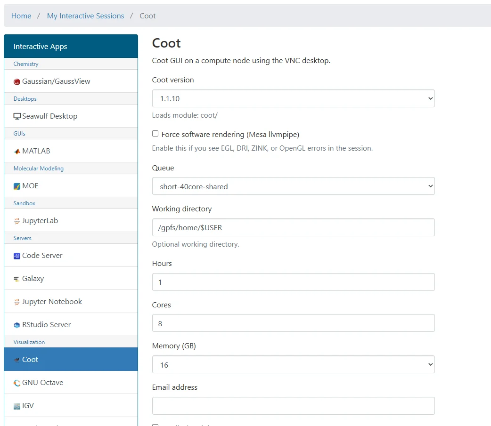

# Coot (Open OnDemand)

Coot supports model building and fitting against crystallographic or cryo-EM density maps. Open its graphical interface on SeaWulf to inspect your model and make interactive corrections.

**On this page:** [Where it runs](#where) · [Start a session](#start) · [Launch settings](#settings) · [Troubleshooting](#trouble)

## Where it runs {#where}

| Cluster | Runs on |
| --- | --- |
| SeaWulf | Shared CPU queues on 40-core or 96-core nodes |

## Start a session {#start}

1. Sign in to the OnDemand portal for your cluster ([SeaWulf](https://sn-ood.seawulf.stonybrook.edu/)) with your NetID and Duo.
2. Open Interactive Apps and choose Coot.
3. Choose the launch settings below and click Launch.
4. After the session starts, Open OnDemand provides Compression and Image Quality controls for the remote desktop display. Compression controls how strongly the graphical display is compressed before being sent to the browser. Higher compression can improve responsiveness on slower network connections but may reduce visual quality. Image Quality controls the quality of the displayed image. Higher values provide a sharper display but may require more network bandwidth. For most sessions, the default settings are appropriate. Adjust them only if the desktop appears slow, blurry, or unresponsive.
5. Open your coordinate model and the matching map or reflection data. Save edited coordinates to your project folder.
6. Save your work or export the results, then click Delete on the session card when finished. Closing the browser tab does not stop the session.

## Launch settings {#settings}

Defaults below are starting points. Ask for resources your task needs, and keep the requested hours within the selected queue limit.

| Setting | What to choose |
| --- | --- |
| Coot version | Version 1.1.10. |
| Force software rendering (Mesa llvmpipe) | Off by default in this form. Enable if you see EGL, DRI, ZINK, or OpenGL errors. |
| Queue | Shared CPU queues on 40-core or 96-core nodes. Short up to 4 hours; long up to 24; extended up to 84. Start with `short-40core-shared` or `short-96core-shared`. |
| Working directory | Defaults to your home folder. Choose the folder containing your project or data. Enter a full path. |
| Hours | Default 1 hour. Choose enough time for your work, within the selected queue limit. |
| Cores | Default 1; form range 1 to 96. Use only as many cores as the task can use, within the selected node capacity. |
| Memory (GB) | Default 4 GB. Choices: 2, 4, 8, 16, 32, 64, 128, 164 GB. |

Email notifications are optional. Enter an email address and select Email when job starts if you want a start notification.

Choose an explicit memory size for routine work. All available can reserve node memory and increase waiting time; use it only when your task needs it.

*SeaWulf Coot Open OnDemand launch interface. The form allows users to select the Coot version, choose the Slurm queue and working directory, and request the wall time, CPU cores, and memory for the session. The optional software-rendering setting can be enabled when EGL, DRI, ZINK, or OpenGL graphics errors occur.*

## Troubleshooting {#trouble}

**Coot shows EGL or OpenGL errors.** Enable Force software rendering on the launch form and start a new session. This option uses Mesa software rendering.

**The map and model do not line up.** Check that the files belong to the same dataset and coordinate frame. Resource settings will not correct a model or map mismatch.

**A large map exhausts memory.** Relaunch with more memory or use a smaller map region. Keep a saved copy of your edited model.

**My session stays Queued.** Try a shorter request, less memory, or fewer cores. Check the session output if the job fails instead of remaining queued.

If the problem continues, [contact HPC support](https://iacs.supportsystem.com) with the cluster, app name, job ID, and the error text.

## Related guides {#related}

- [Open OnDemand apps on SeaWulf](seawulf-ondemand-apps.md)
- [OnDemand overview](../shared/ondemand-overview.md)
- [Open OnDemand](https://rci.stonybrook.edu/hpc/ondemand)

**Applies to** SeaWulf

Ported from RCI's guide: <https://rci.stonybrook.edu/docs/ondemand-coot> (maintained by Research Computing and Informatics).
{: .rci-credit }
