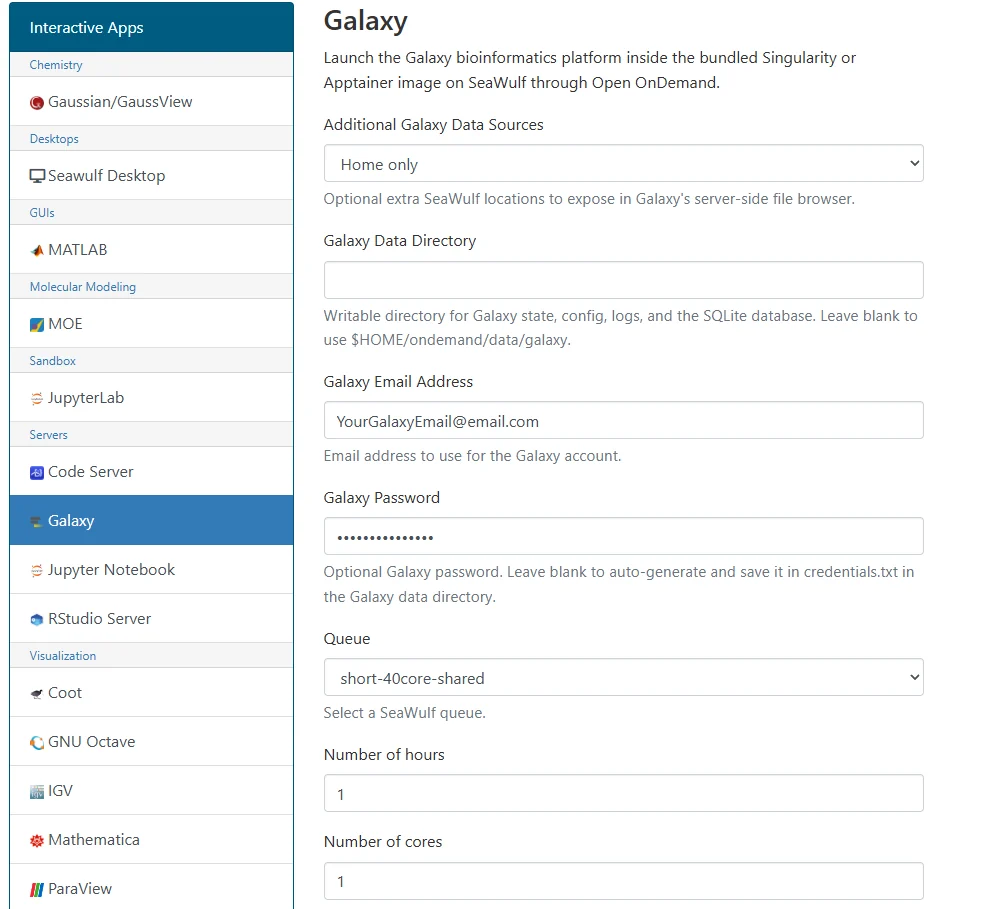

# Galaxy (Open OnDemand)

Galaxy provides a browser interface for building and running bioinformatics workflows. This app starts your own Galaxy server on SeaWulf, with a data directory that you can reuse in later sessions.

**On this page:** [Where it runs](#where) · [Start a session](#start) · [Launch settings](#settings) · [Troubleshooting](#trouble)

## Where it runs {#where}

| Cluster | Runs on |
| --- | --- |
| SeaWulf | Shared CPU queues on 40-core or 96-core nodes |

## Start a session {#start}

1. Sign in to the OnDemand portal for your cluster ([SeaWulf](https://sn-ood.seawulf.stonybrook.edu/)) with your NetID and Duo.
2. Open Interactive Apps and choose Galaxy.
3. Choose the launch settings below and click Launch.
4. Wait for Running, then click the app connect button. Use the Galaxy email and password recorded in `credentials.txt` in your Galaxy data directory when creating or signing in to your Galaxy account.
5. Save your work or export the results, then click Delete on the session card when finished. Closing the browser tab does not stop the session.

Before launching, choose a data directory in your project space for substantial datasets. The default is `$HOME/ondemand/data/galaxy`; it stores Galaxy state, configuration, logs, and the database.

## Launch settings {#settings}

Defaults below are starting points. Ask for resources your task needs, and keep the requested hours within the selected queue limit.

| Setting | What to choose |
| --- | --- |
| Additional Galaxy Data Sources | Choose Home only, Home + scratch, Home + projects, or all three. Default Home only. |
| Galaxy Data Directory | Writable folder for Galaxy state, configuration, and logs. Blank uses `$HOME/ondemand/data/galaxy`. Use project space for larger datasets. |
| Galaxy Email Address | Email for your Galaxy account. Enter the address you intend to use when signing in. |
| Galaxy Password | Optional. Blank generates a password and saves it in `credentials.txt` in your Galaxy data directory. |
| Queue | Shared CPU queues on 40-core or 96-core nodes. Short up to 4 hours; long up to 24; extended up to 84. Start with `short-40core-shared` or `short-96core-shared`. |
| Number of hours | Choose enough time for your work, within the selected queue limit. |
| Number of cores | Default 1; form range 1 to 96. Use only as many cores as the task can use, within the selected node capacity. |
| Memory | Enter a value with units, such as 4G or 16G. Default 4G. |

Email notifications are optional. Enter an email address and select Email when job starts if you want a start notification.

*SeaWulf Galaxy OnDemand app launch interface. The form allows users to select accessible Galaxy data sources, specify a persistent Galaxy data directory and account credentials, and request the queue, wall time, and CPU resources needed for the session.*

## Troubleshooting {#trouble}

**I cannot sign in.** Check `credentials.txt` in the data directory you selected. The Galaxy account email is separate from the optional job notification email.

**My files are missing from the browser.** Check Additional Galaxy Data Sources. A home-only session will not expose scratch or project folders as additional server-side sources.

**The server runs out of space.** Choose a writable data directory with enough space for your histories and datasets. Reuse that same directory next time to keep your Galaxy state.

**My session stays Queued.** Try a shorter request, less memory, or fewer cores. Check the session output if the job fails instead of remaining queued.

If the problem continues, [contact HPC support](https://iacs.supportsystem.com) with the cluster, app name, job ID, and the error text.

## Related guides {#related}

- [Open OnDemand apps on SeaWulf](seawulf-ondemand-apps.md)
- [OnDemand overview](../shared/ondemand-overview.md)
- [Open OnDemand](https://rci.stonybrook.edu/hpc/ondemand)

**Applies to:** SeaWulf

Ported from RCI's guide: <https://rci.stonybrook.edu/docs/ondemand-galaxy> (maintained by Research Computing and Informatics).
