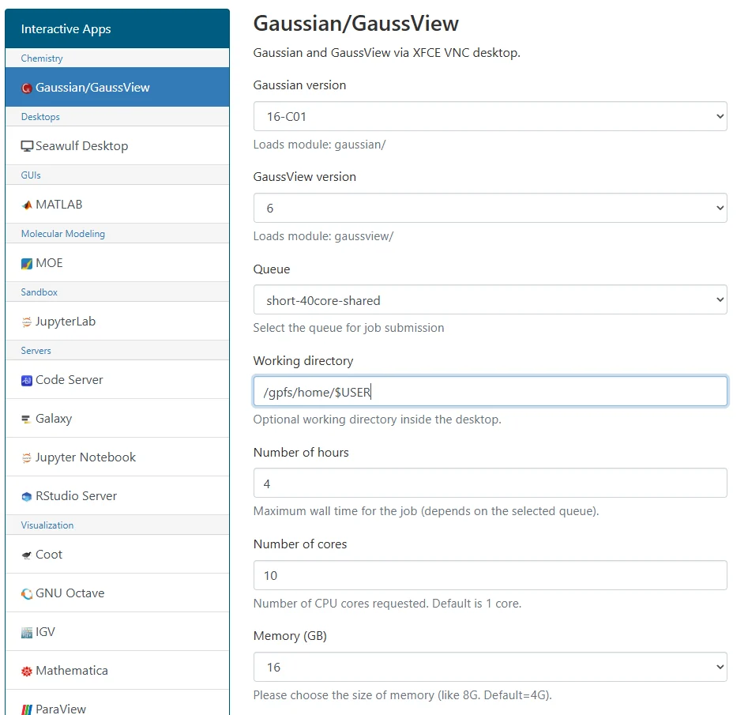

# Gaussian and GaussView (Open OnDemand)

GaussView provides a graphical interface for building molecules and preparing Gaussian calculations. This app opens GaussView on SeaWulf with Gaussian 16 available in the same session.

**On this page:** [Where it runs](#where) · [Start a session](#start) · [Launch settings](#settings) · [Troubleshooting](#trouble)

## Where it runs {#where}

| Cluster | Runs on |
| --- | --- |
| SeaWulf | Shared CPU queues on 40-core or 96-core nodes; whole-node queues also offered |

## Start a session {#start}

1. Sign in to the OnDemand portal for your cluster ([SeaWulf](https://sn-ood.seawulf.stonybrook.edu/)) with your NetID and Duo.
2. Open Interactive Apps and choose Gaussian/GaussView.
3. Choose the launch settings below and click Launch.
4. After the session starts, Open OnDemand provides Compression and Image Quality controls for the remote desktop display. Compression controls how strongly the graphical display is compressed before being sent to the browser. Higher compression can improve responsiveness on slower network connections but may reduce visual quality. Image Quality controls the quality of the displayed image. Higher values provide a sharper display but may require more network bandwidth. For most sessions, the default settings are appropriate. Adjust them only if the desktop appears slow, blurry, or unresponsive.
5. Build or open a molecule in GaussView, prepare the calculation, and save the input and output in your project folder.
6. Save your work or export the results, then click Delete on the session card when finished. Closing the browser tab does not stop the session.

The session allocation is shared by GaussView and calculations started inside it. For unattended calculations, use a separate batch job with resources matched to the Gaussian input.

## Launch settings {#settings}

Defaults below are starting points. Ask for resources your task needs, and keep the requested hours within the selected queue limit.

| Setting | What to choose |
| --- | --- |
| Gaussian version | Version 16-C01. |
| GaussView version | Version 6. |
| Queue | Shared CPU queues on 40-core or 96-core nodes. Short up to 4 hours; long up to 24; extended up to 84. Start with `short-40core-shared` or `short-96core-shared`. |
| Working directory | Defaults to your home folder. Choose the folder containing your project or data. Enter a full path. |
| Number of hours | Default 1 hour. Choose enough time for your work, within the selected queue limit. |
| Number of cores | Default 1; form range 1 to 96. Use only as many cores as the task can use, within the selected node capacity. |
| Memory (GB) | Default 4 GB. Choices: 2, 4, 8, 16, 32, 64, 128, 164 GB. |

Email notifications are optional. Enter an email address and select Email when job starts if you want a start notification.

Choose an explicit memory size for routine work. All available can reserve node memory and increase waiting time; use it only when your task needs it.

*SeaWulf Gaussian/GaussView Open OnDemand launch interface. The form allows users to select the Gaussian and GaussView versions, choose the Slurm queue and working directory, and request the wall time, CPU cores, and memory required for the interactive session.*

## Troubleshooting {#trouble}

**The calculation uses the wrong number of processors.** Set %NProcShared in the Gaussian input to no more than the cores allocated to the session. The launch form does not rewrite your input file.

**Gaussian reports insufficient memory.** Keep Gaussian %Mem below the session allocation so there is room for the desktop and other processes. Relaunch with more memory if needed.

**The calculation ends before finishing.** Compare its run time with the session limit and check the Gaussian output for an error. Save checkpoint files in a location you can reuse.

**My session stays Queued.** Try a shorter request, less memory, or fewer cores. Check the session output if the job fails instead of remaining queued.

If the problem continues, [contact HPC support](https://iacs.supportsystem.com) with the cluster, app name, job ID, and the error text.

## Related guides {#related}

- [Open OnDemand apps on SeaWulf](seawulf-ondemand-apps.md)
- [OnDemand overview](../shared/ondemand-overview.md)
- [Open OnDemand](https://rci.stonybrook.edu/hpc/ondemand)

**Applies to** SeaWulf

Ported from RCI's guide: <https://rci.stonybrook.edu/docs/ondemand-gaussview> (maintained by Research Computing and Informatics).
{: .rci-credit }
