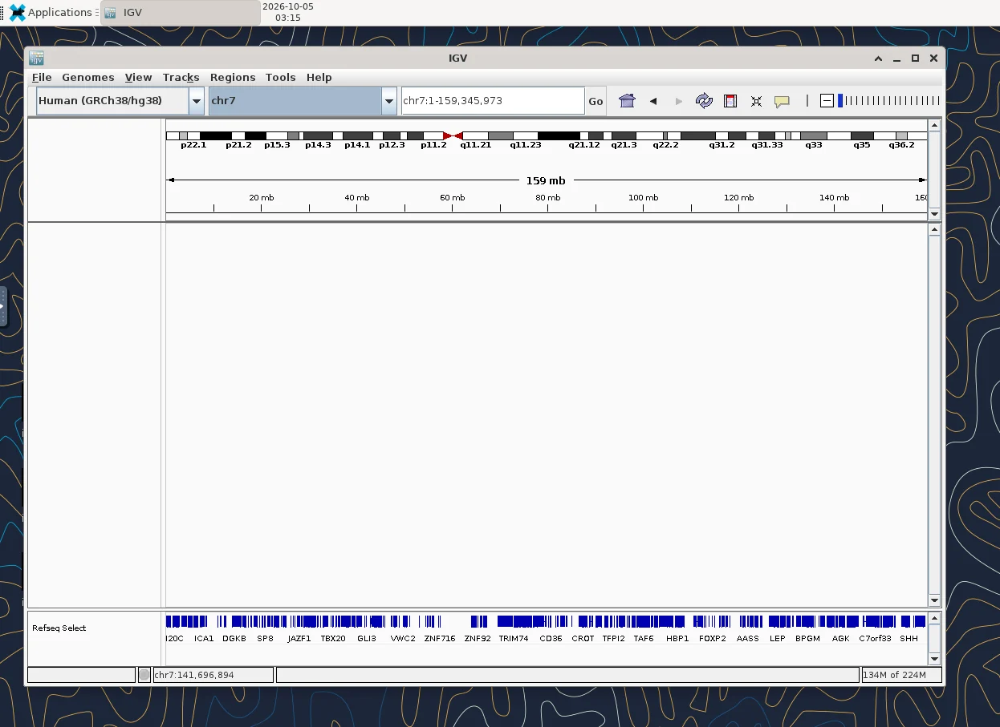

# IGV (Open OnDemand)

The Integrative Genomics Viewer displays alignments, variants, and genomic tracks. Open IGV on SeaWulf or ClinWulf and browse sequencing files from cluster storage.

**On this page:** [Where it runs](#where) · [Start a session](#start) · [Launch settings](#settings) · [Troubleshooting](#trouble)

## Where it runs {#where}

| Cluster | Runs on |
| --- | --- |
| SeaWulf | Shared CPU queues on 40-core or 96-core nodes |
| ClinWulf | CPU or GPU queues |

For clinical work, use your approved study directories on ClinWulf and follow your study requirements for data handling.

> [!NOTE]
> **ClinWulf network access:** ClinWulf OnDemand can only be reached from within Health Sciences and Stony Brook University Hospital and Medical Center. From anywhere else, connect through Citrix Desktop or the Stony Brook Hospital & Medical Center VPN first.

## Start a session {#start}

1. Sign in to the OnDemand portal for your cluster ([SeaWulf](https://sn-ood.seawulf.stonybrook.edu/), [ClinWulf](https://clinwulf-ood.uhmc.sbuh.stonybrook.edu/)) with your NetID and Duo.
2. Open Interactive Apps and choose IGV.
3. Choose the launch settings below and click Launch.
4. After the session starts, Open OnDemand provides Compression and Image Quality controls for the remote desktop display. Compression controls how strongly the graphical display is compressed before being sent to the browser. Higher compression can improve responsiveness on slower network connections but may reduce visual quality. Image Quality controls the quality of the displayed image. Higher values provide a sharper display but may require more network bandwidth. For most sessions, the default settings are appropriate. Adjust them only if the desktop appears slow, blurry, or unresponsive.
5. Select the reference genome that matches your data, then load the alignment or variant tracks from your project folder.
6. Save your work or export the results, then click Delete on the session card when finished. Closing the browser tab does not stop the session.

*SeaWulf Integrative Genomics Viewer (IGV) graphical interface running through Open OnDemand. The interface allows users to select a reference genome, navigate to genomic regions or chromosomes, and load sequencing, alignment, variant, and annotation tracks for interactive genomic data visualization.*

## Launch settings {#settings}

Defaults below are starting points. Ask for resources your task needs, and keep the requested hours within the selected queue limit.

### SeaWulf

| Setting | What to choose |
| --- | --- |
| IGV version | Version 2.19.7. |
| Queue | Shared CPU queues on 40-core or 96-core nodes. Short up to 4 hours; long up to 24; extended up to 84. Start with `short-40core-shared` or `short-96core-shared`. |
| Working directory | Defaults to your home folder. Choose the folder containing your project or data. Enter a full path. |
| Number of hours | Default 1 hour. Choose enough time for your work, within the selected queue limit. |
| Number of cores | Default 1; form range 1 to 96. Use only as many cores as the task can use, within the selected node capacity. |
| Memory (GB) | Default 4 GB. Choices: 2, 4, 8, 16, 32, 64, 128, 164 GB. |

### ClinWulf

| Setting | What to choose |
| --- | --- |
| IGV Version | Version 2.19.7. |
| Queue | CPU Short, Long, or Extra; GPU Short, Long, or Extra. Start with `cpu_short` for CPU work and use the time limit shown by the portal. |
| Project directory | Defaults to your home folder. Choose the folder containing your project or data. Enter a full path. |
| Number of hours | Default 1 hour. Choose enough time for your work, within the selected queue limit. |
| Memory (GB) | Default 4 GB. Choices: 2, 4, 8, 16, 32, 64 GB. |
| Number of GPUs | Default 0. Choices: 0, 1, 2, 4. Use a GPU queue for a nonzero request. |
| Desktop resolution | Desktop size as WIDTHxHEIGHT. Default 1920x1080; use a size that fits your browser window. |
| Additional modules (space-separated) | Optional space-separated modules. Leave blank unless your work needs additional software. |

Email notifications are optional on SeaWulf. Enter an email address and select Email when job starts if you want a start notification.

Choose an explicit memory size for routine work. All available can reserve node memory and increase waiting time; use it only when your task needs it.

## Troubleshooting {#trouble}

**An alignment track cannot be opened.** Check that the file is readable and that the index required by the file format is available beside it.

**Tracks appear at the wrong positions.** Make sure the reference genome build matches the build used to produce the alignment or variant files.

**IGV runs out of memory.** Relaunch with a larger explicit memory allocation. Loading fewer tracks at once can reduce the memory needed.

**My session stays Queued.** Try a shorter request, less memory, or fewer cores or GPUs. Check the session output if the job fails instead of remaining queued.

If the problem continues, [contact HPC support](https://iacs.supportsystem.com) with the cluster, app name, job ID, and the error text.

## Related guides {#related}

- [Open OnDemand apps on SeaWulf](seawulf-ondemand-apps.md)
- [Open OnDemand apps on ClinWulf](https://rci.stonybrook.edu/docs/clinwulf-ondemand-apps)
- [OnDemand overview](../shared/ondemand-overview.md)
- [Open OnDemand](https://rci.stonybrook.edu/hpc/ondemand)

**Applies to:** SeaWulf, ClinWulf

Ported from RCI's guide: <https://rci.stonybrook.edu/docs/ondemand-igv> (maintained by Research Computing and Informatics).
