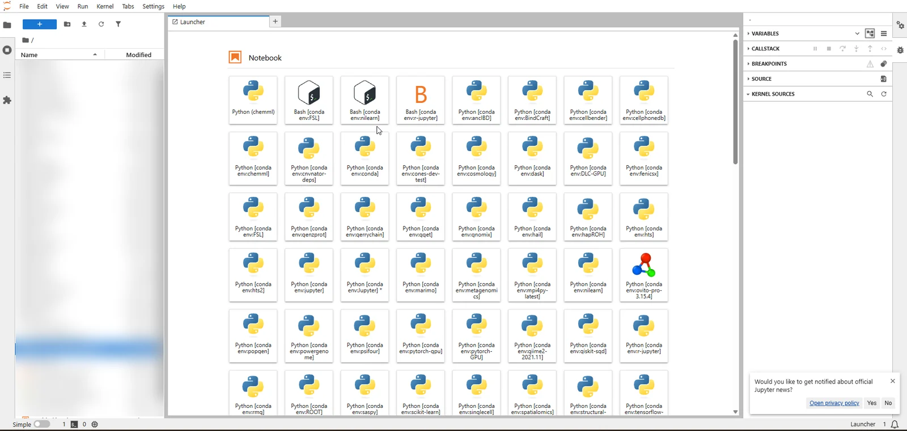

# JupyterLab (Open OnDemand)

JupyterLab brings notebooks, files, terminals, and text editors into one browser workspace. Run your analysis on a cluster compute node while keeping your data on cluster storage.

**On this page:** [Where it runs](#where) · [Start a session](#start) · [Launch settings](#settings) · [Troubleshooting](#trouble)

## Where it runs {#where}

| Cluster | Runs on |
| --- | --- |
| SeaWulf | Shared CPU queues on 40-core or 96-core nodes |
| ClinWulf | CPU or GPU queues |

For clinical work, use your approved study directories on ClinWulf and follow your study requirements for data handling.

!!! note ""
    **ClinWulf network access:** ClinWulf OnDemand can only be reached from within Health Sciences and Stony Brook University Hospital and Medical Center. From anywhere else, connect through Citrix Desktop or the Stony Brook Hospital & Medical Center VPN first.

## Start a session {#start}

1. Sign in to the OnDemand portal for your cluster ([SeaWulf](https://sn-ood.seawulf.stonybrook.edu/), [ClinWulf](https://clinwulf-ood.uhmc.sbuh.stonybrook.edu/)) with your NetID and Duo.
2. Open Interactive Apps and choose JupyterLab. Look under Sandbox for JupyterLab if it is not in the regular menu.
3. Choose the launch settings below and click Launch.
4. Wait for Running, then click the JupyterLab connect button. Open or create a notebook from the Launcher, then choose the kernel for your project (see [Troubleshooting](#trouble) if it is missing).
5. Save your work or export the results, then click Delete on the session card when finished. Closing the browser tab does not stop the session.

*SeaWulf JupyterLab OnDemand app main interface. The left panel displays the contents of the active working directory, including files and subdirectories, while the center panel lists the available Jupyter kernels and associated computational environments configured for use within the SeaWulf environment.*

## Launch settings {#settings}

Defaults below are starting points. Ask for resources your task needs, and keep the requested hours within the selected queue limit.

### SeaWulf

| Setting | What to choose |
| --- | --- |
| Queue | Shared CPU queues on 40-core or 96-core nodes. Short up to 4 hours; long up to 24; extended up to 84. Start with `short-40core-shared` or `short-96core-shared`. |
| Number of hours | Default 1 hour. Choose enough time for your work, within the selected queue limit. |
| Number of cores | Default 1; form range 1 to 96. Use only as many cores as the task can use, within the selected node capacity. |
| Memory (GB) | Default 4 GB. Choices: 2, 4, 8, 16, 32, 64, 128, 164 GB. |
| Modules to load | Keep `jupyter/latest`. Change it only if your project needs another supported JupyterLab module. |

### ClinWulf

| Setting | What to choose |
| --- | --- |
| Queue | CPU Short, Long, or Extra; GPU Short, Long, or Extra. Start with `cpu_short` for CPU work and use the time limit shown by the portal. |
| Number of hours | Default 1 hour. Choose enough time for your work, within the selected queue limit. |
| Number of GPUs | Default 0. Choices: 0, 1, 2, 4. Use a GPU queue for a nonzero request. |
| Memory (GB) | Default 4 GB. Choices: 2, 4, 8, 16, 32, 64 GB. |
| Modules to load | Keep `jupyterlab/2025`. Change it only if your project needs another supported JupyterLab module. |

Email notifications are optional on SeaWulf. Enter an email address and select Email when job starts if you want a start notification.

Choose an explicit memory size for routine work. All available can reserve node memory and increase waiting time; use it only when your task needs it.

## Troubleshooting {#trouble}

**My kernel is missing.** Register your environment as a Jupyter kernel, then start a new session. The [Jupyter notebooks guide](../shared/jupyter-notebooks.md) explains how to add your own environment.

**The kernel restarts.** Try a smaller dataset or relaunch with more memory. Requesting more CPU cores alone will not increase the memory available to your notebook.

**JupyterLab does not start.** Keep the site module in Modules to load. If you changed it, restore `jupyter/latest` on SeaWulf or `jupyterlab/2025` on ClinWulf.

**My session stays Queued.** Try a shorter request, less memory, or fewer cores or GPUs. Check the session output if the job fails instead of remaining queued.

If the problem continues, [contact HPC support](https://iacs.supportsystem.com) with the cluster, app name, job ID, and the error text.

## Related guides {#related}

- [Open OnDemand apps on SeaWulf](seawulf-ondemand-apps.md)
- [Open OnDemand apps on ClinWulf](https://rci.stonybrook.edu/docs/clinwulf-ondemand-apps)
- [OnDemand overview](../shared/ondemand-overview.md)
- [Open OnDemand](https://rci.stonybrook.edu/hpc/ondemand)

**Applies to** SeaWulf ClinWulf

Ported from RCI's guide: <https://rci.stonybrook.edu/docs/ondemand-jupyterlab> (maintained by Research Computing and Informatics).
{: .rci-credit }
