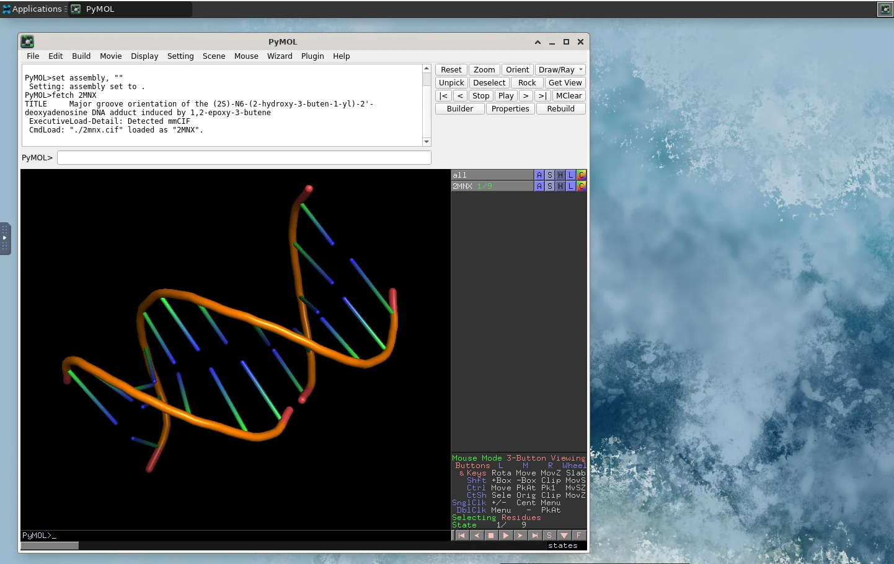

# PyMOL (Open OnDemand)

PyMOL is a molecular visualization tool for exploring structures and preparing figures. The SeaWulf app opens the open-source PyMOL desktop and reads your structure files directly from cluster storage.

**On this page:** [Where it runs](#where) · [Start a session](#start) · [Launch settings](#settings) · [Troubleshooting](#trouble)

## Where it runs {#where}

| Cluster | Runs on |
| --- | --- |
| SeaWulf | Shared CPU queues on 40-core or 96-core nodes |

## Start a session {#start}

1. Sign in to the OnDemand portal for your cluster ([SeaWulf](https://sn-ood.seawulf.stonybrook.edu/)) with your NetID and Duo.
2. Open Interactive Apps and choose PyMOL.
3. Choose the launch settings below and click Launch.
4. After the session starts, Open OnDemand provides Compression and Image Quality controls for the remote desktop display. Compression controls how strongly the graphical display is compressed before being sent to the browser. Higher compression can improve responsiveness on slower network connections but may reduce visual quality. Image Quality controls the quality of the displayed image. Higher values provide a sharper display but may require more network bandwidth. For most sessions, the default settings are appropriate. Adjust them only if the desktop appears slow, blurry, or unresponsive.
5. Load a structure, choose the representations you need, and save your session and exported figures in your project directory.
6. Save your work or export the results, then click Delete on the session card when finished. Closing the browser tab does not stop the session.

*SeaWulf PyMOL graphical interface running through Open OnDemand. The interface provides an interactive three-dimensional view for molecular structures, together with command-line controls and object-management tools for changing representations, selections, colors, and other visualization settings.*

## Launch settings {#settings}

Defaults below are starting points. Ask for resources your task needs, and keep the requested hours within the selected queue limit.

| Setting | What to choose |
| --- | --- |
| PyMOL version | Version 3.1.0 (Open-Source). |
| Queue | Shared CPU queues on 40-core or 96-core nodes. Short up to 4 hours; long up to 24; extended up to 84. Start with `short-40core-shared` or `short-96core-shared`. |
| Working directory | Defaults to your home folder. Choose the folder containing your project or data. Enter a full path. |
| Hours | Default 1 hour. Choose enough time for your work, within the selected queue limit. |
| Cores | Default 1; form range 1 to 96. Use only as many cores as the task can use, within the selected node capacity. |
| Memory (GB) | Default 4 GB. Choices: 2, 4, 8, 16, 32, 64, 128, 164 GB. |

Email notifications are optional. Enter an email address and select Email when job starts if you want a start notification.

Choose an explicit memory size for routine work. All available can reserve node memory and increase waiting time; use it only when your task needs it.

## Troubleshooting {#trouble}

**My structure does not appear.** Check that the file loaded successfully and that the relevant objects are enabled in the object panel.

**A large system responds slowly.** Reduce the displayed objects or use simpler representations. Request more memory if the application is running out of RAM.

**The desktop opens without a PyMOL window.** Check the session output for startup errors. Send the output and job ID to HPC support if a fresh session has the same problem.

**My session stays Queued.** Try a shorter request, less memory, or fewer cores. Check the session output if the job fails instead of remaining queued.

If the problem continues, [contact HPC support](https://iacs.supportsystem.com) with the cluster, app name, job ID, and the error text.

## Related guides {#related}

- [Open OnDemand apps on SeaWulf](seawulf-ondemand-apps.md)
- [OnDemand overview](../shared/ondemand-overview.md)
- [Open OnDemand](https://rci.stonybrook.edu/hpc/ondemand)

**Applies to** SeaWulf

Ported from RCI's guide: <https://rci.stonybrook.edu/docs/ondemand-pymol> (maintained by Research Computing and Informatics).
{: .rci-credit }
