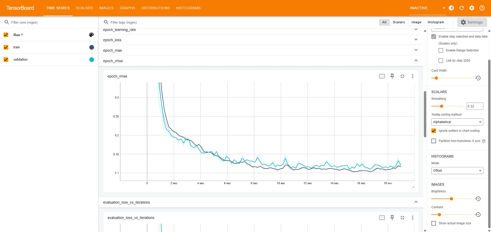

# TensorBoard (Open OnDemand)

TensorBoard turns machine learning event logs into interactive plots and summaries. This app opens a dashboard on SeaWulf or ClinWulf for logs produced by TensorFlow or PyTorch.

**On this page:** [Where it runs](#where) · [Start a session](#start) · [Launch settings](#settings) · [Troubleshooting](#trouble)

## Where it runs {#where}

| Cluster | Runs on |
| --- | --- |
| SeaWulf | Shared CPU queues on 40-core or 96-core nodes |
| ClinWulf | CPU or GPU queues |

For clinical work, use your approved study directories on ClinWulf and follow your study requirements for data handling.

> [!NOTE]
> **ClinWulf network access:** ClinWulf OnDemand can only be reached from within Health Sciences and Stony Brook University Hospital and Medical Center. From anywhere else, connect through Citrix Desktop or the Stony Brook Hospital & Medical Center VPN first.

## Start a session {#start}

1. Sign in to the OnDemand portal for your cluster ([SeaWulf](https://sn-ood.seawulf.stonybrook.edu/), [ClinWulf](https://clinwulf-ood.uhmc.sbuh.stonybrook.edu/)) with your NetID and Duo.
2. Open Interactive Apps and choose TensorBoard.
3. Choose the launch settings below and click Launch.
4. Wait for Running, then click the app connect button. Open the dashboard and select the runs and plots you want to compare. Your training job must write compatible event files to the log directory.
5. Save your work or export the results, then click Delete on the session card when finished. Closing the browser tab does not stop the session.

TensorBoard reads training logs; launching this dashboard does not start a training job. Choose the CPU version for routine log viewing.

*SeaWulf TensorBoard interface running through Open OnDemand. The dashboard displays training and validation metrics from event logs, with interactive views for time series, scalars, images, graphs, distributions, and histograms. Users can compare runs, inspect metrics such as loss and RMSE, and adjust display settings for analysis.*

## Launch settings {#settings}

Defaults below are starting points. Ask for resources your task needs, and keep the requested hours within the selected queue limit.

### SeaWulf

| Setting | What to choose |
| --- | --- |
| TensorBoard / TensorFlow version | TensorBoard Latest CPU. GPU version is not offered. |
| Queue | Shared CPU queues on 40-core or 96-core nodes. Short up to 4 hours; long up to 24; extended up to 84. Start with `short-40core-shared` or `short-96core-shared`. |
| Number of cores | Default 1; form range 1 to 96. Use only as many cores as the task can use, within the selected node capacity. |
| TensorBoard log directory | Full path to the directory containing your TensorFlow or PyTorch event logs, or the parent of run subfolders. |
| Number of hours | Default 1 hour. Choose enough time for your work, within the selected queue limit. |
| Memory (GB) | Default 4 GB. Choices: 2, 4, 8, 16, 32, 64, 128, 164 GB. |
| Additional modules (space-separated) | Optional space-separated modules. Leave blank unless your work needs additional software. |

### ClinWulf

| Setting | What to choose |
| --- | --- |
| TensorBoard / TensorFlow version | CPU version on SeaWulf. On ClinWulf, choose CPU or GPU 2.20.0; pair the GPU version with a GPU queue and a nonzero GPU count. |
| Queue | CPU Short, Long, or Extra; GPU Short, Long, or Extra. Start with `cpu_short` for CPU work and use the time limit shown by the portal. |
| TensorBoard log directory | Full path to the directory containing your TensorFlow or PyTorch event logs, or the parent of run subfolders. |
| Number of hours | Default 1 hour. Choose enough time for your work, within the selected queue limit. |
| Memory (GB) | Default 4 GB. Choices: 2, 4, 8, 16, 32, 64 GB. |
| Number of GPUs | Default 0. Choices: 0, 1, 2, 4. Use a GPU queue for a nonzero request. |
| Additional modules (space-separated) | Optional space-separated modules. Leave blank unless your work needs additional software. |

Email notifications are optional on SeaWulf. Enter an email address and select Email when job starts if you want a start notification.

Choose an explicit memory size for routine work. All available can reserve node memory and increase waiting time; use it only when your task needs it.

## Troubleshooting {#trouble}

**The dashboard says no data was found.** Point TensorBoard log directory to a folder containing event files or their run subfolders. A model checkpoint folder alone may not contain dashboard data.

**New results are missing.** Check that the training job is still writing to the same directory, then refresh the dashboard.

**The GPU version fails to start.** On ClinWulf, select a GPU queue and at least one GPU when using the GPU version. SeaWulf offers the CPU version only.

**My session stays Queued.** Try a shorter request, less memory, or fewer cores or GPUs. Check the session output if the job fails instead of remaining queued.

If the problem continues, [contact HPC support](https://iacs.supportsystem.com) with the cluster, app name, job ID, and the error text.

## Related guides {#related}

- [Open OnDemand apps on SeaWulf](seawulf-ondemand-apps.md)
- [Open OnDemand apps on ClinWulf](https://rci.stonybrook.edu/docs/clinwulf-ondemand-apps)
- [OnDemand overview](../shared/ondemand-overview.md)
- [Open OnDemand](https://rci.stonybrook.edu/hpc/ondemand)

**Applies to:** SeaWulf, ClinWulf

Ported from RCI's guide: <https://rci.stonybrook.edu/docs/ondemand-tensorboard> (maintained by Research Computing and Informatics).
