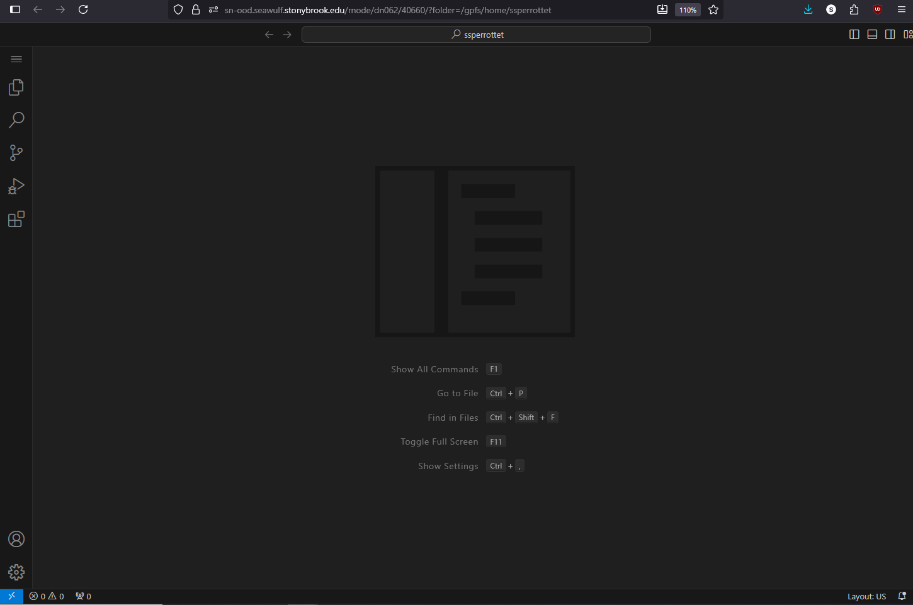

# Code Server

Code Server is Visual Studio Code running in your browser on a cluster compute node. Edit files in home, scratch, and project space, run code in the built-in terminal, and use Git and many VS Code extensions, without installing anything or setting up SSH.

**On this page:** [Where it runs](#where) · [Start a session](#start) · [Launch settings](#settings) · [Working in Code Server](#using) · [Extensions](#extensions) · [Troubleshooting](#trouble)

## Where it runs {#where}

| Cluster | Runs on | Good for |
| --- | --- | --- |
| SeaWulf | Shared CPU queues (40-core or 96-core nodes) | Writing and testing code, editing job scripts |
| NVwulf | B40 GPU nodes | Developing and debugging GPU code |
| ClinWulf | CPU or GPU queues | Code that works with PHI, kept inside ClinWulf |

## Start a session {#start}

1. Sign in to your cluster's [OnDemand portal](ondemand-overview.md#portals) with your NetID and Duo.
2. Open **Interactive Apps** and choose **Code Server**.
3. Set the **working directory** (or **project directory**) to your project folder, fill in the rest of the form, and click **Launch**.
4. When the card shows *Running*, click the connect button. VS Code opens in a new tab.
5. When you're done, save your files and click **Delete** on the session card.

## Launch settings {#settings}

| Setting | What to choose |
| --- | --- |
| Queue | SeaWulf: `short-40core-shared` (up to 4 hours) or a long shared queue for a full day. NVwulf: `b40x4` or `b40x4-long`. ClinWulf: a CPU queue unless you're testing GPU code. |
| Cores | 1 for editing. More if you'll compile or run tests in the terminal. |
| Memory | 4 to 8 GB for editing; more if you run programs from the terminal. |
| GPUs | NVwulf and ClinWulf GPU queues only; 1 is enough for development. |
| Working directory | The folder VS Code opens. Leave blank for your home folder. |
| Additional modules | ClinWulf: optional modules to load before VS Code starts, so they're available in its terminal. |

## Working in Code Server {#using}

- **Terminal:** open it from the menu (**Terminal**, **New Terminal**). It runs on the compute node, so you can load modules, activate conda environments, compile, and run programs just as over SSH.
- **Other folders:** use **File**, **Open Folder** and type a path such as `/gpfs/projects/<group>` (SeaWulf).
- **Python:** pick your conda environment's interpreter with **Python: Select Interpreter** in the command palette (Ctrl+Shift+P).
- **Git:** the Source Control panel works as usual. Set your name and email once in the terminal with `git config --global`.
- **Collaboration:** sessions are private, with no shareable link. Share work through Git or a shared project folder.

*VS Code (Code Server) running in the browser.*

## Extensions {#extensions}

Code Server installs extensions from the [Open VSX](https://open-vsx.org/) registry rather than Microsoft's marketplace. Most popular extensions are there, including Python, Jupyter, and many language tools, but a few Microsoft-only extensions (such as Pylance and the Remote extensions) aren't. Install only what you need; extensions live in your home folder and use its space.

## Troubleshooting {#trouble}

An extension I use at home isn't in the list

It may be Microsoft-only. Search Open VSX for an alternative; for Python, the open-source language server works well.

VS Code keeps reconnecting or loses my open files

Check that the session is still running on the card. If it reached its time limit, launch a new one; VS Code restores recently opened folders.

The terminal can't find a command

Load its module first, for example `module load slurm` for job commands on SeaWulf. See [Using modules](using-modules.md).

My session stays Queued

Try a shorter queue, fewer cores, or less memory.

Related: [OnDemand overview](ondemand-overview.md) · [Conda environments](conda-environments.md) · [SeaWulf apps](../seawulf/seawulf-ondemand-apps.md) · [NVwulf apps](../nvwulf/nvwulf-ondemand-apps.md) · [ClinWulf apps](https://rci.stonybrook.edu/docs/clinwulf-ondemand-apps)

**Applies to** SeaWulf NVwulf

Ported from RCI's guide: <https://rci.stonybrook.edu/docs/code-server> (maintained by Research Computing and Informatics).
{: .rci-credit }
