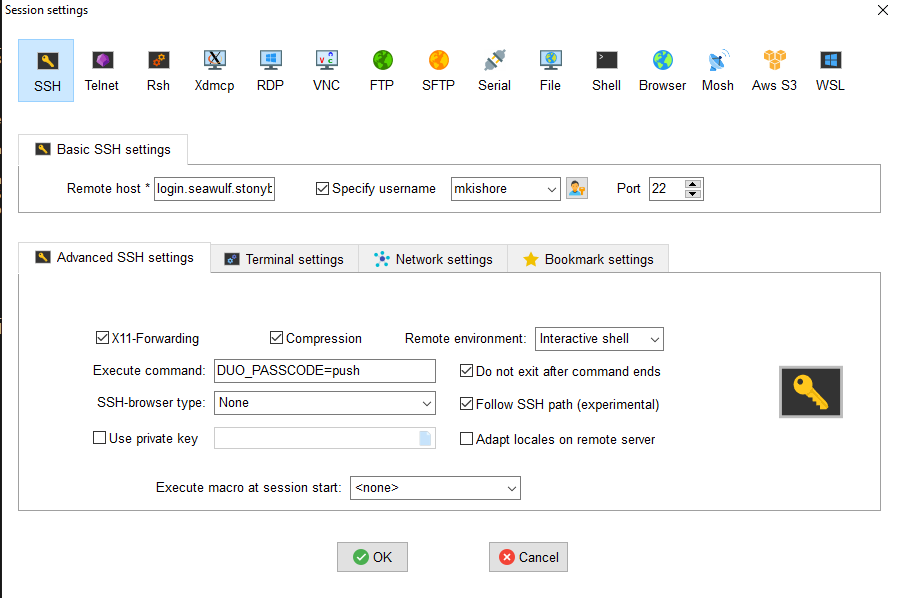

# DUO authentication

Every login to SeaWulf, NVwulf, and ClinWulf needs two things: your NetID password and a Duo approval on your phone or another enrolled device. This page covers setting up Duo, what the prompt looks like, and how to get fewer prompts when you log in often or move files.

**On this page:** [Set up Duo](#setup) · [At login](#login) · [Skip the menu](#passcode) · [Fewer prompts](#fewer) · [Troubleshooting](#trouble) · [Who to contact](#help)

## Set up Duo before your first login {#setup}

Duo is Stony Brook's two-step login, run by DoIT. If you already use it for email or other university systems, you're set, since the clusters use the same enrollment.

1. Enroll a device by following DoIT's [Duo two-step login](https://it.stonybrook.edu/services/duo-security-two-step-login) instructions. A smartphone with the free **Duo Mobile** app is easiest.
2. Allow Duo Mobile to send notifications, so pushes show up right away.
3. **Add a second device**, such as a tablet or another phone, in the [Duo device settings](https://it.stonybrook.edu/help/kb/reactivating-removing-and-renaming-devices-in-my-duo-account-and-updating-duo-settings). If you lose or replace your phone, you can still log in.

## What happens at login {#login}

**In Open OnDemand** (your browser), a Duo screen appears after your password. Approve the push, or choose another method on that screen.

**Over SSH**, after your password you'll see a short menu, similar to this:

```
Duo two-factor login for <netid>

Enter a passcode or select one of the following options:

 1. Duo Push to XXX-XXX-1234
 2. Phone call to XXX-XXX-1234
 3. SMS passcodes to XXX-XXX-1234

Passcode or option (1-3):
```

Type **1** and approve the push on your phone. You can also type a 6-digit passcode from the Duo Mobile app, which works even when your phone has no signal.

## Skip the menu with DUO_PASSCODE {#passcode}

If you always use the same method, set the `DUO_PASSCODE` variable and the menu is skipped. It also helps file-transfer tools such as `scp` and `sftp`, which can't show the menu.

| Value | What it does |
| --- | --- |
| `push` | Sends a Duo push to your device |
| `phone` | Calls your phone |
| `sms` | Texts you a batch of passcodes. That login fails; log in again with one of the codes. |
| a passcode, e.g. `123456` | Uses a code from Duo Mobile, a text, or a hardware token |
| `push2`, `phone2`… | Adds a number to pick a specific device if you have more than one |

### macOS and Linux

1. Add these lines to `~/.ssh/config` on your computer (create the file if needed):

    ```
    Host *.seawulf.stonybrook.edu
        SendEnv DUO_PASSCODE
    ```

2. Set the variable, then log in or copy files as usual:

    ```
    export DUO_PASSCODE=push
    ssh <netid>@milan.seawulf.stonybrook.edu
    ```

3. To make it permanent, add the `export` line to `~/.zshrc` (macOS) or `~/.bashrc` (Linux) on your computer.

### Windows (MobaXterm)

1. Open your session's settings in MobaXterm.
2. Add the environment variable `DUO_PASSCODE` with the value `push`.
3. Set the **SSH-browser type** to **None**. MobaXterm's file browser opens a second connection, which otherwise asks for Duo again.



*MobaXterm session settings: SSH-browser type set to None, with DUO_PASSCODE added.*

## Fewer prompts when you work a lot {#fewer}

- **Use the Stony Brook VPN.** You approve Duo once when the VPN connects, and cluster logins through the VPN don't ask again. This is the best fix for scripts and file-transfer tools that open many connections.
- **Reuse one connection (macOS and Linux).** SSH can send later logins and copies through a connection that's already open, so you approve Duo once per session. Add this to `~/.ssh/config`:

    ```
    Host *.seawulf.stonybrook.edu
        ControlMaster auto
        ControlPath ~/.ssh/cm-%r@%h:%p
        ControlPersist 1h
    ```

    While your first SSH window is open (and for an hour after), new `ssh`, `scp`, and `rsync` commands to the same address reuse it.

- **Set up an SSH key** so you don't type your password each time. See [Passwordless SSH](passwordless-ssh.md).
- **Move big data with Globus**, which doesn't need a Duo prompt for every file. See [Globus file transfer](../seawulf/globus-file-transfer.md).

## Troubleshooting {#trouble}

<details markdown="1">
<summary>"Your account has been locked out due to excessive authentication failures"</summary>

This happens after 10 Duo requests in a row go unanswered, often because a program kept reconnecting in the background. You'll get an email asking you to confirm the lockout; reply to it and your account will be unlocked. Then fix the cause: use the VPN or connection reuse (above) for tools that open many connections, and make sure your phone is actually receiving pushes.

</details>

<details markdown="1">
<summary>"Authentication failure: Invalid username or password" even though the password is right</summary>

You may be locked out of Duo itself, which affects every system that uses it. Call DoIT at [631-632-9800](tel:+16316329800) (2-9800 on campus) or open a ticket at [service.stonybrook.edu](https://service.stonybrook.edu) to have a Duo administrator unlock it.

</details>

<details markdown="1">
<summary>The push never arrives</summary>

Open Duo Mobile and check that your Stony Brook account is listed and notifications are allowed. Then type **2** for a phone call, or enter a passcode from the app instead. If your phone has no signal, the passcode in Duo Mobile still works.

</details>

<details markdown="1">
<summary>I got a new phone</summary>

Add the new phone in the [Duo device settings](https://it.stonybrook.edu/help/kb/reactivating-removing-and-renaming-devices-in-my-duo-account-and-updating-duo-settings) using a device that's still enrolled, then remove the old one. If you no longer have any enrolled device, contact DoIT to reactivate your account.

</details>

<details markdown="1">
<summary>scp, sftp, or my file-transfer app keeps failing or asking again and again</summary>

These tools can't show the Duo menu. Set `DUO_PASSCODE=push` (see [above](#passcode)), connect through the VPN, or use connection reuse. For graphical apps like FileZilla or WinSCP, the VPN is the simplest fix.

</details>

<details markdown="1">
<summary>A push arrived that I didn't start</summary>

Deny it. Someone may know your password, so change your NetID password through DoIT's [NetID service](https://it.stonybrook.edu/services/netid) right away and let DoIT know.

</details>

## Who to contact {#help}

| Problem | Contact |
| --- | --- |
| Enrolling devices, new phones, Duo lockouts | DoIT: [service.stonybrook.edu](https://service.stonybrook.edu) or 631-632-9800 |
| Logging in to a cluster, blocked connections, file transfers | HPC support: [iacs.supportsystem.com](https://iacs.supportsystem.com) |

Next: [Connecting to the cluster](connecting-cluster.md) covers the addresses for each cluster and more login troubleshooting.

**Applies to:** All clusters

Ported from RCI's guide: <https://rci.stonybrook.edu/docs/duo-authentication> (maintained by Research Computing and Informatics).
