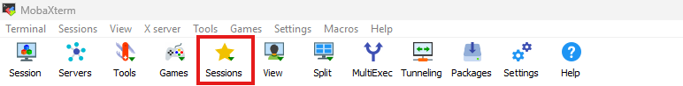
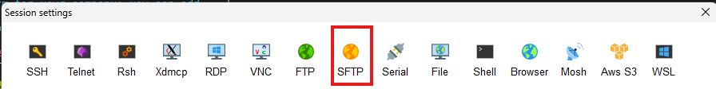
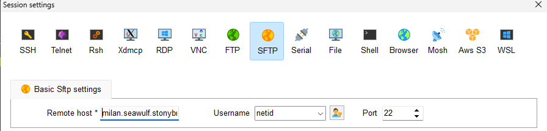

# File transfer from the CLI

To move files between your computer and the cluster from a terminal, use `scp` for quick copies, `rsync` for folders and big transfers, or `sftp` to browse. Windows users can also drag and drop with MobaXterm or WinSCP. For very large datasets, [Globus](../seawulf/globus-file-transfer.md) is faster and more reliable.

**On this page:** [Which tool?](#which) · [scp](#scp) · [rsync](#rsync) · [sftp](#sftp) · [Windows apps](#windows) · [Fewer Duo prompts](#duo) · [Troubleshooting](#trouble)

!!! note ""
    **Run these on your own computer,** not on the cluster. Replace `<netid>` with your NetID. Every transfer needs Duo, just like logging in.

## Which tool? {#which}

| You want to… | Use |
| --- | --- |
| Copy a few files once | `scp` |
| Copy a folder, resume after a dropped connection, or send only what changed | `rsync` |
| Look around and pick files interactively | `sftp` |
| Drag and drop on Windows | MobaXterm or WinSCP |
| Upload or download in the browser | [Open OnDemand](ondemand-overview.md) file manager |
| Move hundreds of GB or more | [Globus](../seawulf/globus-file-transfer.md) |

## scp: quick copies {#scp}

```
# Upload two files to your home folder
scp file1.txt file2.txt <netid>@milan.seawulf.stonybrook.edu:~/

# Download a file to the current folder
scp <netid>@milan.seawulf.stonybrook.edu:~/output.txt ./

# Upload a whole folder
scp -r my_folder/ <netid>@milan.seawulf.stonybrook.edu:~/

# Several remote files at once (quotes make the braces expand on the cluster)
scp <netid>@milan.seawulf.stonybrook.edu:'~/results/{a,b,c}.txt' ./
```

Group files into one command where you can: each `scp` is a new login and a new Duo prompt.

## rsync: folders and big transfers {#rsync}

```
# Upload a folder (only copies what's new or changed)
rsync -avz --progress my_folder/ <netid>@milan.seawulf.stonybrook.edu:~/my_folder/

# Download from a project space
rsync -avz --progress <netid>@milan.seawulf.stonybrook.edu:/gpfs/projects/SmithGroup/data/ ./data/

# See what would be copied without copying anything
rsync -avz --dry-run my_folder/ <netid>@milan.seawulf.stonybrook.edu:~/my_folder/
```

Flags: `-a` keeps permissions and dates, `-v` lists files, `-z` compresses, `--progress` shows progress. If a transfer stops, run the same command again and rsync picks up where it left off.

**Watch the trailing slash:** `my_folder/` copies the folder's contents; `my_folder` copies the folder itself.

## sftp: browse and pick {#sftp}

```
sftp <netid>@milan.seawulf.stonybrook.edu
sftp> ls                  # list files on the cluster
sftp> cd /gpfs/scratch/<netid>
sftp> get results.csv     # download
sftp> put input.dat       # upload
sftp> bye
```

**Have the Duo app open as you connect.** Command-line sftp doesn't prompt you for Duo, so if the app isn't open, the session won't start and you'll get a "Connection closed" error. To get a push without a prompt, see [Fewer Duo prompts](#duo) below.

## Windows apps {#windows}

- **MobaXterm (recommended):** use an SFTP session, then drag files between the panels. See [MobaXterm, step by step](#mobaxterm) below.
- **WinSCP:** choose the SFTP protocol, host `milan.seawulf.stonybrook.edu`, your NetID, and drag and drop.
- **Open OnDemand:** upload and download to home, scratch, or project space in your browser.

### MobaXterm, step by step {#mobaxterm}

1. In the toolbar at the top of MobaXterm, click **Sessions**.
    
2. In the Session settings window, choose **SFTP**.
    
3. Under Basic Sftp settings, set **Remote host** to `milan.seawulf.stonybrook.edu` and **Username** to your NetID. Leave Port at 22 and click **OK**.
    
4. Have the Duo app open on your phone and approve the request when it appears.
5. When the session opens, the files on your computer are in the left panel and your files on the cluster are in the right panel. Drag files from one panel to the other to transfer them.

**If the session closes right away** with "SFTP error #103: Connection closed by lower level protocol", Duo usually wasn't approved in time. Open the Duo app and connect again.

Use an SFTP session like this rather than the file browser in the sidebar of a normal SSH session, which asks for Duo again and again.

## Fewer Duo prompts {#duo}

- **Connect to the Stony Brook VPN first.** You approve Duo once, and transfers through the VPN don't ask again.
- **Set `DUO_PASSCODE=push`** so tools that can't show the Duo menu still work. See [Duo authentication](duo-authentication.md#passcode).
- **Reuse one connection** on macOS and Linux. See [fewer Duo prompts](duo-authentication.md#fewer).

## Troubleshooting {#trouble}

<details markdown="1">
<summary>The transfer hangs or never asks for Duo</summary>

File-transfer tools often can't show the Duo menu. Set `DUO_PASSCODE`, connect through the VPN, and check your default device in the [Duo device settings](https://it.stonybrook.edu/help/kb/reactivating-removing-and-renaming-devices-in-my-duo-account-and-updating-duo-settings).

</details>

<details markdown="1">
<summary>"Permission denied" when copying into a project space</summary>

You may not be a member of that project's group yet. Ask your PI to request access. Also check the path is spelled exactly right.

</details>

<details markdown="1">
<summary>"Disk quota exceeded"</summary>

Your home folder is only 20 GB. Copy large data to scratch or project space instead, and check with `myquota`.

</details>

<details markdown="1">
<summary>Transfers are slow or keep dropping</summary>

Use `rsync` so you can resume, bundle many small files into one archive with `tar` first, or switch to [Globus](../seawulf/globus-file-transfer.md) for large amounts of data.

</details>

**Applies to** <span class="rci-chip">All clusters</span>

Ported from RCI's guide: <https://rci.stonybrook.edu/docs/file-transfer-cli> (maintained by Research Computing and Informatics).
{: .rci-credit }
