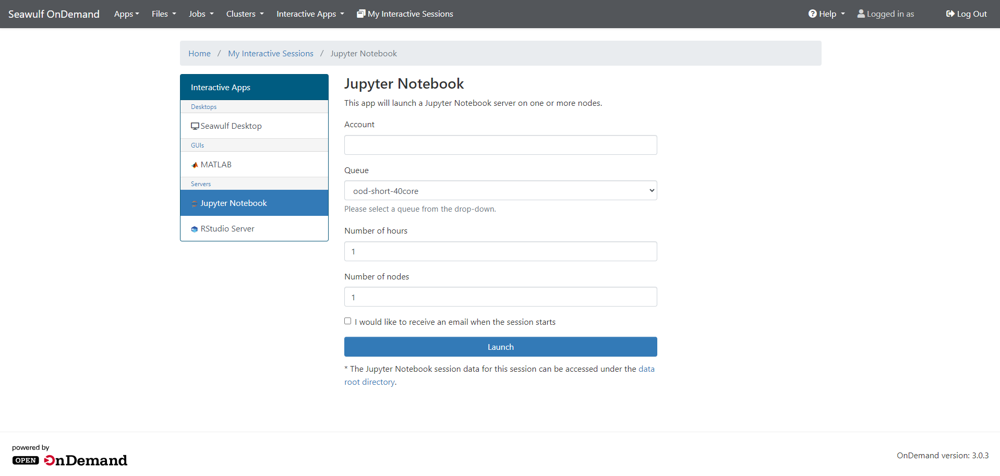
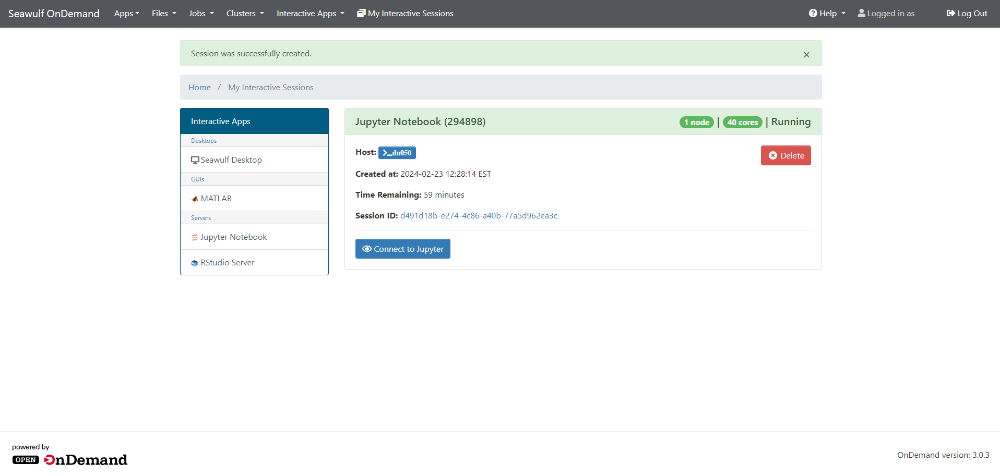
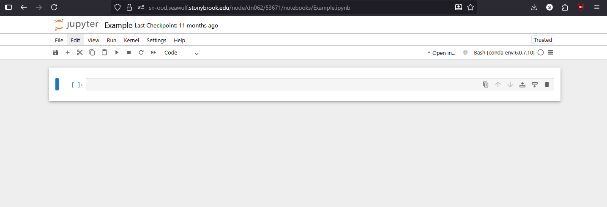

# Jupyter notebooks

Jupyter lets you write and run Python in your browser, with plots and notes right next to your code. Through Open OnDemand it runs on a cluster compute node, with GPUs on NVwulf and ClinWulf, and no SSH tunnels to set up.

**On this page:** [Where it runs](#where) · [Start a session](#start) · [Launch settings](#settings) · [Use your own environment](#kernel) · [Files](#files) · [Troubleshooting](#trouble)

## Where it runs {#where}

| Cluster | Apps | Runs on |
| --- | --- | --- |
| SeaWulf | Jupyter Notebook, JupyterLab | Shared CPU queues (40-core or 96-core nodes), no GPUs |
| NVwulf | Jupyter Notebook | B40 GPU nodes (RTX PRO 6000 Blackwell, 96 GB per GPU) |
| ClinWulf | Jupyter Notebook, JupyterLab | CPU or GPU queues, for work with PHI |

**Jupyter Notebook** is the classic one-notebook-per-tab interface. **JupyterLab** is the newer interface with a file browser, notebooks, terminals, and text files side by side; it's listed under **Sandbox** while it's being tested. Both open the same `.ipynb` files.

## Start a session {#start}

1. Sign in to your cluster's [OnDemand portal](ondemand-overview.md#portals) with your NetID and Duo.
2. Open **Interactive Apps** and choose **Jupyter Notebook** (or **JupyterLab**).
3. Fill in the form (see [below](#settings)) and click **Launch**.
4. Wait for the card to show *Running*, then click **Connect to Jupyter**.
5. When you're done, save your notebooks, close the tab, and click **Delete** on the session card.

## Launch settings {#settings}

| Setting | SeaWulf | NVwulf | ClinWulf |
| --- | --- | --- | --- |
| Queue | `short-40core-shared` (up to 4 hours) is right for most work; long and extended shared queues for more | `b40x4` (up to 8 hours) or `b40x4-long` (up to 48 hours) | CPU or GPU, in short, long, and extra lengths |
| Cores | 1 to 4 for most notebooks | A few per GPU | Not on the form |
| Memory | 2 to 164 GB; start with 4 to 8 | 8 to 480 GB; start with 8 to 32 | Type it, for example `8G` |
| GPUs | None | 1 unless your code uses more | On GPU queues, type and count, for example `a100:1` |

Ask only for what you need: smaller requests start sooner and leave room for others.



*The Jupyter launch form (SeaWulf). Forms on other clusters add GPU settings.*



*A running session. Click Connect to Jupyter to open it.*

## Use your own environment {#kernel}

To use your own Python packages in Jupyter, turn a conda environment into a Jupyter *kernel*. Do this once, from a terminal (**Clusters** then **Shell Access**). On SeaWulf:

```
module load anaconda/3
conda create --name myproject python=3.11 ipykernel numpy pandas matplotlib
conda activate myproject
python -m ipykernel install --user --name myproject --display-name "Python (myproject)"
```

Start a new Jupyter session and pick **Python (myproject)** from the kernel list. Install more packages later with `conda install` in the same environment. More in [Conda environments](conda-environments.md) and [Python package management](python-package-management.md).

!!! note ""
    **On NVwulf,** install GPU builds of your libraries (for example PyTorch with CUDA) in the environment, then check the GPU from a notebook with `import torch; torch.cuda.is_available()`.

## Files {#files}

Jupyter opens in your home folder. To reach scratch or project space, add a shortcut once from a terminal, for example on SeaWulf:

```
ln -s /gpfs/scratch/$USER ~/scratch
ln -s /gpfs/projects/<group> ~/project
```

Home folders are small (20 GB on SeaWulf), so keep large datasets in scratch or project space and save notebooks you care about somewhere backed up.



*Jupyter Notebook running in the browser.*

## Troubleshooting {#trouble}

<details markdown="1">
<summary>My environment doesn't appear in the kernel list</summary>

Make sure `ipykernel` is installed in the environment and you ran the `python -m ipykernel install --user` line above, then start a new session. List registered kernels with `jupyter kernelspec list`.

</details>

<details markdown="1">
<summary>The kernel keeps dying or restarting</summary>

It's usually out of memory. Delete the session and launch again with more memory, or load less data at once.

</details>

<details markdown="1">
<summary>My session stays Queued</summary>

Try a shorter queue, fewer cores or GPUs, or less memory.

</details>

<details markdown="1">
<summary>The session ended while I was working</summary>

It reached the hours you asked for. Save often and ask for a little more time than you think you need.

</details>

<details markdown="1">
<summary>"Disk quota exceeded"</summary>

Conda environments and caches fill a home folder fast. Check with `myquota` (SeaWulf), remove environments you no longer use, or create big ones in project space. See [Checking storage quotas](../seawulf/checking-storage-quotas.md).

</details>

Related: [OnDemand overview](ondemand-overview.md) · [SeaWulf apps](../seawulf/seawulf-ondemand-apps.md) · [NVwulf apps](../nvwulf/nvwulf-ondemand-apps.md) · [ClinWulf apps](https://rci.stonybrook.edu/docs/clinwulf-ondemand-apps)

**Applies to** <span class="rci-chip">SeaWulf</span> <span class="rci-chip">NVwulf</span> <span class="rci-chip">ClinWulf</span>

Ported from RCI's guide: <https://rci.stonybrook.edu/docs/jupyter-notebooks> (maintained by Research Computing and Informatics).
{: .rci-credit }
