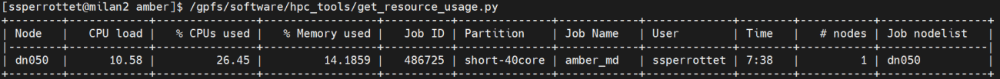
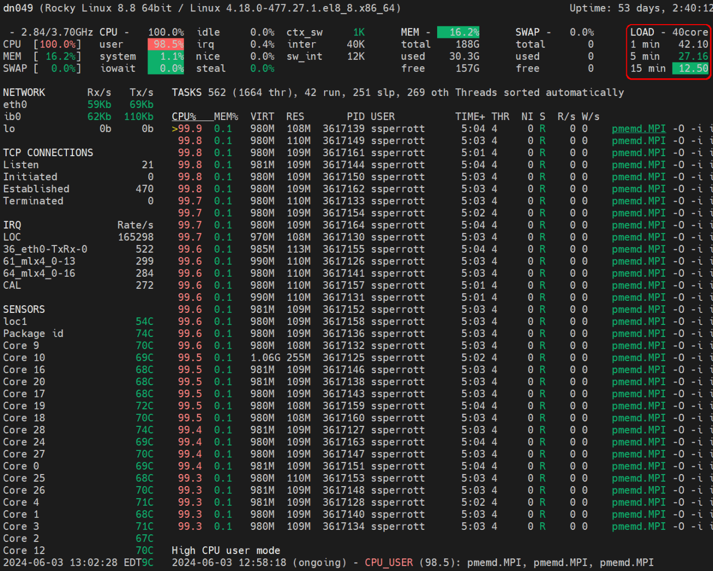
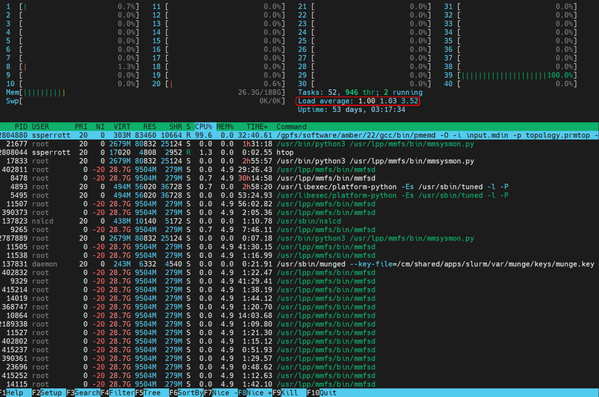
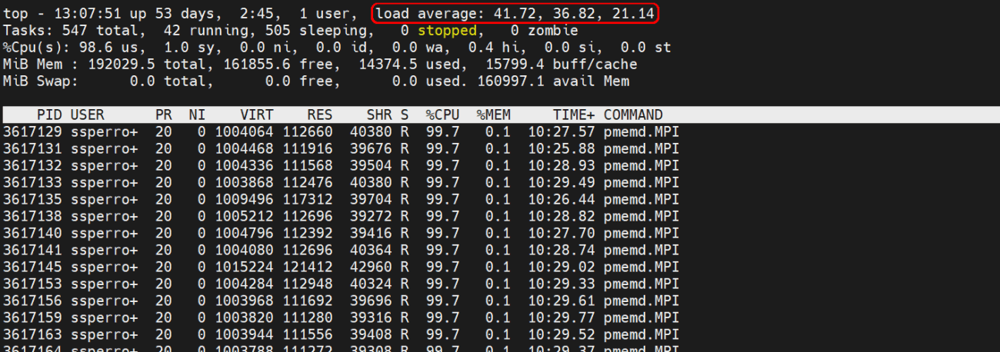

# Managing jobs

Once a job is submitted, you'll want to see where it is, change or cancel it if needed, and check afterward how well it used what it asked for. These are the commands for each of those steps.

**On this page:** [Watch your jobs](#watch) · [Hold, release, cancel](#change) · [After a job finishes](#after) · [Live view on the node](#live) · [Use resources well](#tune) · [Why is my job waiting?](#reasons)

> [!NOTE]
> **First:** run `module load slurm` in each session so these commands are available.

## Watch your jobs {#watch}

| Command | What it shows |
| --- | --- |
| `squeue -u $USER` | Your running and waiting jobs |
| `squeue -u $USER --start` | Slurm's estimate of when waiting jobs will start |
| `scontrol show job <jobid>` | Everything about one job, including why it's waiting |
| `sacct -j <jobid> -l` | Detailed accounting for a running or finished job |

```
# A tidier view: ID, name, state, run time, nodes, and the reason it's waiting
squeue -u $USER --format="%.10i %.20j %.8T %.10M %.6D %R"
```

## Hold, release, and cancel {#change}

```
scontrol hold <jobid>                    # keep a waiting job from starting
scontrol release <jobid>                 # let it start again

scancel <jobid>                          # cancel one job
scancel --name=my_job                    # cancel all jobs with this name
scancel --user=$USER --state=PENDING     # cancel all your waiting jobs
scancel --user=$USER                     # cancel ALL your jobs (careful)
```

## After a job finishes {#after}

```
seff <jobid>                                                  # CPU and memory efficiency
sacct -j <jobid> --format=JobID,JobName,State,Elapsed,MaxRSS,CPUTime
/gpfs/software/hpc_tools/get_resource_usage.py                 # SeaWulf summary of CPU and memory use
```

**Reading `seff`:** low CPU efficiency means cores sat idle (ask for fewer, or check your code actually runs in parallel). Memory efficiency far below 100% means you can ask for less memory next time.

## Live view on the compute node {#live}

1. **Find your node.** Look in the NODELIST column:

    ```
    squeue -u $USER
    ```

    For example `dn045`.

2. **Connect to it** (only works while your job is running there):

    ```
    ssh dn045
    ```

3. **Watch it** with one of these:

    ```
    module load glances && glances     # easiest to read
    module load htop && htop           # classic detailed view
    top                                # always available
    ```

**CPU load** is the average number of processes wanting a CPU, shown for the last 1, 5, and 15 minutes. On a busy 40-core node you'd expect about 40. Much lower means cores are idle; much higher means processes are fighting for cores, which slows everything down.

## Use resources well {#tune}

- Match CPU load to the number of cores you asked for.
- Compare peak memory with what you requested, and trim the request.
- Move small jobs to [shared queues](../seawulf/shared-nodes.md).
- Update your scripts based on what `seff` and the live view show. Better-sized jobs start sooner and help your [fair-share priority](fairshare-job-priority.md).

## Why is my job waiting? {#reasons}

The last column of `squeue` gives the reason:

| Reason | What it means |
| --- | --- |
| `Priority` | Other jobs are ahead of yours. It will start in turn. |
| `Resources` | Your job is next, and is waiting for enough nodes to free up. |
| `QOSMaxJobsPerUserLimit` or similar | You've reached a limit on running jobs for that queue. It starts when one of yours finishes. |
| `JobHeldUser` | You put it on hold. Use `scontrol release`. |
| `ReqNodeNotAvail` | The nodes it needs are down or reserved, often for maintenance. Check the [status page](https://rci.stonybrook.edu/status). |

## Screenshots



*get_resource_usage.py output: this node is only 26.5% busy, a sign the job asked for more than it used.*



*glances on a compute node*



*htop on a compute node*



*top on a compute node*

**Applies to:** All clusters

Ported from RCI's guide: <https://rci.stonybrook.edu/docs/managing-jobs> (maintained by Research Computing and Informatics).
