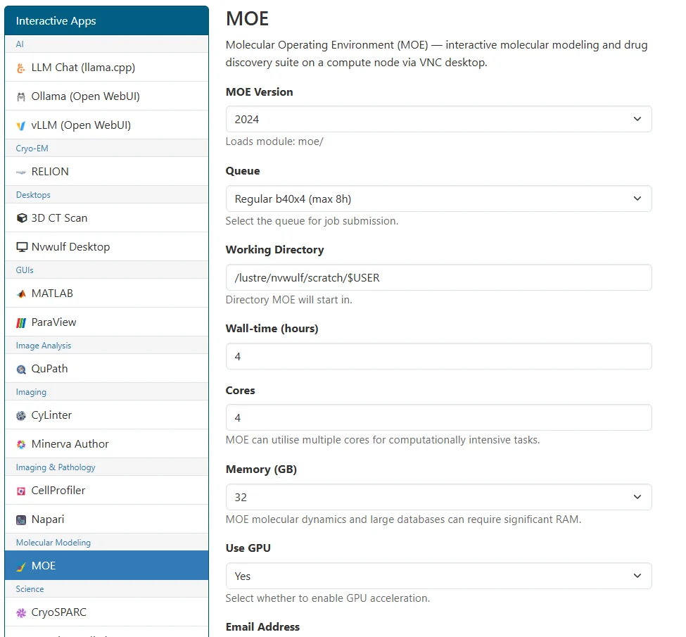

# MOE (Open OnDemand)

The Molecular Operating Environment provides tools for molecular modeling, structure analysis, and drug discovery. Open MOE through a browser desktop on SeaWulf or NVwulf and work directly with cluster files.

**On this page:** [Where it runs](#where) · [Start a session](#start) · [Launch settings](#settings) · [Troubleshooting](#trouble)

## Where it runs {#where}

| Cluster | Runs on |
| --- | --- |
| SeaWulf | Shared CPU queues on 40-core or 96-core nodes |
| NVwulf | B40 nodes using `b40x4` or `b40x4-long` |

## Start a session {#start}

1. Sign in to the OnDemand portal for your cluster ([SeaWulf](https://sn-ood.seawulf.stonybrook.edu/), [NVwulf](https://nvwulf-ood.nvwulf.stonybrook.edu/)) with your NetID and Duo.
2. Open Interactive Apps and choose MOE.
3. Choose the launch settings below and click Launch.
4. After the session starts, Open OnDemand provides Compression and Image Quality controls for the remote desktop display. Compression controls how strongly the graphical display is compressed before being sent to the browser. Higher compression can improve responsiveness on slower network connections but may reduce visual quality. Image Quality controls the quality of the displayed image. Higher values provide a sharper display but may require more network bandwidth. For most sessions, the default settings are appropriate. Adjust them only if the desktop appears slow, blurry, or unresponsive.
5. Open your molecular system or database in MOE and save the project in the working directory you selected.
6. Save your work or export the results, then click Delete on the session card when finished. Closing the browser tab does not stop the session.

## Launch settings {#settings}

Defaults below are starting points. Ask for resources your task needs, and keep the requested hours within the selected queue limit.

### SeaWulf

| Setting | What to choose |
| --- | --- |
| MOE Version | Version 2024. |
| Queue | Shared CPU queues on 40-core or 96-core nodes. Short up to 4 hours; long up to 24; extended up to 84. Start with `short-40core-shared` or `short-96core-shared`. |
| Working Directory | Defaults to your home folder. Choose the folder containing your project or data. Enter a full path. |
| Wall-time (hours) | Default 2 hours. Choose enough time for your work, within the selected queue limit. |
| Cores | Default 4; form range 1 to 96. Use only as many cores as the task can use, within the selected node capacity. |
| Memory (GB) | Default 16 GB. Choices: 4, 8, 16, 32, 64, 128, 256 GB. |

### NVwulf

| Setting | What to choose |
| --- | --- |
| MOE Version | Version 2024. |
| Queue | `b40x4` Regular, up to 8 hours, or `b40x4-long` Long, up to 48 hours. |
| Working Directory | Defaults to `/lustre/nvwulf/scratch/<netid>`. Choose the folder containing your project or data. Enter a full path. |
| Wall-time (hours) | Default 4 hours. Choose enough time for your work, within the selected queue limit. |
| Cores | Default 4; form range 1 to 16. Use only as many cores as the task can use, within the selected node capacity. |
| Memory (GB) | Default 128 GB. Choices: 64, 128, 256, 480 GB. |
| Number of GPUs | Default 2. Choices: 1, 2, 3, 4. Choose a count your processing task can use. |

Email notifications are optional. Enter an email address and select Email when job starts if you want a start notification.

Choose an explicit memory size for routine work. All available can reserve node memory and increase waiting time; use it only when your task needs it.

*NVwulf MOE Open OnDemand launch interface. The form allows users to select the MOE version, choose the B40 queue and working directory, specify wall time, CPU cores, and memory, and enable GPU acceleration for computationally intensive molecular modeling tasks.*

## Troubleshooting {#trouble}

**A license error appears.** Record the message and contact HPC support with the cluster, app name, and job ID.

**A database or calculation runs out of memory.** Choose more memory for a new session, or start with a smaller system. Large databases can need substantially more RAM than routine visualization.

**Extra GPUs do not speed up the task.** GPU allocation alone does not make a MOE task use GPUs. Choose resources for the specific calculation rather than requesting the maximum.

**My session stays Queued.** Try a shorter request, less memory, or fewer cores or GPUs. Check the session output if the job fails instead of remaining queued.

If the problem continues, [contact HPC support](https://iacs.supportsystem.com) with the cluster, app name, job ID, and the error text.

## Related guides {#related}

- [Open OnDemand apps on SeaWulf](../seawulf/seawulf-ondemand-apps.md)
- [Open OnDemand apps on NVwulf](../nvwulf/nvwulf-ondemand-apps.md)
- [OnDemand overview](ondemand-overview.md)
- [Open OnDemand](https://rci.stonybrook.edu/hpc/ondemand)

**Applies to:** SeaWulf, NVwulf

Ported from RCI's guide: <https://rci.stonybrook.edu/docs/ondemand-moe> (maintained by Research Computing and Informatics).
