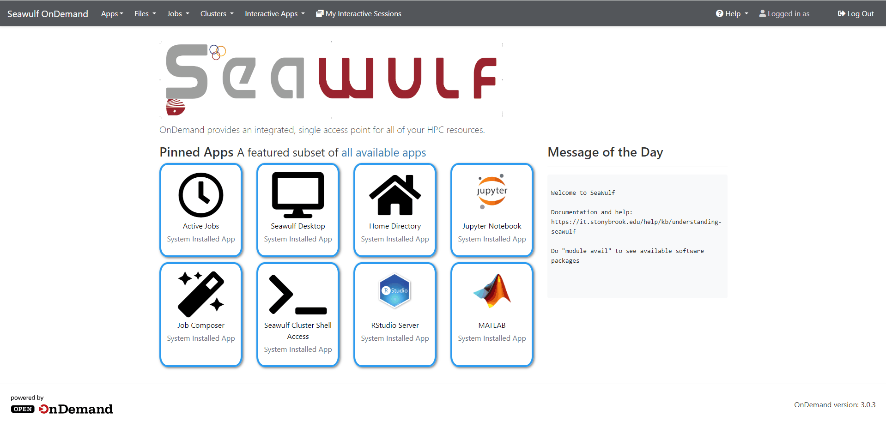

# OnDemand overview

Open OnDemand puts the clusters in your web browser: a terminal, a file manager, job tools, and dozens of point-and-click apps like Jupyter, RStudio, MATLAB, VS Code, and full Linux desktops. There's nothing to install, and it works on any computer.

**On this page:** [Portals](#portals) · [Log in](#login) · [A quick tour](#tour) · [Apps](#apps) · [Launching an app](#launch) · [Files](#files) · [Good habits](#habits) · [Troubleshooting](#trouble)

## Portals {#portals}

Each cluster has its own portal and its own set of apps.

| Cluster | Open OnDemand address | Apps |
| --- | --- | --- |
| SeaWulf | [sn-ood.seawulf.stonybrook.edu](https://sn-ood.seawulf.stonybrook.edu/) | [18 apps](../seawulf/seawulf-ondemand-apps.md) on CPU nodes: notebooks, R, MATLAB, chemistry and structural biology |
| NVwulf | [nvwulf-ood.nvwulf.stonybrook.edu](https://nvwulf-ood.nvwulf.stonybrook.edu/) | [19 apps](../nvwulf/nvwulf-ondemand-apps.md) on GPU nodes: notebooks, AI chat, cryo-EM, imaging |
| ClinWulf | [clinwulf-ood.uhmc.sbuh.stonybrook.edu](https://clinwulf-ood.uhmc.sbuh.stonybrook.edu/) | [8 apps](https://rci.stonybrook.edu/docs/clinwulf-ondemand-apps) for research with PHI |

> [!NOTE]
> **ClinWulf network access:** ClinWulf OnDemand can only be reached from within Health Sciences and Stony Brook University Hospital and Medical Center. From anywhere else, connect through Citrix Desktop or the Stony Brook Hospital & Medical Center VPN first.

## Log in {#login}

1. Open the portal for your cluster.
2. Sign in with your NetID and NetID password.
3. Approve the Duo request (see [Duo authentication](duo-authentication.md)).

You'll need an account on that cluster first. See [Requesting accounts & project numbers](requesting-accounts-project-numbers.md) and, for GPUs, [Getting access to NVwulf](../nvwulf/getting-access-nvwulf.md).

## A quick tour {#tour}

The menu bar at the top of every portal has the same parts:

| Menu | What's there |
| --- | --- |
| Files | A file manager for your home folder (and, on SeaWulf, your scratch folder). Upload, download, edit, rename, and move files. |
| Jobs | **Active Jobs** lists your running and waiting jobs. **Job Composer** builds and submits batch jobs from templates (see [Job Composer](../seawulf/job-composer.md)). |
| Clusters | The **Cluster Shell Access** terminal, just like an SSH login, and on NVwulf and ClinWulf a **System Status** page showing how busy the nodes are. |
| Interactive Apps | Every app you can launch, grouped by type (Servers, Desktops, GUIs, and so on). |
| My Interactive Sessions | Cards for the apps you've launched, with their status, time left, and connect button. |



*The SeaWulf Open OnDemand dashboard, with pinned apps on the front page.*

## Apps {#apps}

These guides cover the apps most people start with. Each one explains the launch form on every cluster that has the app.

| App | What it's for |
| --- | --- |
| [Jupyter](jupyter-notebooks.md) | Python notebooks, with your own conda environments |
| [RStudio Server](rstudio.md) | R in the browser |
| [MATLAB](../seawulf/matlab-open-ondemand.md) | MATLAB's full desktop |
| [Code Server](code-server.md) | VS Code in the browser |
| [WolfieHPCDesktop](seawulf-desktop.md) | A full desktop for any graphical program |
| [Job Composer](../seawulf/job-composer.md) | Create and submit batch jobs from templates |

For every other app, from Gaussian and ChimeraX to CryoSPARC and private AI chat, see the app pages for [SeaWulf](../seawulf/seawulf-ondemand-apps.md), [NVwulf](../nvwulf/nvwulf-ondemand-apps.md), and [ClinWulf](https://rci.stonybrook.edu/docs/clinwulf-ondemand-apps).

## Launching an app {#launch}

1. Pick the app from **Interactive Apps** or the dashboard.
2. Fill in the form: queue, hours, cores, memory, and on NVwulf and ClinWulf, GPUs. Ask only for what you need; smaller requests start sooner. The [queue selection guide](../seawulf/queue-selection-guide.md) explains SeaWulf's queues.
3. Click **Launch**. The session card moves from *Queued* to *Starting* to *Running*. Tick the email box on the form if you'd like a message when it starts.
4. When it's running, click the connect button to open the app in a new tab.
5. When you're finished, click **Delete** on the session card so the resources go back to others. Closing the browser tab doesn't end the session.

> [!NOTE]
> **Your session keeps running without you.** You can close the tab, shut your laptop, and reconnect later from **My Interactive Sessions**, as long as the hours you asked for haven't run out. When they do, the session ends and anything unsaved is lost.

## Working with files {#files}

Choose **Files** in the menu to browse, upload, download, create, rename, move, copy, and delete files, or to edit a text file in the browser.

| Cluster | Your home folder | Also in the Files menu |
| --- | --- | --- |
| SeaWulf | `/gpfs/home/<netid>` | Your scratch folder, `/gpfs/scratch/<netid>` |
| NVwulf | `/lustre/nvwulf/home/<netid>` | Home only |
| ClinWulf | `/vast/home/<netid>` | Home only |

To reach other folders, such as your group's project space, add a shortcut (a symbolic link) in your home folder once, from a terminal. For example, on SeaWulf:

```
ln -s /gpfs/projects/<group> ~/project
```

Browser uploads and downloads are fine for small files. For large transfers, [rsync](file-transfer-cli.md) or [Globus](../seawulf/globus-file-transfer.md) are faster and more reliable.

## Good habits {#habits}

- **Delete sessions you've finished with.** An idle Jupyter or desktop session still holds its cores, memory, and GPUs until its time runs out.
- **Start small.** One to four cores and a modest amount of memory are plenty for most interactive work. Run big computations as [batch jobs](writing-job-scripts.md) instead.
- **Save as you go**, especially near the end of your hours.
- **Keep PHI on ClinWulf.** SeaWulf and NVwulf aren't for patient data.

## Troubleshooting {#trouble}

<details markdown="1">
<summary>My session stays "Queued"</summary>

The queue you picked is busy. Delete the session and try a shorter or shared queue, fewer cores or GPUs, less memory, or fewer hours. On NVwulf and ClinWulf, **Clusters** then **System Status** shows how busy the nodes are.

</details>

<details markdown="1">
<summary>The session card says "Completed" right after it started</summary>

The app didn't start properly, often because the home folder is full or the settings didn't fit the queue. Open the session's log with the link on the card (usually `output.log`) for the error, and check your space with `myquota` on SeaWulf.

</details>

<details markdown="1">
<summary>The app opens but is blank or disconnects</summary>

Refresh the page or reconnect from the session card. If the session has ended, check its time limit and launch a new one.

</details>

<details markdown="1">
<summary>The portal itself is acting strangely</summary>

Use **Restart Web Server** in the Help menu (top right). It restarts your personal portal process without touching your running jobs.

</details>

<details markdown="1">
<summary>I can't sign in</summary>

Check your NetID password and Duo. Too many failed attempts can lock Duo. See [Duo troubleshooting](duo-authentication.md#trouble).

</details>

<details markdown="1">
<summary>The Files app can't see my project folder</summary>

Add the symbolic link shown above, then refresh the Files page.

</details>

Still stuck? [Open a ticket](https://iacs.supportsystem.com/) with the cluster, the app, and the time it happened, or drop into [HPC virtual office hours](https://rci.stonybrook.edu/events/hpc-virtual-office-hours).

**Applies to:** SeaWulf, NVwulf, ClinWulf

Ported from RCI's guide: <https://rci.stonybrook.edu/docs/ondemand-overview> (maintained by Research Computing and Informatics).
