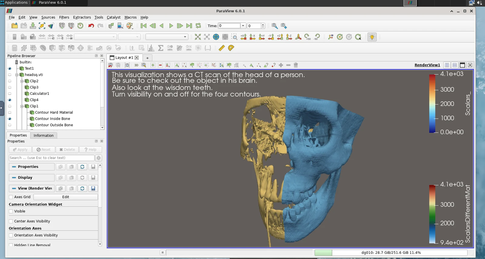

# ParaView (Open OnDemand)

ParaView provides interactive visualization of simulation results and three-dimensional imaging data. Use it through a cluster desktop to explore large datasets without copying them to your own computer.

**On this page:** [Where it runs](#where) · [Start a session](#start) · [Launch settings](#settings) · [Troubleshooting](#trouble)

## Where it runs {#where}

| Cluster | Runs on |
| --- | --- |
| SeaWulf | Shared CPU queues on 40-core or 96-core nodes |
| NVwulf | B40 nodes using `b40x4` or `b40x4-long` |
| ClinWulf | CPU or GPU queues |

For clinical work, use your approved study directories on ClinWulf and follow your study requirements for data handling.

!!! note ""
    **ClinWulf network access:** ClinWulf OnDemand can only be reached from within Health Sciences and Stony Brook University Hospital and Medical Center. From anywhere else, connect through Citrix Desktop or the Stony Brook Hospital & Medical Center VPN first.

## Start a session {#start}

1. Sign in to the OnDemand portal for your cluster ([SeaWulf](https://sn-ood.seawulf.stonybrook.edu/), [NVwulf](https://nvwulf-ood.nvwulf.stonybrook.edu/), [ClinWulf](https://clinwulf-ood.uhmc.sbuh.stonybrook.edu/)) with your NetID and Duo.
2. Open Interactive Apps and choose ParaView.
3. Choose the launch settings below and click Launch.
4. After the session starts, Open OnDemand provides Compression and Image Quality controls for the remote desktop display. Compression controls how strongly the graphical display is compressed before being sent to the browser. Higher compression can improve responsiveness on slower network connections but may reduce visual quality. Image Quality controls the quality of the displayed image. Higher values provide a sharper display but may require more network bandwidth. For most sessions, the default settings are appropriate. Adjust them only if the desktop appears slow, blurry, or unresponsive.
5. Open a dataset, click Apply in the Properties panel, and choose a representation. Save a state file to return to the same visualization later.
6. Save your work or export the results, then click Delete on the session card when finished. Closing the browser tab does not stop the session.

*ParaView graphical interface running through Open OnDemand. The interface includes the Pipeline Browser and Properties panels for managing datasets and visualization filters, while the main Render View displays an interactive three-dimensional CT dataset with clipping, contouring, and scalar-based coloring.*

## Launch settings {#settings}

Defaults below are starting points. Ask for resources your task needs, and keep the requested hours within the selected queue limit.

### SeaWulf

| Setting | What to choose |
| --- | --- |
| ParaView version | Choose 6.0.1, 5.11.0. Default 6.0.1. |
| Queue | Shared CPU queues on 40-core or 96-core nodes. Short up to 4 hours; long up to 24; extended up to 84. Start with `short-40core-shared` or `short-96core-shared`. |
| Working directory | Defaults to your home folder. Choose the folder containing your project or data. Enter a full path. |
| Number of hours | Default 1 hour. Choose enough time for your work, within the selected queue limit. |
| Number of cores | Default 1; form range 1 to 96. Use only as many cores as the task can use, within the selected node capacity. |
| Memory (GB) | Default 4 GB. Choices: 2, 4, 8, 16, 32, 64, 128, 164 GB. |

### NVwulf

| Setting | What to choose |
| --- | --- |
| Queue | `b40x4` Regular, up to 8 hours, or `b40x4-long` Long, up to 48 hours. |
| Number of hours | Choose enough time to inspect and save your visualization, within the selected queue limit. |
| Memory | Choose enough system RAM to load the data and filters. Start modestly and increase if a session runs out of memory. |
| GPUs | Start with one GPU for interactive rendering. Request more only if the configured visualization workflow uses them. |
| Cores | A few cores are a reasonable start for interactive work. Additional cores help only when the selected operation uses them. |

### ClinWulf

| Setting | What to choose |
| --- | --- |
| ParaView version | Version 6.0.1. |
| Queue | CPU Short, Long, or Extra; GPU Short, Long, or Extra. Start with `cpu_short` for CPU work and use the time limit shown by the portal. |
| Project directory | Defaults to your home folder. Choose the folder containing your project or data. Enter a full path. |
| Number of hours | Default 1 hour. Choose enough time for your work, within the selected queue limit. |
| Memory (GB) | Default 4 GB. Choices: 2, 4, 8, 16, 32, 64 GB. |
| Number of GPUs | Default 0. Choices: 0, 1, 2, 4. Use a GPU queue for a nonzero request. |
| Desktop resolution | Desktop size as WIDTHxHEIGHT. Default 1920x1080; use a size that fits your browser window. |
| Additional modules (space-separated) | Optional space-separated modules. Leave blank unless your work needs additional software. |

Email notifications are optional on SeaWulf. Enter an email address and select Email when job starts if you want a start notification.

Choose an explicit memory size for routine work. All available can reserve node memory and increase waiting time; use it only when your task needs it.

## Troubleshooting {#trouble}

**I opened a file but see no data.** Click Apply, check that the dataset is visible in the Pipeline Browser, and reset the camera.

**The application slows down or runs out of memory.** Start with a smaller dataset or fewer expensive filters. Increase system memory for the next session if the data requires it.

**Rendering is black or fails.** Reconnect once. On NVwulf, select GPU resources for GPU rendering; on ClinWulf, pair a GPU request with a GPU queue. Report persistent graphics errors to support.

**My session stays Queued.** Try a shorter request, less memory, or fewer cores or GPUs. Check the session output if the job fails instead of remaining queued.

If the problem continues, [contact HPC support](https://iacs.supportsystem.com) with the cluster, app name, job ID, and the error text.

## Related guides {#related}

- [Open OnDemand apps on SeaWulf](../seawulf/seawulf-ondemand-apps.md)
- [Open OnDemand apps on NVwulf](../nvwulf/nvwulf-ondemand-apps.md)
- [Open OnDemand apps on ClinWulf](https://rci.stonybrook.edu/docs/clinwulf-ondemand-apps)
- [OnDemand overview](ondemand-overview.md)
- [Open OnDemand](https://rci.stonybrook.edu/hpc/ondemand)

**Applies to** All clusters

Ported from RCI's guide: <https://rci.stonybrook.edu/docs/ondemand-paraview> (maintained by Research Computing and Informatics).
{: .rci-credit }
