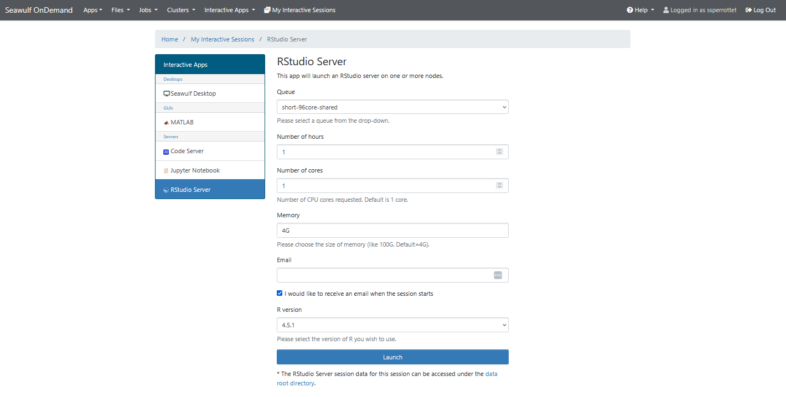
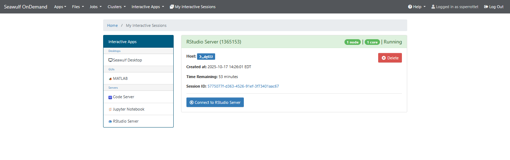
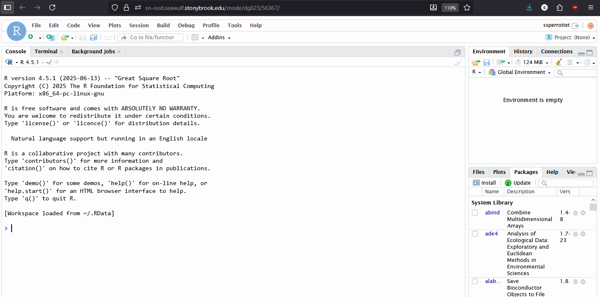

# RStudio

RStudio Server gives you the full RStudio interface in your browser, running on a cluster compute node. Write and run R scripts, make plots, and use the built-in terminal, with more memory and cores than a laptop and nothing to install.

**On this page:** [Where it runs](#where) · [Start a session](#start) · [Launch settings](#settings) · [Installing packages](#packages) · [Files and sharing](#files) · [Troubleshooting](#trouble)

## Where it runs {#where}

| Cluster | R versions | Runs on |
| --- | --- | --- |
| SeaWulf | R 4.5.1 or 4.3.2, chosen on the form | Shared CPU queues (40-core or 96-core nodes) |
| NVwulf | Set by the app | B40 GPU nodes |
| ClinWulf | Set by the app | CPU or GPU queues, for work with PHI |

To check the version inside a session, type `R.version.string` in the console.

## Start a session {#start}

1. Sign in to your cluster's [OnDemand portal](ondemand-overview.md#portals) with your NetID and Duo.
2. Open **Interactive Apps** and choose **RStudio Server**.
3. Fill in the form (see [below](#settings)) and click **Launch**.
4. When the card shows *Running*, click the connect button.
5. When you're done, save your scripts, close the tab, and click **Delete** on the session card.

## Launch settings {#settings}

| Setting | SeaWulf | NVwulf | ClinWulf |
| --- | --- | --- | --- |
| Queue | `short-40core-shared` (up to 4 hours) for most work; long and extended shared queues for more | `b40x4` (up to 8 hours) or `b40x4-long` (up to 48 hours) | A CPU queue unless you need a GPU |
| Cores | 1 to 4; more only if you use parallel packages | 1 to 4 | 1 to 4 |
| Memory | 2 to 164 GB; about twice the size of your data is a good start | 8 to 480 GB | Type it, for example `16G` |
| Extras | **R version**, and **Additional modules** for packages that need system libraries | GPUs (usually 1) | GPUs, typed as type and count (for example `a100:1`), only on GPU queues |



*The RStudio Server launch form (SeaWulf).*



*A running session, ready to connect.*

## Installing packages {#packages}

Install packages the usual way. The first time, R asks to create a personal library in your home folder; answer yes.

```
install.packages("tidyverse")
```

- **Packages belong to one R version.** If you switch versions on the form, reinstall the packages you need.
- **If an install fails** with a missing library such as `hdf5`, `libpng`, or `cmake`, delete the session and relaunch with that module in **Additional modules** (SeaWulf), for example `hdf5/1.12.1`. Find module names with `module avail` in a terminal.
- **Bioconductor** packages install with `BiocManager::install()` after `install.packages("BiocManager")`.
- For a reproducible project, `renv` keeps a separate library per project.

## Files and sharing {#files}

RStudio opens in your home folder. To reach scratch or project space from the Files pane, add a shortcut once from the RStudio **Terminal** tab, for example on SeaWulf:

```
ln -s /gpfs/scratch/$USER ~/scratch
ln -s /gpfs/projects/<group> ~/project
```

RStudio sessions are private; there's no link to share a running session. Work together through Git (RStudio's Git pane works as usual) or a shared project folder.



*RStudio Server running in the browser.*

## Troubleshooting {#trouble}

<details markdown="1">
<summary>R crashes or says "cannot allocate vector"</summary>

You ran out of memory. Save your work, delete the session, and relaunch with more memory.

</details>

<details markdown="1">
<summary>RStudio opens with an old, broken workspace</summary>

RStudio restores your last session. Turn this off under **Tools**, **Global Options**, **General**: untick restoring `.RData` and set saving the workspace to *Never*. If it still won't open, rename `~/.local/share/rstudio` from a terminal and relaunch.

</details>

<details markdown="1">
<summary>A package won't install</summary>

Read the error for a missing system library, then relaunch with that module added (see [above](#packages)). If you're stuck, [open a ticket](https://iacs.supportsystem.com/) with the package name and the error.

</details>

<details markdown="1">
<summary>My session stays Queued</summary>

Try a shorter queue, fewer cores, or less memory.

</details>

Related: [OnDemand overview](ondemand-overview.md) · [Using modules](using-modules.md) · [SeaWulf apps](../seawulf/seawulf-ondemand-apps.md) · [NVwulf apps](../nvwulf/nvwulf-ondemand-apps.md) · [ClinWulf apps](https://rci.stonybrook.edu/docs/clinwulf-ondemand-apps)

**Applies to** <span class="rci-chip">SeaWulf</span> <span class="rci-chip">NVwulf</span> <span class="rci-chip">ClinWulf</span>

Ported from RCI's guide: <https://rci.stonybrook.edu/docs/rstudio> (maintained by Research Computing and Informatics).
{: .rci-credit }
