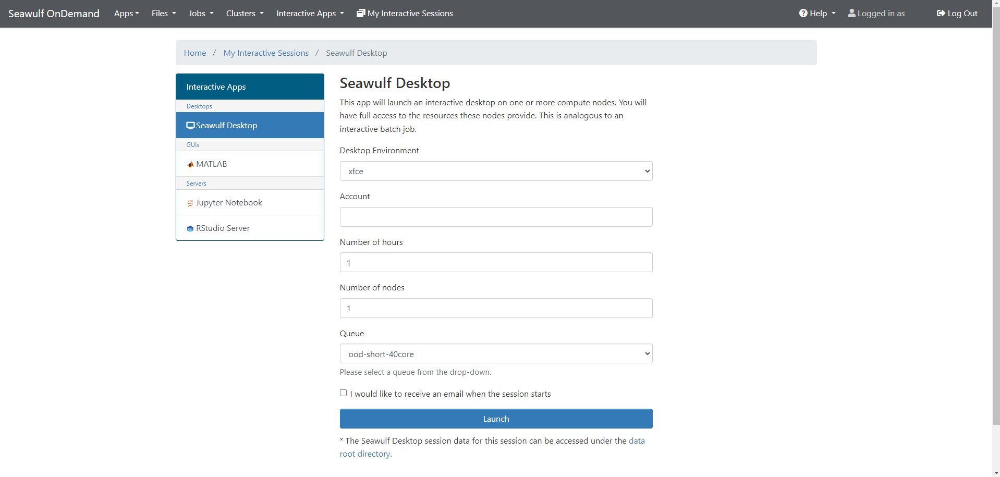
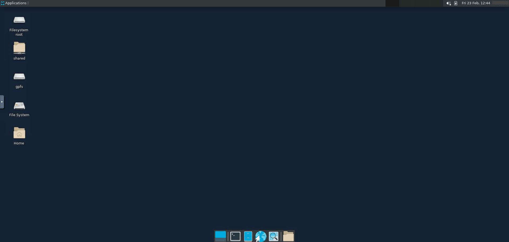
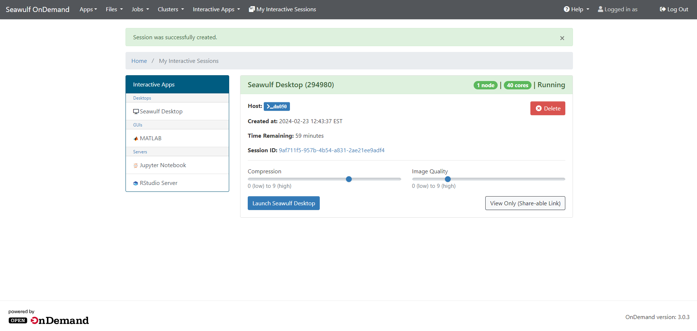

# WolfieHPCDesktop

**WolfieHPCDesktop** gives you a full Linux desktop on a cluster compute node, in your web browser. Use it for any graphical program that doesn't have its own OnDemand app, open terminals, and manage files, all with the node's cores, memory, and (on NVwulf and ClinWulf) GPUs.

**On this page:** [Desktops on each cluster](#where) · [Start a desktop](#start) · [Launch settings](#settings) · [Using the desktop](#using) · [Sharing and display settings](#share) · [Troubleshooting](#trouble)

## Desktops on each cluster {#where}

WolfieHPCDesktop works the same way on all three clusters. In each portal, open **Interactive Apps** and look under **Desktops** for the app name below.

| Cluster | App name | Runs on |
| --- | --- | --- |
| SeaWulf | Seawulf Desktop | Shared CPU queues (40-core or 96-core nodes), XFCE desktop |
| NVwulf | Nvwulf Desktop | B40 GPU nodes |
| ClinWulf | Clinwulf Desktop | CPU short and long queues, or the GPU short queue |

A desktop is often smoother than [X11 forwarding](../seawulf/x11-forwarding.md) for graphical programs, especially off campus. Many common tools also have their own apps that start them for you, such as MATLAB, ParaView, ChimeraX, or IGV; see the app pages for [SeaWulf](../seawulf/seawulf-ondemand-apps.md), [NVwulf](../nvwulf/nvwulf-ondemand-apps.md), and [ClinWulf](https://rci.stonybrook.edu/docs/clinwulf-ondemand-apps).

## Start a desktop {#start}

1. Sign in to your cluster's [OnDemand portal](ondemand-overview.md#portals) with your NetID and Duo.
2. Open **Interactive Apps** and choose the desktop app (under **Desktops**).
3. Fill in the form (see [below](#settings)) and click **Launch**.
4. When the card shows *Running*, click the launch button. The desktop opens in a new browser tab.

## Launch settings {#settings}

| Setting | What to choose |
| --- | --- |
| Queue | SeaWulf: `short-40core-shared` (up to 4 hours), or long and extended shared queues for more. NVwulf: `b40x4` or `b40x4-long`. ClinWulf: `cpu_short` or `cpu_long`, or `gpu_short` for a GPU. |
| Cores | 1 to 4 for most graphical work; more for programs that compute in parallel. |
| Memory | SeaWulf 2 to 164 GB, NVwulf 8 to 480 GB; on ClinWulf type it, for example `16G`. 8 GB is a comfortable start. |
| GPUs | NVwulf: usually 1. ClinWulf GPU queue: type and count, for example `a100:1`. |
| Hours | How long the desktop stays up. It closes at this limit, so save before then. |

*The SeaWulf Desktop launch form.*

## Using the desktop {#using}

- **Terminal:** open one from the taskbar at the bottom or the **Applications** menu. Load modules and start programs there, for example `module load paraview` then `paraview &`.
- **Files:** the desktop's file manager opens your home folder; type a path to reach scratch or project space.
- **Copy and paste:** use the control panel on the left edge of the desktop tab to move text between your computer and the desktop.
- **Password prompt:** if the desktop asks for a password (for example after the screen locks), enter your NetID password.
- **Ending:** close the tab, go back to the session card, and click **Delete** to free the node. Closing the tab alone leaves it running.

*A full Linux desktop in the browser.*

## Sharing and display settings {#share}

The running session card has:

- **Compression** and **Image quality** sliders. On a slow connection, raise compression and lower quality.
- **View Only (Share-able Link)**, which lets another cluster user watch your desktop without controlling it. Handy when you're getting help.

*A running desktop session and its controls.*

## Troubleshooting {#trouble}

The desktop is slow or blurry

Adjust **Compression** and **Image quality** on the session card and reconnect. A faster or wired network connection helps too.

A 3D program shows OpenGL errors or a black window

SeaWulf desktops have no GPU, so heavy 3D programs may need software rendering or may be too slow. For GPU-accelerated graphics, use NVwulf's desktop or its 3D CT Scan app.

The desktop disconnected

Reconnect from the session card. If the card is gone, the session reached its time limit; start a new one.

My session stays Queued

Try a shorter queue, fewer cores, less memory, or no GPU.

Related: [OnDemand overview](ondemand-overview.md) · [X11 forwarding](../seawulf/x11-forwarding.md) · [Using modules](using-modules.md)

**Applies to** SeaWulf NVwulf ClinWulf

Ported from RCI's guide: <https://rci.stonybrook.edu/docs/seawulf-desktop> (maintained by Research Computing and Informatics).
{: .rci-credit }
