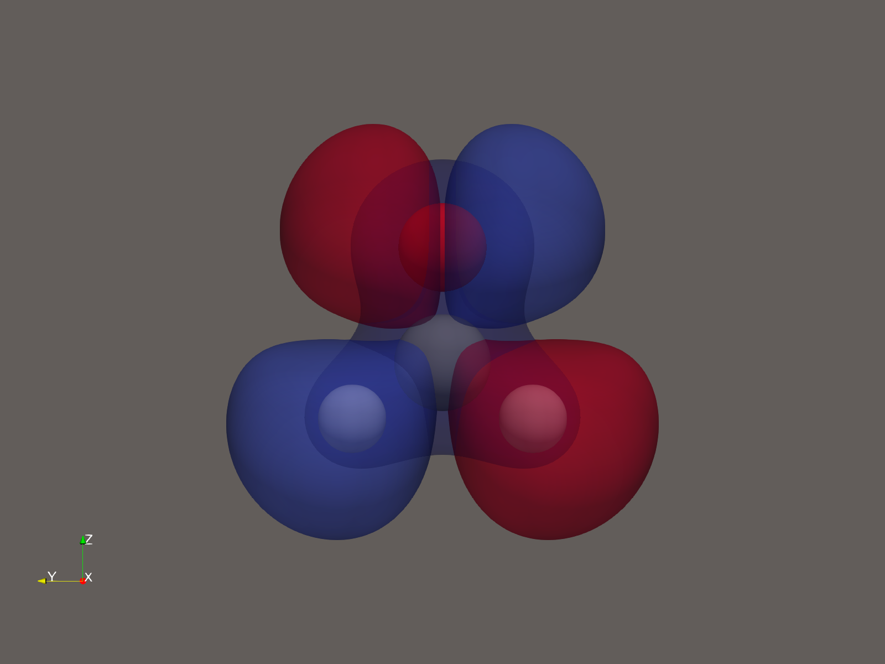
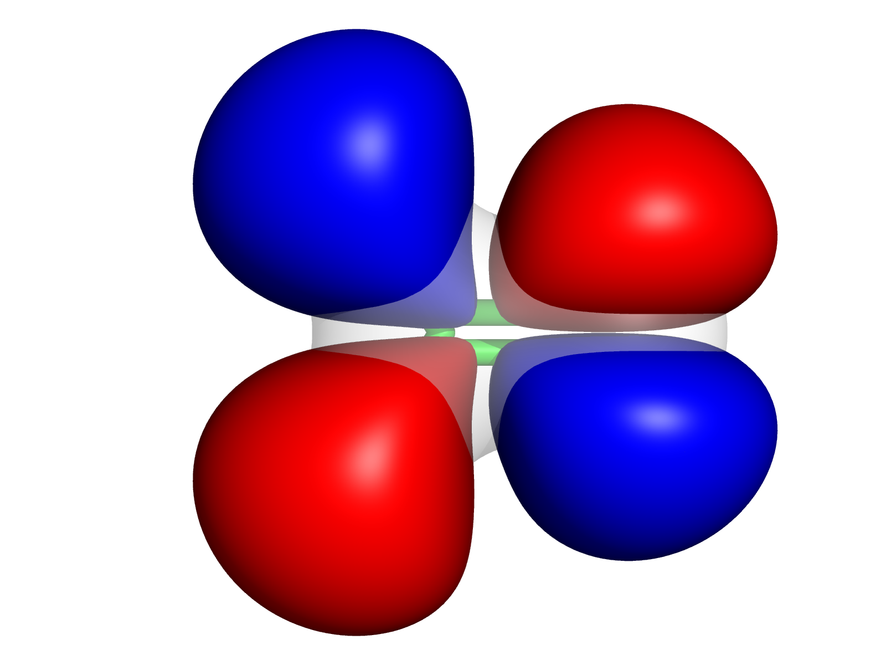

# See orbitals and electron density from a cube file

> **Status:** draft. Verified steps and screenshots to come.

Draw a molecule's electron density and one of its orbitals as surfaces, at values you choose. Four programs read the same two files.
**Time:** 10 to 15 minutes, depending on the program

Quantum-chemistry programs compute numbers on a 3-D grid: the electron density, orbitals, the [electrostatic potential](../../../../reference/glossary.md#electrostatic-potential-esp). A [cube file](../../../../reference/glossary.md#cube-file) stores that grid, along with the positions of the atoms, and each program below turns it into a surface.

> [!NOTE]
> **Cluster details.** <mark>Highlighted</mark> values are placeholders. Kitsune's queue names, module versions, paths, and addresses go in when the cluster is deployed.

## Choose your program

Each program has its own page below. They cover the same ground.

| Program | Lesson | What it suits | Minutes |
|---|---|---|---|
| GaussView | [Orbitals and density in GaussView](gaussview.md) | Work that already runs in Gaussian. Its license covers a named group: <mark>Kitsune Gaussian access, to come</mark> | 10 |
| ParaView | [Orbitals and density in ParaView](paraview.md) | Pictures you want to script, or a pipeline you are already using | 15 |
| ChimeraX | [Orbitals and density in ChimeraX](chimerax.md) | Work that also involves proteins or cryo-EM maps. It reads the grid from a cube file, but not the atoms, so the molecule comes from the PDB file | 10 |
| PyMOL | [Orbitals and density in PyMOL](pymol.md) | Publication figures, drawn the way PyMOL draws proteins | 10 |

<details>
<summary>What each program's result looks like</summary>

The same orbital, from the same cube files, drawn by the ParaView and PyMOL lessons' scripts. The lobes are the same shape and size in both. Only the drawing style differs. Pictures from GaussView and ChimeraX follow once the lessons have been run in them.


*Figure 1. ParaView: see-through lobes, with the atoms showing inside.*


*Figure 2. PyMOL: solid lobes around the molecule's sticks. The red and blue may come out swapped in your own pictures: an orbital's overall sign is arbitrary.*

</details>

## Get the cube files

Every version starts from the same calculation of formaldehyde, H₂CO. It writes `density.cube` and `homo.cube`, which all four programs read, and `formaldehyde.pdb`, from which PyMOL and ChimeraX take the atoms.

The script needs [PySCF](https://pyscf.org/), which comes with one of the cluster's Python modules. It also needs a copy of the lesson's scripts in your home directory (<mark>Kitsune copy of the lesson files, to come</mark>). It writes into `~/scratch`, so make that folder first with [step 2 of the data lesson](../../start/your-data.md#step-2-make-scratch-visible-from-home).

**Run in:** the OnDemand desktop terminal. <mark>Load Kitsune's Python module with PySCF in place of the first line.</mark>

```bash
module load python-with-pyscf
python ~/kitsune-curriculum/tutorials/visualization/scripts/make_cubes_pyscf.py --out ~/scratch/cubes --check
```

**You should see:** six lines starting `check:`, each ending in `PASS`. Your `~/scratch/cubes` folder now holds five files: the three above, plus `esp.cube` and `lumo.cube` for later lessons. The calculation takes about a minute.

If Python reports `ModuleNotFoundError: No module named 'pyscf'`, the module isn't loaded in this terminal: run the `module load` line again.

## What every version teaches

An [isosurface](../../../../reference/glossary.md#isosurface) is the set of points where the grid equals a value you choose, its [isovalue](../../../../reference/glossary.md#isosurface), and that value decides the shape. For the density, 0.0004 e/bohr³ encloses almost all the electrons and gives a surface about the size of the molecule. A larger value, 0.05, follows the atoms and bonds, because the density only reaches it near the nuclei. An orbital has positive and negative regions, so it needs two surfaces, at +0.02 and −0.02, in two colors. Density is positive everywhere, so one surface covers it.

## Next

- [Orbitals and density in ParaView](paraview.md): the version that produced the first picture above.
- [ParaView lessons](../../maps/paraview.md): the other ParaView lessons.
- [All the tutorials](../../../README.md): lessons by program, topic, and path.
