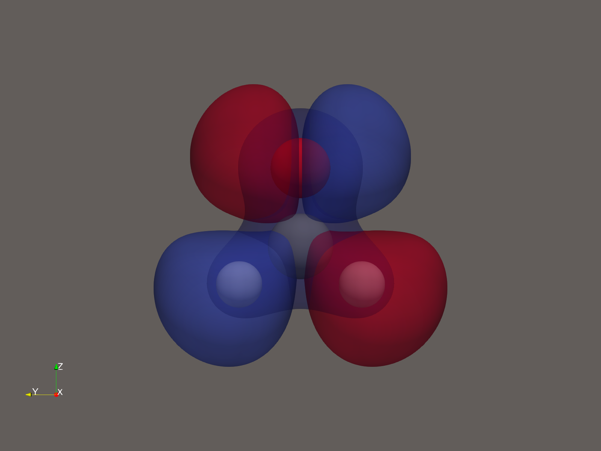

# See orbitals and electron density in ParaView

> **Status:** draft. Verified steps and screenshots to come.

Contour formaldehyde's electron density and its highest occupied orbital in ParaView, at [isovalues](../../../../reference/glossary.md#isosurface) you choose.
**Time:** 15 minutes · **Program:** ParaView · **Also in:** [GaussView](gaussview.md), [ChimeraX](chimerax.md), [PyMOL](pymol.md)

| Before this | Data | You'll need |
|---|---|---|
| [Start ParaView on OnDemand](../../tools/paraview.md) | Formaldehyde's `density.cube` and `homo.cube` in `~/scratch/cubes`: [get the cube files](README.md#get-the-cube-files) | A running ParaView session |

> [!NOTE]
> **Cluster details.** <mark>Highlighted</mark> values are placeholders. Kitsune's queue names, module versions, paths, and addresses go in when the cluster is deployed.

## Why this matters

A [cube file](../../../../reference/glossary.md#cube-file) holds a number at every point of a box drawn around a molecule: an electron density, an orbital, an [electrostatic potential](../../../../reference/glossary.md#electrostatic-potential-esp). ParaView treats it as an ordinary volume, so the Contour filter and the color maps from the simulation lessons work on it unchanged, and you can reuse the same pipeline on the next molecule.

## Key idea

The Contour filter finds every point where the grid equals a number you type and builds a surface through them, an [isosurface](../../../../reference/glossary.md#isosurface). That number is the only setting that matters here. Density is highest near the nuclei, so `0.05` gives a surface close to the atoms and bonds, and `0.0004` one about the size of the molecule. An orbital changes sign between lobes, so it needs two contours, `0.02` and `-0.02`, in different colors. The orbital here is the [HOMO](../../../../reference/glossary.md#molecular-orbital-homo-lumo). The [topic page](README.md#what-every-version-teaches) works the idea through in more detail.

## Steps

### Step 1: Open the density

Choose **File ▸ Open…**, open `~/scratch/cubes/density.cube`, and click **Apply**.

**You should see:** under `density.cube` in the Pipeline Browser, two outputs: **Molecule** (the atoms) and **Gridded Data** (the numbers). ParaView 6 splits the file this way; in ParaView 5 the reader gives the grid alone.

Screenshot: the Pipeline Browser with the Molecule and Gridded Data outputs

*Screenshot to come.*

### Step 2: Draw the density surface

Select **Gridded Data**. Choose **Filters ▸ Alphabetical ▸ Contour**, set **Isosurfaces** to `0.05`, and click **Apply**.

**You should see:** a surface around the atoms. Change the value to `0.0004` and click **Apply**: the surface grows to about the size of the molecule. Set it back to `0.05`.

Screenshot: Contour's properties, with Isosurfaces marked

*Screenshot to come.*

### Step 3: Show the atoms

Select **Molecule**. In **Properties**, type `radius` in the search box and set **Atomic Radius Factor** to `5.6`. Then select **Contour1** and set its **Opacity** to `0.3`.

**You should see:** four balls inside a see-through surface: oxygen red, carbon gray, the hydrogens white. No bonds are drawn: a cube file records no bonds, and ParaView does not infer them.

Screenshot: the Properties search box finding Atomic Radius Factor

*Screenshot to come.*

> [!NOTE]
> ParaView measures cube data in grid steps, not in bohr or ångström: about 19 steps to the ångström in these files. Atoms drawn at their usual size in ångströms are specks on that scale, so you enlarge them. The lesson's files are spaced the same along all three axes, to within about 1%, so the shapes and proportions are right. A cube file with different spacing on one axis will look stretched along that axis.

### Step 4: Draw the orbital

Open `homo.cube`, select its **Gridded Data**, and add a **Contour** with two isosurface values: `0.02` and `-0.02`. Tick **Compute Scalars** (click the gear icon to see it) and click **Apply**. Color the result by the orbital's values with the **Cool to Warm** preset, and set its **Opacity** to `0.6`.

**You should see:** four lobes lying in the plane of the molecule, red alternating with blue as the orbital's sign changes. The pair beside the oxygen straddles the C=O bond; the pair over the hydrogens is the bigger of the two at ±0.02.

What you should see

*Figure 1. Formaldehyde's highest occupied orbital at ±0.02, over a see-through density surface at 0.05, drawn by the lesson's script. The colors may be swapped in your own picture, because an orbital's overall sign is arbitrary.*

Screenshot: Contour's properties with both values, and Compute Scalars under the gear icon

*Screenshot to come.*

### Step 5: Save a picture

Choose **File ▸ Save Screenshot…** and save to `~/scratch/orbitals-paraview.png` at 1600 by 1200.

**You should see:** `orbitals-paraview.png` in the **Files** app, in your `scratch` folder. To make the same picture without clicking, run [`scripts/orbitals_paraview.py`](../../scripts/orbitals_paraview.py) with `pvbatch`, from the folder holding the cube files.

## Check your understanding

You raise the density isovalue from 0.0004 to 0.05. Does the surface get bigger or smaller, and why?

Smaller. A contour keeps only points where the density reaches the value you set. Density rises steeply toward the nuclei, so only points near them reach the larger value.

Why does the orbital need two isosurfaces when the density needs only one?

Because the orbital's sign flips between lobes. A contour at +0.02 catches the positive lobes, one at −0.02 the negative ones. With only the first you would see half the orbital. A density is positive everywhere, so a single contour catches all of it.

## If something goes wrong

| What you see | Why | What to do |
|---|---|---|
| No surface at all | The isovalue is higher than any value in the file, or has the wrong sign | Try `0.05` for density, `0.02` and `-0.02` for an orbital |
| Only one lobe of the orbital | Only one isosurface value was entered | Enter both `0.02` and `-0.02` in **Isosurfaces**, then **Apply** |
| The atoms are specks | They're drawn at their size in ångströms on a ruler of grid steps | Set **Atomic Radius Factor** to `5.6`, as in Step 3 |
| The orbital is one flat color | **Compute Scalars** is off, so there are no values to color by | Tick **Compute Scalars** under the gear icon, **Apply**, then color by the orbital's values |

## Next

- [All versions of this lesson](README.md): what GaussView, ChimeraX, and PyMOL make of the same two files.
- [Start ParaView on OnDemand](../../tools/paraview.md): the basics of the window, if you skipped it.
- [ParaView lessons](../../maps/paraview.md): what else ParaView can do with this kind of data.

## Credits

Cube files computed with [PySCF](https://pyscf.org/) (Apache-2.0) at B3LYP/6-31G(d), the level the Gaussian lessons use.
