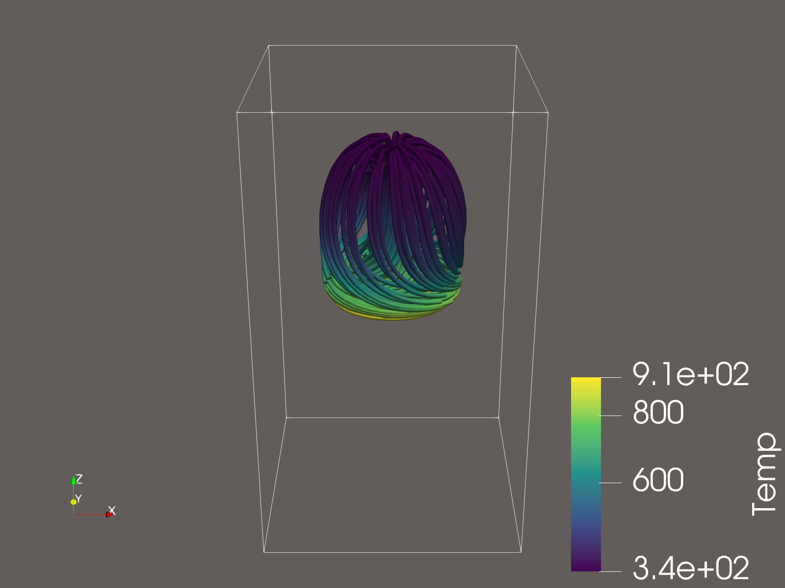
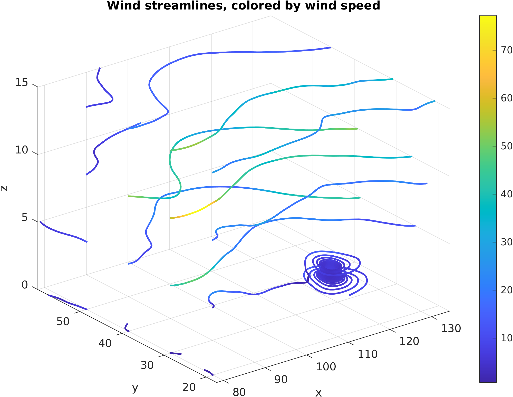

# Draw streamlines through a flow field

> **Status:** draft. Verified steps and screenshots to come.

Draw [streamlines](../../../../reference/glossary.md#streamline) through a velocity field and color them by a second variable. Two programs do it here: ParaView and MATLAB.
**Time:** 10 minutes

A [vector field](../../../../reference/glossary.md#scalar-field-and-vector-field) holds a direction and a speed at every point of the data. Arrows show a sample of it. Streamlines connect those samples into curves, so a recirculation appears as a closed loop and a stagnant region as a gap.

## Choose your program

Each version is a complete lesson on its own page. Pick the program you use.

| Program | Lesson | Practice data | The second variable | Minutes |
|---|---|---|---|---|
| ParaView | [Draw streamlines in ParaView](paraview.md) | `disk_out_ref.ex2`: air around a heated, spinning disk | Temperature, colored along each line | 10 |
| MATLAB | [Draw streamlines in MATLAB](matlab.md) | MATLAB's sample `wind` data | Wind speed, colored along each line | 10 |

ParaView reads simulation output directly: Exodus, VTK, NetCDF, OpenFOAM, and CSV. Use MATLAB if your velocity data is already in MATLAB arrays.

What each program's result looks like

Both pictures come from the lessons' own scripts.

*Figure 1. ParaView: streamlines through `disk_out_ref.ex2`, colored by temperature. Yellow is the hottest air.*

*Figure 2. MATLAB: streamlines through MATLAB's wind data, colored by wind speed. Yellow is the fastest wind.*

## What every version teaches

A [streamline](../../../../reference/glossary.md#streamline) is a curve that is tangent to the velocity everywhere along it. Both versions build one by putting down starting points, the seeds, and following the field from each in small steps. The seeds are a choice you make: they decide which part of the flow the picture shows, and a region no streamline reaches does not appear. Both lessons then color the curves by a second quantity, temperature in ParaView and speed in MATLAB, so one figure shows the path and the value along it.

## Next

- [Draw streamlines in ParaView](paraview.md): the version with a simulated flow, colored by temperature.
- [ParaView lessons](../../maps/paraview.md): the ParaView set these two belong to.
